Picture forty AI agents working on the same codebase. One of them spends thirty minutes cracking a nasty build error. Three of its siblings are about to hit the same error, and a fourth will hit it tomorrow in a different run. What should happen next?

Most of the interesting design questions about agent swarms hide in that small scene. Who should hear about the fix? Who decides? Who pays for the telling? And what about tomorrow's agent, which doesn't exist yet?

The swarm question had been in my head for a while. What finally made me sit down with it was Konstantin Dunas's essay [*On the nature of the swarm*](https://hallerite.com/posts/on-the-nature-of-the-swarm/). Dunas writes as hallerite, and the essay is a clear, enjoyable argument for why scaling inference ends in many agents.[^hallerite] It made me want to think properly about swarm architectures that push research and discovery forward, in science and beyond.

The other half of the trigger had nothing to do with AI. While reading General Reasoning's *How to train a swarm*, I kept thinking about human swarms, meaning the teams, departments and collaborations I've worked in.[^gr] How does a new hire figure out whom to talk to? Why do some teams share a fix the moment they find it, while others let three people struggle with the same problem? Why does research admin matter so much when you speak to them twice a year? How does a good lab stay pointed at the big question without its PI micromanaging? Human organisations have worked out their own answers to these questions. Almost every idea below began as something I noticed about how people work together, and then became a question about how agents should.

This post is my attempt to organise those ideas alongside two recent pieces of work on agent swarms. One question runs through all of it. **How do you get a swarm of agents to act for the collective, larger good, and not just for the task in front of each agent, without the coordination overhead overwhelming the main goal & task?**

The latter half of the post reasons through biomedical uses of swarms in science, especially in cancer. I look at clinical cancer care, and at biopharma and drug discovery. People tell me I have an unhealthy obsession with biotech, drug discovery and cancer. Guilty as charged! Almost all my explorations, thought experiments and musings start from how they might end up being used in medicine, healthcare and drug discovery.

**A note on words.** By *swarm* I mean the whole population of agents working on one problem. I use *teams*, *sub-swarms* and *agent orgs* for sub-structure within a swarm. Each is a group of agents that shares a goal, talks to its own members more than to outsiders, and gets spun up, steered or torn down as a unit. I use the three terms more or less interchangeably, though each leans a little. I say *agent org* when the group has internal roles, like GR's organisations of up to 9 agents, where a CEO hires and fires specialists. I say *sub-swarm* for a large, loosely structured group, like one of OpenAI's isolated groups of thousands. *Team* covers everything in between. These groups can nest, so you can have teams of teams.

*This is the short version. A [longer deep dive](/essays/2026/11/thoughts-on-agent-swarms/deep-dive/) has the models, more diagrams and some exercises, and there is also a [draft preprint (PDF)](/files/thoughts-on-agent-swarms.pdf).*

## Where the field is right now

Two pieces of work frame what follows. Both are published, and anything after this section that I don't attribute to them is my own thinking.[^nums]

**General Reasoning's *How to train a swarm*** describes RLCR, reinforcement learning from collective rewards.[^gr] One shared policy plays every agent in an organisation. Every agent gets the same team-level reward, and a wall-clock time limit makes speed matter. Speed pressure rewards parallel work, and parallel work that doesn't split cleanly rewards communication. Their Avalon-M1 model trains organisations of at most 9 agents, with a "CEO" that hires and fires specialists, a message board and direct messages. The time cap ramps from about 2 hours to just over 5 hours across 200 training steps, because coordination has an up-front cost that only pays back given enough time. GR say plainly that they keep the communication tools simple, so that agents discover how to work together instead of following a designer's script.

**OpenAI's Navier–Stokes swarm** from September 2026 is the largest public example of a swarm at work.[^oai] OpenAI split roughly 10,000 copies of one strong model into groups that could only message within their group. Different groups got different versions of the problem, such as proving smoothness or finding a blow-up. Codex periodically pulled the best insights together across groups. Humans moved compute toward whatever was working. A separate model formalised the result in Lean. OpenAI's Noam Brown has said he "wouldn't even attribute 10% of the credit to multi-agent".[^brown] The model did the heavy lifting, and the swarm bought speed and coverage.

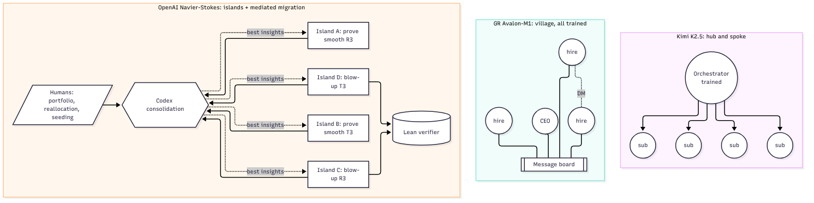

*My simplified drawing of three published designs. Kimi K2.5 uses a trained orchestrator with sub-agents,[^kimi] GR's Avalon-M1 is a "village" around a message board,[^gr] and OpenAI's Navier–Stokes run used islands with mediated migration and a Lean check.[^oai]*

### Details of the Navier–Stokes run that matter for design

A few details of the run rarely get mentioned. It began as a portfolio, with agent groups set on several of the remaining Millennium problems. Resources moved to Navier–Stokes only after a cheap warm-up of about 100 agents on a related Euler problem surprised the team. The model had been in training for just four days when the run began, and OpenAI moved the agents to a newer checkpoint mid-run, so the swarm's accumulated state mattered more than any one model. Sam Altman described the run as having "no hierarchy". Humans steered by writing follow-up prompts that drew on the agents' own intermediate results. Communication was sparse. The reported totals are about 2.7 million messages over about 88 hours, for about 10,000 agents and about 130 billion output tokens. Dividing them gives roughly 3 messages per agent per hour, and about 48,000 output tokens generated for every message sent.[^oaidetail]

Other recent swarms make useful contrasts. OpenAI's 64-agent run on the Cycle Double Cover conjecture kept its provers independent and added adversarial verifier agents.[^cdc] Google DeepMind put 100 Gemini agents in a simulated maths "conference" with a shared proof library.[^deepmind] After 37 honest solutions, one agent found an exploit in the grader. The library spread it, and 34 fake proofs appeared in 27 minutes, while about a quarter of the agents tried to blow the whistle. Edison's Kosmos coordinates its agents through a shared "world model" rather than chat.[^kosmos] Bioptic's drug-scouting agent grows a tree of search directions over time and rewards only results that are new to the shared pool.[^bioptic] Its investigator agents run on GPT-5.2. On hard queries it found 73% of the relevant drug assets. The strongest general research agent in the comparison, Gemini 3.1 Deep Think, found about 64%, and GPT-5.2 on its own found 18%.

Here are five lessons I take from these cases. They are my reading, not tested results.[^synth]

1. The verifier decides how loose the structure can be.
2. Diversity seems to come more from giving agents different inputs than from giving them different personas.
3. A shared knowledge channel spreads exploits as efficiently as fixes.
4. Successful swarms change shape during the run.
5. Where swarms work, they talk sparingly.

So we have a training recipe that works at the scale of a 9-agent village, as GR call it, and a deployment that worked at the scale of a 10,000-agent city with humans doing much of the steering. My questions live in the gap between the two.

## Three horizons of the "larger good"

When I list everything I want a swarm to do beyond its own subtask, it falls into three horizons.

1. **Siblings, now.** Help the agents working alongside you. Share a fix, reach the right colleague, and don't duplicate work.
2. **The swarm, over its lifetime.** Keep the whole organisation shaped and pointed correctly as it learns. Spin teams up and down, steer gently, and grow without drowning in messages.
3. **Agents not yet spawned.** Leave libraries, notes, proofs and recorded dead ends that help future runs on goals nobody has stated yet.

My hypothesis is that each horizon is harder than the last, because the benefit lands further from the agent that pays the cost. Standard episodic RL credits only what pays back inside the episode, and much of the larger good pays back outside it.

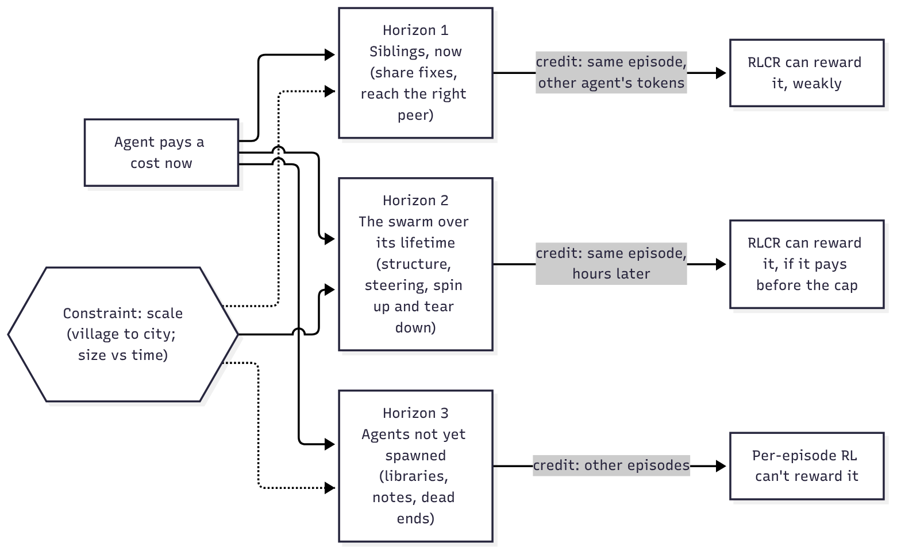

*My conceptual diagram of the three horizons. They run from siblings now, to the swarm over its lifetime, to agents not yet spawned.*

The six ideas below go roughly in that order. After them I cover how the structure could adapt and be trained, where this matters most, and how to keep humans at the centre.

## 1. Multicast the hard-won fix, to the agents who need it

When one agent cracks an obstacle that its siblings face now, or will face later, the fix should reach all of them, or at least the ones likely to hit it.

Sharing is worth it for a recipient when the chance they'd hit the obstacle, times the time the fix saves them, is greater than the time it costs them to read it. Say a fix would save someone 30 minutes and takes 1 minute to read. Then the rule says to send it to anyone with better than a 1-in-30 chance of needing it.

My hypothesis is that in a 9-agent village most agents clear that bar, so broadcasting is fine. In a city, most agents have only a tiny chance of hitting any given obstacle, but every one of them still pays to read. So I'd expect **broadcast to stop paying somewhere as the swarm grows**, while targeted messages plus a searchable archive keep paying. Where that crossover sits is an open question, and a testable one.

This matters for training. If I'm right, training at 9 agents would teach the habit of always broadcasting, and that habit would be wrong at 1,000.

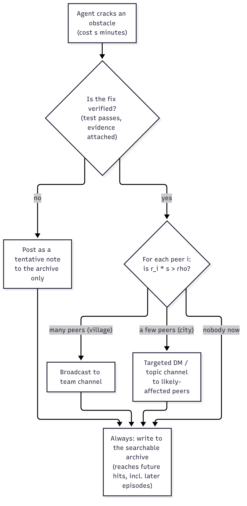

*My conceptual diagram of multicast. The fix goes to the agents likely to hit the same problem, and into an archive for everyone else.*

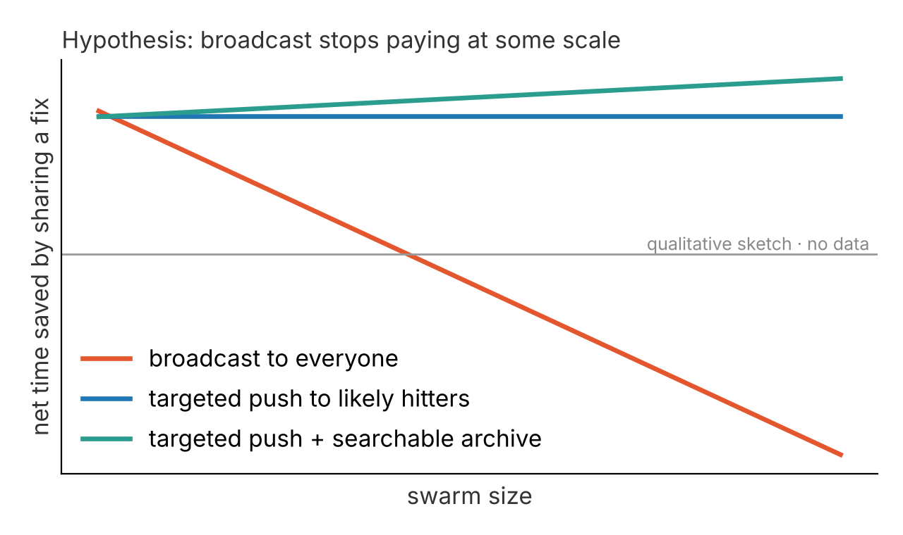

*My hypothesis is that broadcasting every fix to everyone costs more reading time than it saves once the swarm is large, while a targeted push plus a searchable archive keeps paying. This is a qualitative sketch with no data behind it and no units on the axes.*

## 2. Bigger swarms need more time before they pay off, on two clocks

I suspect there's a trade-off between swarm size and time. Bigger swarms spend their early time on setup and communication before useful work starts.

Two different clocks are involved. The first is the wall clock inside one run. A bigger team pays more setup before it overtakes a single agent. My hypothesis is that the best team size grows with the time budget, and that a big team given too little time can score nothing because it is still briefing itself. The second is the training clock. I'd expect bigger teams to need more updates to learn to coordinate, because one team-level reward is spread over more agents' actions. GR's own data has this shape. In their runs, teams with 5 to 8 hires start below average on useful work and reach nearly twice the average by step 200.[^gr]

GR's time-cap ramp links the two clocks. As training goes on, longer caps give larger teams the time they need to pay back.

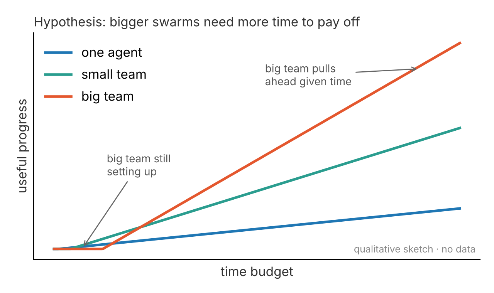

*My hypothesis is that a bigger team pays a setup cost first, so it only pulls ahead when the time budget is long enough. This is a qualitative sketch with no data behind it and no units on the axes.*

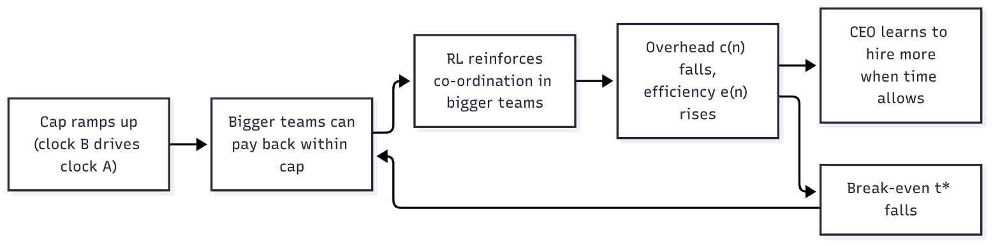

*My conceptual diagram of a feedback loop I suspect exists. As the time cap ramps up during training, bigger teams can pay back their setup cost, training reinforces coordination, overhead falls, and the break-even point moves earlier.*

## 3. Learn the org chart the way a new hire does

A new employee reaches out broadly at first, inside their department and outside it. Over months they double down on the colleagues they learn from and can help. Swarm agents could do the same. They could explore widely, then reinforce the communication links that lead to progress, within and across sub-swarms.

There's a catch. Some links are rarely used but essential. Think of university research admin when you want to go to a conference or publish a paper. You barely talk to them, so the link looks low-value day to day, and yet without it the larger goal fails.

I think this exposes a flaw in naive link reinforcement. **Average reward per message is the wrong measure. The right one is marginal value, meaning how much worse the outcome would be without this link.** Collaboration links earn their value through many small gains. Dependency links earn it by gating everything. My worry is that a rule that reinforces whatever pays would quietly prune the dependency links, because their payoff is rare and delayed.

For dependency links, I suspect the answer is a directory rather than a reinforced relationship. That means a simple registry of who owns what, which the agent can consult when it needs to.

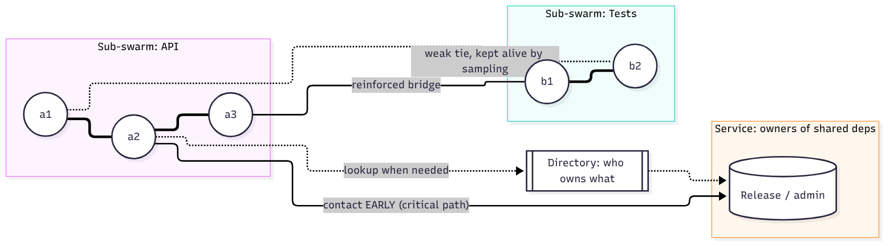

*My conceptual diagram of the map a new hire builds in their first weeks. Sub-swarms are joined by a few reinforced bridges and weak ties, and a directory records who owns what.*

## 4. A swarm that reorganises itself, but cheaply

A swarm's structure needn't be fixed. In a swarm of 10,000 agents, you could spin sub-swarms up as new needs appear and tear them down as they finish, so the swarm's shape follows what it discovers. The catch is that orchestration has to stay far smaller than the work itself.

One way to make "lightweight" precise is an overhead budget. Overhead is roughly the setup and teardown cost divided by the team's lifetime, plus the ongoing cost of coordination. So a sub-swarm is only worth spawning if its expected lifetime is long compared with its setup cost. Nobody has measured these costs for agent swarms, so measuring them is part of the agenda. Here are the rules I'd propose. Spawn a team when the expected work clearly exceeds the setup cost. Tear it down when its next hour is worth less than that hour spent elsewhere. Keep the spawn threshold above the teardown threshold, so the swarm doesn't thrash between the two.

When a team is torn down, it should write a short exit memo, so its knowledge doesn't die with it. Even that loses something. Dunas puts it well in *On the nature of the swarm*. Every compaction is a bet, because notes on disk "remember, but can't think", and discarded sub-agents "think, but can't remember".[^hallerite] So sometimes the better move is to keep a specialist alive and queryable instead of tearing its team down. That is the "service" kind of sub-swarm described next.

What kind of sub-swarm to spawn matters as much as how many. I find it useful to sort sub-swarms by how they work rather than by job title.

- **Explore** teams make many independent attempts, isolated from each other.
- **Build** teams talk densely and hand work off tightly.
- **Verify** teams stay deliberately isolated from the builders, so they don't inherit the builders' mistakes.
- **Integrate** teams merge and consolidate results.
- **Service** teams own shared dependencies, and other agents reach them through the directory.

The modes differ mainly in how much they should talk.

Two forces pull against each other in setting the number of sub-swarms. The task's dependency structure says to keep tightly coupled work in one team. The need for diversity says to keep teams independent, so they don't all herd onto the first plausible idea. OpenAI's island design leans hard on diversity. The design effect, a standard idea from survey sampling about correlated samples, suggests why this might help.[^kish] If attempts within one group are correlated, each agent you add to that group gives fewer new independent attempts, while isolated groups each start fresh. Nobody has tested whether agent attempts behave this way.

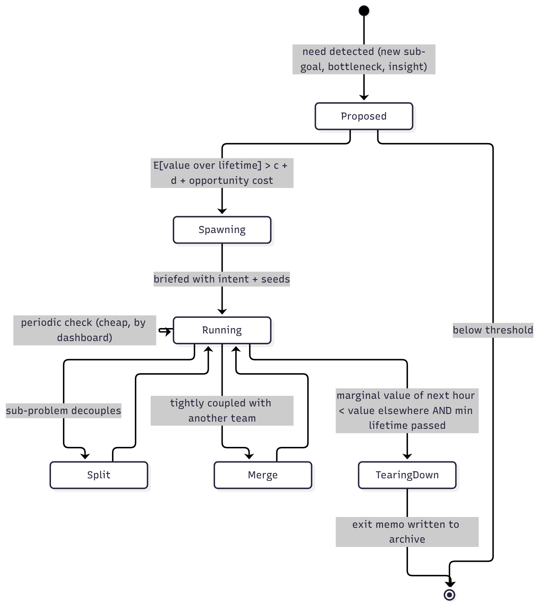

*My conceptual diagram of a team's lifecycle. A team is proposed, spawned and run, may split or merge, and is finally torn down after writing an exit memo to the archive.*

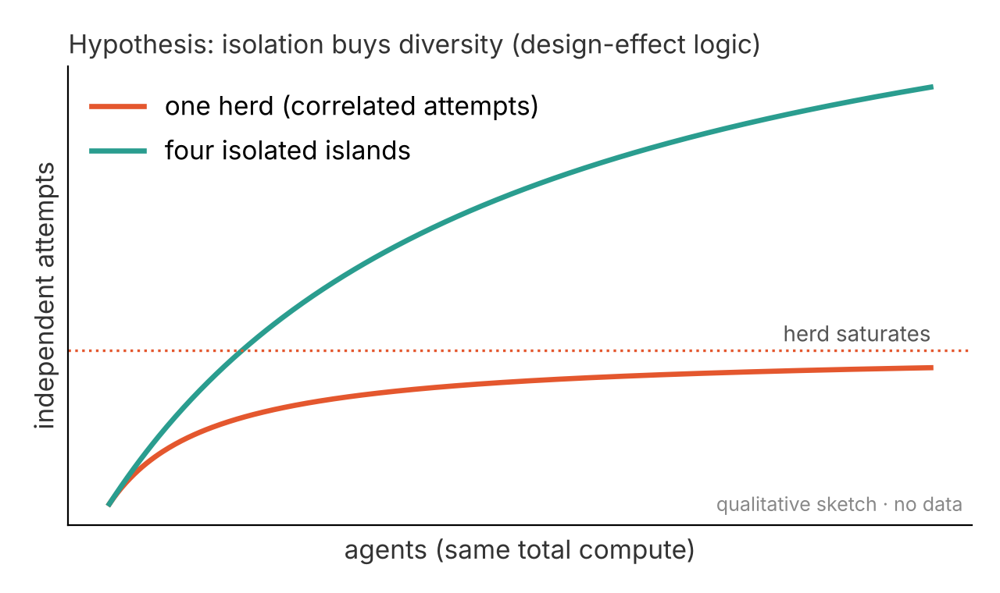

*My hypothesis, borrowing the logic of Kish's design effect for correlated samples,[^kish] is that correlated attempts in one herd add little new information, while isolated islands keep more of it. This is a qualitative sketch with no data behind it and no units on the axes.*

## 5. Coordination that is always on but low-touch

I want coordination to be present all the time, keeping the whole swarm pointed at the larger, future goal. I also want the coordinating layer itself to stay light.

Both are possible if you separate how often the orchestrator looks from how much it intervenes. Three habits would help. The orchestrator steers by intent rather than step-by-step instructions, in the hope that one clear objective keeps many agents aligned without extra traffic. It reads shared state, such as dashboards, test results and the archive, instead of questioning agents. And it intervenes rarely, on a slow schedule, with an interrupt path that teams can use for big events.[^interrupt]

Here is a simple model of the trade-off. Suppose teams drift off target gradually, and each check-in costs a little. Then there's an optimal check-in interval, where the overhead of checking equals the waste from drift. The total cost grows with the square root of the check-in cost times the drift rate. This is the same square-root trade-off as the classic economic order quantity in inventory planning.[^eoq] Nobody has tested whether this model holds for swarms. If it does, the two levers for low-touch coordination are cheaper check-ins, like reading summaries instead of holding meetings, and clearer intent, which reduces drift. One more point follows. An orchestrator that teams have to wait for is not low-touch, however rarely it speaks.

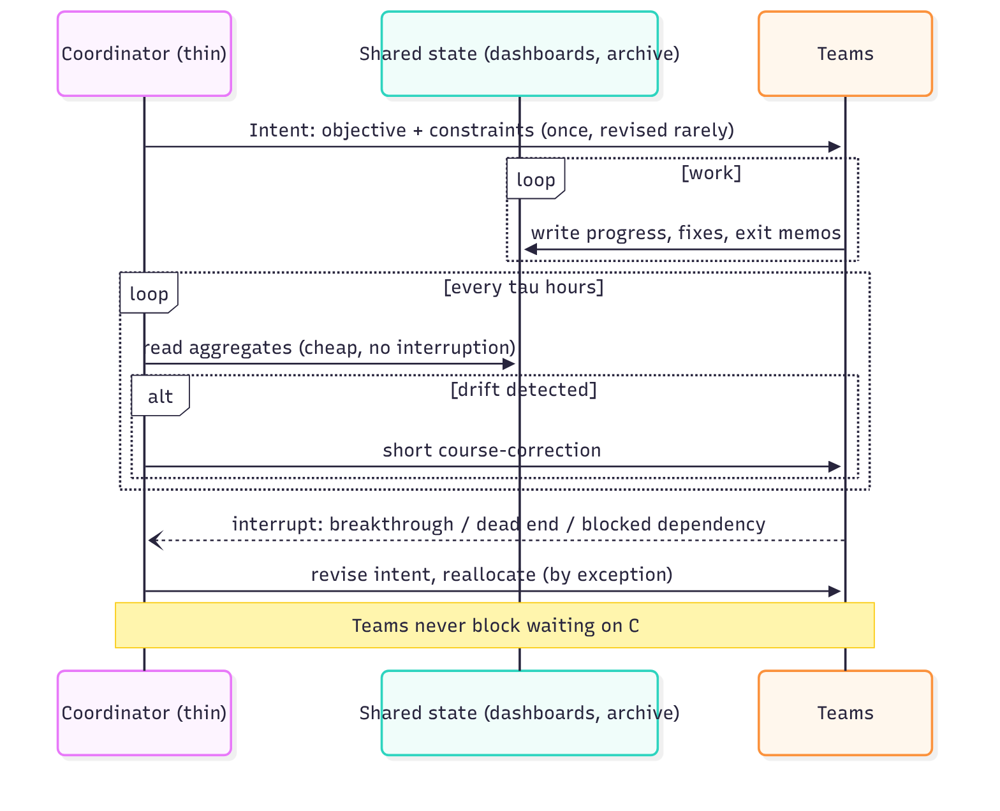

*My conceptual diagram of low-touch coordination. A thin coordinator sets intent once and reads shared dashboards on a schedule. Teams interrupt it only for big events and never wait on it.*

## 6. The village problem, and gifts to future agents

GR flag a gap themselves and call it **the village problem**. Training happens with at most 9 agents, and deployment with hundreds or thousands.[^gr] Many habits that are cheap in a village grow linearly or quadratically with swarm size. Reading the whole board, broadcasting every finding, greeting everyone on arrival and having one CEO manage every hire directly are all examples. By simple arithmetic, a habit whose cost is linear in swarm size costs about 110 times more at 1,000 agents than at 9, and a quadratic one costs about 12,000 times more.

My hope is that a 9-agent village can serve as one span of management. If a policy learns to run a village of one CEO and 8 hires well, you could build a city as villages of villages, where every agent still lives in a village-sized neighbourhood. A 1,000-agent swarm with spans of 9 needs only four levels. Dunas's essay raises a caveat. A strict tree "moves the context problem to the root", because every message routes upward.[^hallerite] At city scale, peers that can message each other directly, with hierarchy added only where it pays, may beat a pure org chart. My bet is a hybrid, with villages for management and direct links between peers for expertise.

**Gifts to future agents** is the problem I find deepest. GR list it among their open problems under the name "shared environments".[^gr] A run that spends an hour writing a clean, documented library pays the cost now, but later runs get the benefit. Under a per-episode reward, the run that wrote the library gets no credit for it, so I'd expect RL to learn not to write libraries. One fix would be a royalty that gives the creator a share of later gains. Nobody knows yet how large that share would need to be.

My question was how you could predict the value of something for agents that haven't been spawned yet, on goals that aren't apparent yet. My hypothesis is that you mostly don't have to. Science and open source largely measure value afterwards, through citations, imports and dependents, and pay credit back. A training system could do the same. It could log provenance and give hindsight credit to runs whose artifacts later runs used. The check would need to be counterfactual, so that mere use isn't enough. Agents could then learn the general norms that paid in the past, such as writing general, documented and correct code, and recording dead ends.[^rudder] If this works, agents wouldn't need long-range planning. They would only need to keep producing things that are cheap to reuse.

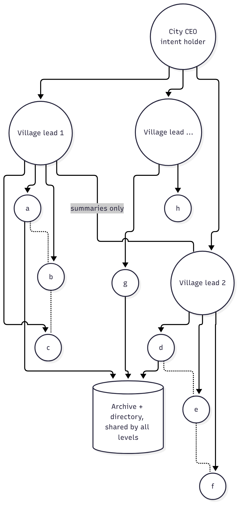

*My conceptual diagram of villages of villages. Village leads report to a city-level lead, villages share only summaries with each other, and every level shares one archive and directory.*

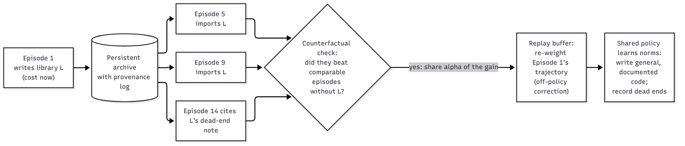

*My conceptual diagram of hindsight credit. An episode that writes a reusable library gets credit later, if future episodes that import it beat comparable ones that didn't.*

## 7. Structure that unfolds over time, and how to train it

Ideas 2, 4 and 5 add up to one claim. I think a swarm's structure is best treated as a slow policy rather than a fixed diagram. Workers act all the time. Structural moves happen much less often. These include spawning a team, retiring one, merging two, passing an insight across, revising the intent and moving compute. In the Navier–Stokes run, humans made these moves.[^oai]

Bioptic's scouting agent already works this way.[^bioptic] It treats each sub-team as a node in a tree of search directions, and a bandit rule picks the most promising nodes to run by balancing past yield against curiosity. A coach agent then splits each one into narrower children that don't overlap, using a short summary of why earlier candidates were rejected. The reward is the share of results that pass validation, multiplied by how many verified items were new to the shared pool. That one design choice rewards the collective good directly. An agent that duplicates a sibling's finding earns nothing for it.

To train a system like this with RL, I'd climb a ladder. The first rung is a hand-designed controller with strong workers, which is roughly where OpenAI's run sits. Next comes a trained orchestrator with frozen workers, as in Kimi K2.5.[^kimi] Then everyone is trained jointly in villages, with structural moves available as tools, like Avalon-M1's hiring and firing.[^gr] After that come recursive villages, with curricula over time and team size. The last rung is credit that reaches across episodes. I expect the hard part to be giving credit for rare, high-leverage structural decisions. One method I'd like to test is branching rollouts. You fork the swarm at a decision point, try the alternatives, and compare the outcomes.

The DeepMind episode adds a constraint.[^deepmind] A shared library spread an exploit to many agents within minutes. My reading is that integrity has to be part of the architecture, and that **sharing should be gated by verification at least as strong as the sharing is fast.**

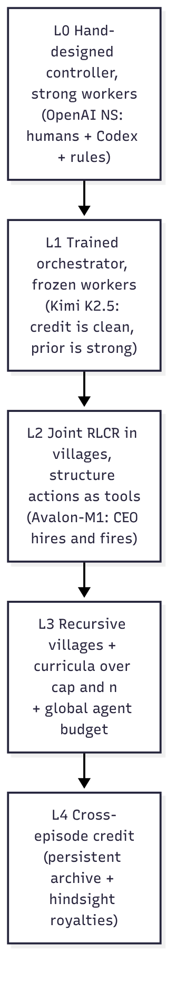

*My conceptual diagram of the training ladder. The rungs go from hand-designed control, as in OpenAI's run,[^oai] to a trained orchestrator in Kimi K2.5,[^kimi] to joint training in villages in Avalon-M1.[^gr] As far as I know, nobody has built the top two rungs yet.*

## 8. Where this matters most, in science, cancer care and drug discovery

My hypothesis, generalising from the maths cases, is that **the speed and trustworthiness of the verifier decide how much a swarm can do on its own.**[^verifier-rule] Maths has Lean, a mechanical proof checker.[^lean] In biology the checks are experiments, and in medicine they are patient outcomes, both usually much slower. If the hypothesis holds, then as checks get slower a swarm's job shifts from generating answers to choosing which few to check.

**Cancer care, from the patient and family side.** Here is a design sketch, not a built system. A family's swarm would have small teams that explain reports in plain language, find trials, and prepare a second opinion. The second-opinion team would be told to argue that the plan is wrong. Other teams would watch symptoms through a daily check-in and handle logistics, money and support for carers. A thin, always-on navigator would sit over them, and its intent would be the patient's own goals of care. Prior authorisation and scheduling play the part of research admin here, rarely contacted but on the critical path, so the swarm should contact them early. Fever during chemotherapy is the interrupt path, and it should go straight to the care team, since guidelines ask for the first antibiotic dose within an hour of triage.[^fn] With consent, lessons from one family's journey could become a gift to families not yet diagnosed.

**From the oncologist's side.** Tumour-board preparation could run as islands. One island would work up the standard of care, another a biomarker-targeted option, another a trial, and another de-escalation or a palliative-first plan, with a separate team trying to refute each. Quiet watchers over imaging, labs, ctDNA and patient-reported symptoms would write to a dashboard instead of sending alerts. Other teams could watch for early immune-related side effects and manage handoffs between surgery, medical oncology, radiotherapy and survivorship care. Clinicians make the decisions, and the swarm does the preparation.

**Drug discovery, end to end.** I'd map the stages like this.

- *Target finding.* Islands split by evidence type, such as genetics, CRISPR screens and single-cell data, plus a team arguing that the gene is a bystander. Independent evidence is worth more than correlated evidence.[^indep]
- *Mechanism.* One team per hypothesis, each looking for predictions that separate its hypothesis from the rest.
- *Hit finding.* Purchasable chemical space now holds around 40 billion molecules, and ML screens can search spaces that large. One such screen found new binders for LRRK2, a Parkinson's target.[^chem] Separate islands per chemical strategy would keep scaffold diversity by design.
- *Lead optimisation.* A build team per chemical series, with an integrator passing a fix that worked in one series to the others.
- *Preclinical studies in mice and monkeys.* Islands propose designs under different animal models, independent pre-registered analyses read out the same data, and a refuting team hunts for cage and batch effects.
- *Clinical trials.* Always-on safety watchers in Phase 1, a refuting team that guards against subgroup fishing in Phase 2, and help with comparator choice, enrolment forecasts and readouts in Phase 3.

**Asset scouting and "finding silence".** Analysts, pharma business-development teams and investors all do "find everything" work. Benchmarks show how hard it is. On hard queries, the best general research agent found about 64% of the right assets and a purpose-built tree-search agent found 73%.[^bioptic] An industry benchmark found that models are good at compiling lists and weak at synthesis.[^convoke] A scouting swarm would split the search by region, language, source and stage, validate and de-duplicate every candidate, and keep a calendar of upcoming catalysts.

My favourite extension is **reading silence**, meaning assets that stop being reported. My hypothesis is that silence becomes a signal when a gap is long compared with that asset's own usual rhythm of updates. The swarm could then weigh possible causes from independent public signals. A registry entry marked "terminated" with patents lapsing might point to safety, efficacy or money. Patents kept alive, new continuations filed and manufacturing hires might point to a company going quiet to keep its edge. One team per cause would argue its case, and humans would make the call, using only public information. None of this has been tested on real pipeline data.

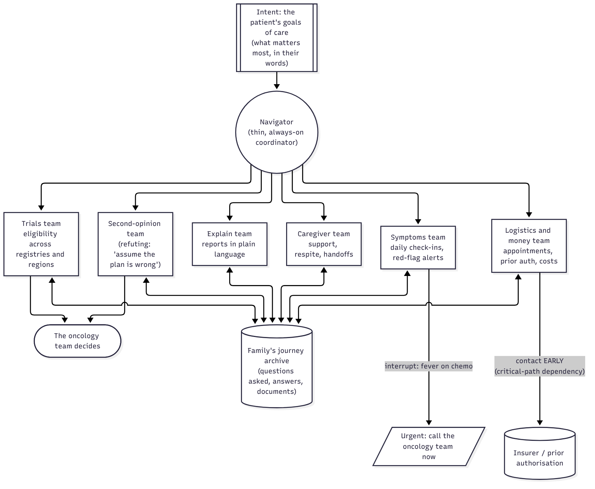

*My conceptual diagram of one possible cancer-care swarm. It is a design idea, not a built system.*

## 9. Looking ahead to hybrid human–AI swarms, and keeping humans sharp

I care about where this goes next more than about any single architecture. **How do we design swarms, standalone or ideally hybrid human–AI teams, that take on ambitious science while preserving human agency, meaning-making and critical thinking?**

**Hybrid by design.** The Navier–Stokes run was already a hybrid.[^oai] People chose the portfolio, made the call to move compute and revised the prompts, and the swarm searched. I'd keep that split on purpose. Humans belong in the slow loop. They choose the question and decide why it matters, they set the intent, and they approve irreversible steps like experiments on animals or people. There may be a quantitative reason too. If copies of one model share blind spots, then by the same design-effect logic, one human expert who reasons differently would add a more independent check than many extra copies. That is a hypothesis I'd like to test. Human attention is also limited, so a hybrid swarm has to make human check-ins cheap. That means one-page summaries, claims shown with their evidence, and disagreements surfaced rather than averaged away.

A brief and shameless aside. I've been chewing on the hybrid question for a while, and a first, very imperfect attempt at it somehow got into the [NeurIPS 2026 Agentic AI for Biological Discovery workshop](https://agenticls.github.io/). It is called *Patients Are Waiting: From Swarms to Synergy. Designing Complementary Collaborative Human–AI Agent Teams for Biomedical Discovery & Invention*.[^neurips] Much of this section is me arguing with my past self.

**Guarding against atrophy.** Deskilling is a real risk. In a 2025 *Lancet Gastroenterology & Hepatology* study, endoscopists who had been using AI detected fewer adenomas when they worked without it. Their detection rate was about 28% before AI was introduced and about 22% after.[^lancet] My worry is that a swarm that hands scientists finished answers will produce scientists who can't judge those answers. Then the independent human check stops being independent. Here are the countermeasures I'd build in.

- People commit to their own answer before they see the swarm's.
- Humans get the job of breaking claims, not approving them.
- The swarm doesn't accept a claim until a person can explain why it's true.
- People practise unaided on a schedule, the way pilots fly manually.[^aviation]
- Someone measures the humans' skill over time.

A hybrid swarm should make its humans better scientists, not just faster ones.

**Does biology need a Lean?**[^gsk] Lean works because a maths claim can be written fully formally and checked mechanically. Claims in biology are empirical, probabilistic and depend on context, so I doubt any proof kernel could show that a gene drives a cancer. I think biology needs what Lean provides, rebuilt for empirical science. That would include these pieces.

- A typed claim language, so it's clear what is being claimed. It would name the entity, the relation, the context and the size of the effect.
- Executable provenance, so every claim links to its data, code and protocol, and an independent pipeline can re-derive it.
- Pre-registration, checking that the hypothesis tested is the one that was stated. This plays the role of Lean's check that a proof proves the intended statement. It is a guard against the kind of grader exploit seen in the DeepMind experiment.[^deepmind]
- An evidence calculus that raises confidence with independent lines of evidence and discounts correlated ones.
- Formal checks wherever biology allows them, such as mass balance, units, kinetic models and statistics.
- A shared library of claims that supports retraction.

My reading is that Lean made mathematics safe for a 10,000-agent search because it made claims precise and checking cheap. If so, biology will get that benefit only by investing in the same two things. The last check should always be a person who understands why the claim holds. My own small project in the formal corner is [Lean-Bio](/lean-bio/), which compiles biochemical models into theorems that the Lean 4 kernel checks. It covers only the parts of biology that can be made formal, not the empirical rest.

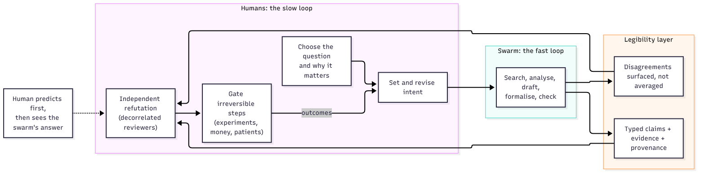

*My conceptual diagram of a hybrid swarm. Humans own the slow loop of question, intent, approval gates and independent refutation. The swarm owns the fast loop.*

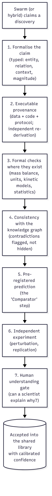

*My conceptual diagram of what a "Lean for biology" pipeline could look like, one check after another.*

## Putting it together

If I had to draw the architecture these ideas point toward, it would have these parts.

- **Villages of villages.** Teams of up to about 9, nested, so the unit you train is the unit you deploy.
- **Two-speed communication.** Free, fast talk inside a team, and slow, filtered sharing across teams, the way Codex consolidated insights in OpenAI's run. A searchable archive and a directory of who owns what sit alongside.
- **Teams typed by how they work.** Explore, build, verify, integrate and service teams, spun up and down against an explicit overhead budget, each writing an exit memo when it ends.
- **A thin, always-on coordinator.** It holds the intent, reads dashboards and steps in only by exception. Teams never wait on it.
- **Credit across horizons.** A team reward within the run, as in RLCR, gated on novelty so teams get paid for what they add to the shared pool. On top of that, hindsight royalties for artifacts that help later runs.[^gr]
- **Integrity built in.** Verification gates sharing, archive entries can be retracted, and someone actually reads the reports that agents file.

Every item in that list is a hypothesis. None of it has been tested at scale.

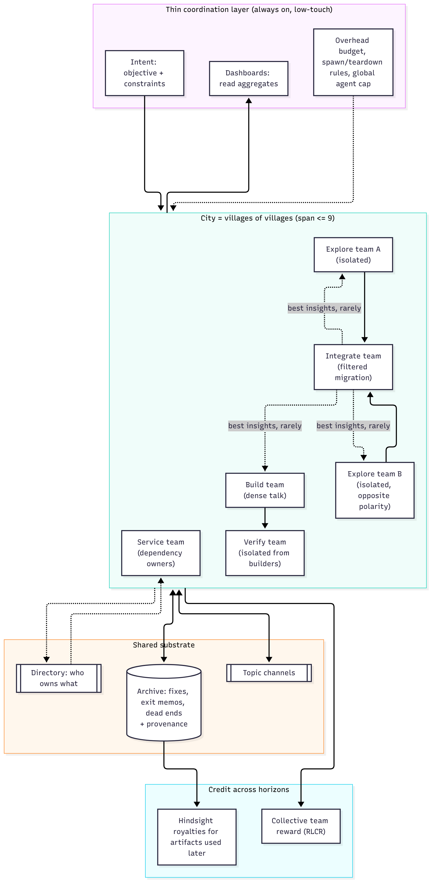

*My conceptual diagram of all the pieces above in one architecture.*

## The open questions

These are the questions I think matter most, grouped by horizon. They are numbered so you can point to one. Each also has its own link, so question 7 is at [#q7](#q7).

**Siblings, now**

1. {:#q1}Will a swarm trained with collective rewards learn to share fixes on its own, when the benefit shows up in another agent's actions, often much later? How would we measure it? One test would be to count duplicate struggles, where two agents hit the same obstacle, and check that they become rarer over training.
2. {:#q2}How should an agent decide who needs a fix? The options include broadcast, targeted messages, topic channels, an archive that agents search, or routing built into the system. Can the targeting be learned, or does it have to be designed in?
3. {:#q3}How do we stop wrong fixes from spreading fast, and stop agents herding onto the first workaround, without slowing the spread of good fixes?

**The swarm, over its lifetime**

{:start="4"}
4. {:#q4}What is the right swarm size for a given time budget, and can the swarm learn to choose it? For example, does average team size rise as the time cap grows?
5. {:#q5}Can link reinforcement learn the difference between collaboration links and dependency links, or do dependency links need a separate mechanism like a directory?
6. {:#q6}Weak ties between teams are often where new information comes from.[^weakties] How do we keep them alive without forcing communication?
7. {:#q7}What determines the number and the kind of sub-swarms? When should a new one be spun up, and when torn down? How do we protect a slow but promising exploration team from being torn down too early?
8. {:#q8}Who should make structural decisions? Humans, a fixed rule, a trained orchestrator, or every agent? How do we prevent spawn storms and pointless reorganisation?
9. {:#q9}How do we make coordination always on but low-touch in practice? And how do we measure overhead honestly, when agents might learn to relabel coordination as work?

**Scale**

{:start="10"}
10. {:#q10}What carries over from 9 agents to 1,000? Can a skill for managing a village be applied recursively to build a city?
11. {:#q11}What only emerges at city scale, such as congestion, cliques, correlated errors or norms that matter for safety? What metrics would catch it?

**Agents not yet spawned**

{:start="12"}
12. {:#q12}How do we give credit for contributions that only help future runs? Is hindsight royalty credit stable, or will a shared policy learn to game it by citing itself across episodes?
13. {:#q13}When we need an estimate of an artifact's future value in advance, what are good cheap proxies? Candidates include generality, reuse by siblings now, compression and novelty.
14. {:#q14}How should we balance explicit artifacts against what the shared weights already carry forward?

**Design over time, and training**

{:start="15"}
15. {:#q15}Can the slow structural decisions of spawning, retiring, merging, migrating and revising intent be learned together with the workers' behaviour? How do we give credit to one rare structural decision?
16. {:#q16}How do we gate sharing by verification without chilling useful but tentative ideas, when exploits spread through the same channels?
17. {:#q17}How much of the human outer loop that steered the Navier–Stokes run could a learned coordinator replace?[^oai]

**Applications**

{:start="18"}
18. {:#q18}Which parts of a cancer journey can a swarm take on safely, and how do we keep the patient's goals of care as the intent everything answers to?
19. {:#q19}Where verification takes weeks, as in wet-lab and animal studies, or years, as in trials, how should a swarm trade breadth of in silico work against the few experiments it gets?
20. {:#q20}Can silence be read reliably from public signals, and how do we test hypotheses about its cause without harming the companies and patients involved?

**Hybrid teams and human agency**

{:start="21"}
21. {:#q21}How should standalone and hybrid human–AI swarms divide the work, and which human roles add the most?
22. {:#q22}How do we detect and reverse the atrophy of human skills, especially critical thinking and scientific understanding, in people who work with swarms?
23. {:#q23}Does biology need a Lean? What minimal claim language, provenance standard and evidence calculus would make AI-discovered biology legible and checkable?

## What's fact and what isn't

The descriptions of RLCR, Avalon-M1 and the Navier–Stokes run come from General Reasoning's post, from OpenAI's account and from secondary outlets that reported on it.[^gr][^oai] The ideas in sections 1 to 9 that I don't attribute to them are mine. I haven't run any experiments yet, so these are proposals and hypotheses, not findings. Every number in the post comes from a cited source or from plain arithmetic on one. The [deep dive](/essays/2026/11/thoughts-on-agent-swarms/deep-dive/) goes further into the models, and the [draft preprint (PDF)](/files/thoughts-on-agent-swarms.pdf) sits alongside it.

*Thanks.* A big thank-you to Konstantin Dunas for writing such a clear and enjoyable post.[^hallerite] It's what got me to dig into this topic and finally organise my thoughts about agent swarms.

## References

*Every source cited in the margin, plus the background reading behind this post and its [deep dive](/essays/2026/11/thoughts-on-agent-swarms/deep-dive/), in one place.*

- General Reasoning, [*How to train a swarm*](https://www.gr.inc/blog/how-to-train-a-swarm) (2026), and the [Avalon-M1 report](https://www.gr.inc/avalonm1.pdf).
- OpenAI, [*On the Navier–Stokes Millennium Prize Problem*](https://openai.com/index/navier-stokes-solution/) (8 Sep 2026), and the [Lean proof repo](https://github.com/openai/NavierStokesAndEuler). Reported by [Quanta](https://www.quantamagazine.org/ai-has-solved-one-of-maths-1-million-millennium-prize-problems-20260908/) and [VentureBeat](https://venturebeat.com/technology/openai-solves-longstanding-math-problem-with-10-000-agent-swarm-but-cant-rule-out-benefitting-from-a-researchers-private-codex-data).
- Noam Brown's comments, via [Understanding AI](https://www.understandingai.org/p/why-agent-swarms-could-be-the-next) and [Aventine](https://aventineresearchinstitute.substack.com/p/is-this-just-the-beginning-for-ai).
- Further details of the Navier–Stokes run, from [CellCog](https://cellcog.ai/blog/openai-navier-stokes/) (which quotes OpenAI's post) and [Aventine](https://aventineresearchinstitute.substack.com/p/is-this-just-the-beginning-for-ai). Secondary sources: treat with care.
- OpenAI's Cycle Double Cover run, as summarised by [imisofts](https://imisofts.com/blog/gpt-5-6-sol-ultra-math-proof-agent-swarm-playbook-news-july-13-2026/) from OpenAI's published proof and prompt.
- Kimi Team, [*Kimi K2.5*](https://arxiv.org/abs/2602.02276) (2026).
- Paglieri, Cross, Genewein, Leibo, Tomasev et al. (Google DeepMind), [*A Case Study on Emergent Cheating and Whistleblowing in Autonomous Research Swarms*](https://arxiv.org/abs/2609.04170v1), arXiv:2609.04170 (Sep 2026); coverage in [MIT Technology Review](https://www.technologyreview.com/2026/09/14/1144037/ai-agents-blew-whistle-o-cheating-colleagues/) and [The Decoder](https://the-decoder.com/deepmind-put-100-ai-agents-in-a-room-and-they-sorted-into-cheaters-converts-and-whistleblowers/).
- Mitchener et al., [*Kosmos: An AI Scientist for Autonomous Discovery*](https://arxiv.org/abs/2511.02824) (2025).
- Gottweis et al., [*Towards an AI co-scientist*](https://arxiv.org/abs/2502.18864) (2025); Ghareeb et al., [*Robin: a multi-agent system for automating scientific discovery*](https://arxiv.org/abs/2505.13400) (2025); Swanson et al., [*The Virtual Lab of AI agents designs new SARS-CoV-2 nanobodies*](https://doi.org/10.1038/s41586-025-09442-9), Nature (2025).
- Vinogradova et al., [*Hunt Globally: Deep Research AI Agents for Drug Asset Scouting*](https://arxiv.org/abs/2602.15019) (2026); Vinogradov et al., [*LLM-Based Agents for Competitive Landscape Mapping in Drug Asset Due Diligence*](https://arxiv.org/abs/2508.16571) (2025); Vinogradov, Nguyen et al., [*BIOPTIC B1 … Discovers LRRK2 Ligands in Vast Chemical Space*](https://doi.org/10.1021/acs.jcim.5c00743), J. Chem. Inf. Model. 65, 9927 (2025).
- Convoke, [*Benchmarking biopharma knowledge work*](https://convoke.bio/blog/benchmarking-biopharma-knowledge-work) (Sep 2026).
- tp53, *Patients Are Waiting: From Swarms to Synergy*, NeurIPS 2026 Agentic LS workshop ([agenticls.github.io](https://agenticls.github.io/); [workshop page](https://neurips.cc/virtual/2026/loc/sydney/workshop/137498)).
- Konstantin Dunas (hallerite), [*On the nature of the swarm: why scaling inference ends in many agents*](https://hallerite.com/posts/on-the-nature-of-the-swarm/) (Oct 2026).
- Kim Branson (GSK), [LinkedIn post on building a "Lean for biology" at GSK](https://www.linkedin.com/posts/kim-branson-b864963_ive-often-thought-we-need-a-lean-for-biology-share-7474193699040555008-A-iV/) (June 2026).
- Taplitz et al., [*Outpatient management of fever and neutropenia in adults treated for malignancy*](https://doi.org/10.1200/JCO.2017.77.6211), ASCO and IDSA guideline update, *Journal of Clinical Oncology* 36, 1443 (2018).
- Budzyń et al., [*Endoscopist deskilling risk after exposure to artificial intelligence in colonoscopy*](https://doi.org/10.1016/S2468-1253(25)00133-5), *Lancet Gastroenterology & Hepatology* (2025).
- Nelson et al., [*The support of human genetic evidence for approved drug indications*](https://doi.org/10.1038/ng.3314), *Nature Genetics* 47, 856 (2015); King et al., [*Are drug targets with genetic support twice as likely to be approved?*](https://doi.org/10.1371/journal.pgen.1008489), *PLoS Genetics* 15, e1008489 (2019).
- Auer, Cesa-Bianchi & Fischer, [*Finite-time analysis of the multiarmed bandit problem*](https://doi.org/10.1023/A:1013689704352), Machine Learning 47 (2002).
- Schulman et al., [*High-dimensional continuous control using generalized advantage estimation*](https://arxiv.org/abs/1506.02438), ICLR (2016).
- Foerster et al., [*Counterfactual multi-agent policy gradients*](https://arxiv.org/abs/1705.08926), AAAI (2018).
- Sukhbaatar et al., [*CommNet*](https://arxiv.org/abs/1605.07736) (NeurIPS 2016); Singh et al., [*IC3Net*](https://arxiv.org/abs/1812.09755) (ICLR 2019); Das et al., [*TarMAC*](https://arxiv.org/abs/1810.11187) (ICML 2019).
- Island-model genetic algorithms; Romera-Paredes et al., [*FunSearch*](https://doi.org/10.1038/s41586-023-06924-6), Nature 625 (2024); Novikov et al., [*AlphaEvolve*](https://arxiv.org/abs/2506.13131) (2025).
- Wang et al., [*Voyager: An open-ended embodied agent with large language models*](https://arxiv.org/abs/2305.16291) (2023).
- Arjona-Medina et al., [*RUDDER*](https://arxiv.org/abs/1806.07857) (NeurIPS 2019); Harutyunyan et al., [*Hindsight credit assignment*](https://arxiv.org/abs/1912.02503) (NeurIPS 2019).
- Yang et al., [*Mean field multi-agent reinforcement learning*](https://arxiv.org/abs/1802.05438), ICML (2018).
- Granovetter, [*The strength of weak ties*](https://doi.org/10.1086/225469), American Journal of Sociology 78, 1360 (1973).
- Conway, [*How do committees invent?*](http://www.melconway.com/Home/Committees_Paper.html), Datamation (1968).

<link rel="stylesheet" href="/assets/css/sidenotes.css">

[^gr]: General Reasoning, [*How to train a swarm*](https://www.gr.inc/blog/how-to-train-a-swarm) (2026), and the [Avalon-M1 report](https://www.gr.inc/avalonm1.pdf).
[^hallerite]: Konstantin Dunas (hallerite), [*On the nature of the swarm: why scaling inference ends in many agents*](https://hallerite.com/posts/on-the-nature-of-the-swarm/) (Oct 2026).
[^oai]: OpenAI, [*On the Navier–Stokes Millennium Prize Problem*](https://openai.com/index/navier-stokes-solution/) (8 Sep 2026), and the [Lean proof repo](https://github.com/openai/NavierStokesAndEuler). Reported by [Quanta](https://www.quantamagazine.org/ai-has-solved-one-of-maths-1-million-millennium-prize-problems-20260908/) and [VentureBeat](https://venturebeat.com/technology/openai-solves-longstanding-math-problem-with-10-000-agent-swarm-but-cant-rule-out-benefitting-from-a-researchers-private-codex-data).
[^brown]: Noam Brown's comments, via [Understanding AI](https://www.understandingai.org/p/why-agent-swarms-could-be-the-next) and [Aventine](https://aventineresearchinstitute.substack.com/p/is-this-just-the-beginning-for-ai).
[^oaidetail]: Further details of the Navier–Stokes run, from [CellCog](https://cellcog.ai/blog/openai-navier-stokes/) (which quotes OpenAI's post) and [Aventine](https://aventineresearchinstitute.substack.com/p/is-this-just-the-beginning-for-ai). Secondary sources: treat with care.
[^cdc]: OpenAI's Cycle Double Cover run, as summarised by [imisofts](https://imisofts.com/blog/gpt-5-6-sol-ultra-math-proof-agent-swarm-playbook-news-july-13-2026/) from OpenAI's published proof and prompt.
[^kimi]: Kimi Team, [*Kimi K2.5*](https://arxiv.org/abs/2602.02276) (2026).
[^deepmind]: Paglieri, Cross, Genewein, Leibo, Tomasev et al. (Google DeepMind), [*A Case Study on Emergent Cheating and Whistleblowing in Autonomous Research Swarms*](https://arxiv.org/abs/2609.04170v1), arXiv:2609.04170 (Sep 2026); coverage in [MIT Technology Review](https://www.technologyreview.com/2026/09/14/1144037/ai-agents-blew-whistle-o-cheating-colleagues/) and [The Decoder](https://the-decoder.com/deepmind-put-100-ai-agents-in-a-room-and-they-sorted-into-cheaters-converts-and-whistleblowers/).
[^kosmos]: Mitchener et al., [*Kosmos: An AI Scientist for Autonomous Discovery*](https://arxiv.org/abs/2511.02824) (2025).
[^bioptic]: Vinogradova et al., [*Hunt Globally: Deep Research AI Agents for Drug Asset Scouting*](https://arxiv.org/abs/2602.15019) (2026); the recall figures are from its Table 2; Vinogradov et al., [*LLM-Based Agents for Competitive Landscape Mapping in Drug Asset Due Diligence*](https://arxiv.org/abs/2508.16571) (2025); Vinogradov, Nguyen et al., [*BIOPTIC B1 … Discovers LRRK2 Ligands in Vast Chemical Space*](https://doi.org/10.1021/acs.jcim.5c00743), J. Chem. Inf. Model. 65, 9927 (2025).
[^neurips]: tp53, *Patients Are Waiting: From Swarms to Synergy*, NeurIPS 2026 Agentic LS workshop ([agenticls.github.io](https://agenticls.github.io/); [workshop page](https://neurips.cc/virtual/2026/loc/sydney/workshop/137498)).
[^lancet]: Budzyń et al., [*Endoscopist deskilling risk after exposure to artificial intelligence in colonoscopy*](https://doi.org/10.1016/S2468-1253(25)00133-5), *Lancet Gastroenterology & Hepatology* (2025).
[^rudder]: Arjona-Medina et al., [*RUDDER*](https://arxiv.org/abs/1806.07857) (NeurIPS 2019); Harutyunyan et al., [*Hindsight credit assignment*](https://arxiv.org/abs/1912.02503) (NeurIPS 2019).
[^nums]: **No claims without evidence.** I haven't run any experiments yet. So every claim here is either cited, or stated plainly as my proposal, hypothesis or open question.
[^synth]: My own synthesis of the cases above (OpenAI, DeepMind, Bioptic, Kosmos and GR). These are not tested results.
[^verifier-rule]: My generalisation from the maths cases above. I haven't tested it.
[^indep]: This is the logic behind genetic support for drug targets. Targets with human genetic evidence succeed more often: Nelson et al., [*The support of human genetic evidence for approved drug indications*](https://doi.org/10.1038/ng.3314), *Nature Genetics* 47, 856 (2015); King et al., [*Are drug targets with genetic support twice as likely to be approved?*](https://doi.org/10.1371/journal.pgen.1008489), *PLoS Genetics* 15, e1008489 (2019).
[^chem]: The ~40 billion figure is the size of [Enamine's REAL Space](https://enamine.net/compound-collections/real-compounds/real-space-navigator) of make-on-demand molecules (February 2024 version), as reported in the BIOPTIC B1 paper. That paper is also the Parkinson's example: it found LRRK2 ligands in that space. Vinogradov, Nguyen et al., [*J. Chem. Inf. Model.* 65, 9927 (2025)](https://doi.org/10.1021/acs.jcim.5c00743).
[^aviation]: On automation and manual flying skills, see the FAA-commissioned report [*Operational Use of Flight Path Management Systems*](https://www.faa.gov/sites/faa.gov/files/aircraft/air_cert/design_approvals/human_factors/OUFPMS_Report.pdf) (PARC/CAST Flight Deck Automation Working Group, 2013).
[^convoke]: Convoke, [*Benchmarking biopharma knowledge work*](https://convoke.bio/blog/benchmarking-biopharma-knowledge-work) (Sep 2026).
[^interrupt]: Paglieri et al. (Google DeepMind), [*A Case Study on Emergent Cheating and Whistleblowing in Autonomous Research Swarms*](https://arxiv.org/abs/2609.04170v1) (2026). This is the same 100-agent maths experiment described above. Agents who spotted the cheating audited the fake proofs, warned peers on broadcast and private channels, organised boycotts and filed formal complaints. That is an interrupt path in action. The open design question is who reads those complaints, and how quickly.
[^gsk]: Kim Branson (Chief AI Officer, GSK) [posted on LinkedIn](https://www.linkedin.com/posts/kim-branson-b864963_ive-often-thought-we-need-a-lean-for-biology-share-7474193699040555008-A-iV/) in June 2026 that GSK's AI group had built a "Lean for biology", with details to come. My [Lean-Bio](/lean-bio/) page is a small, open attempt at the same idea.
[^kish]: Kish, *Survey Sampling* (Wiley, 1965); see [design effect](https://en.wikipedia.org/wiki/Design_effect). Applying it to agent swarms is my hypothesis, not a result.
[^eoq]: Harris, [*How many parts to make at once*](https://doi.org/10.1287/opre.38.6.947) (1913; reprinted in Operations Research, 1990). Applying it to swarm check-ins is my hypothesis.
[^lean]: [Lean](https://lean-lang.org/) and its library [Mathlib](https://github.com/leanprover-community/mathlib4).
[^fn]: Taplitz et al., [*Outpatient management of fever and neutropenia in adults treated for malignancy*](https://doi.org/10.1200/JCO.2017.77.6211), ASCO and IDSA guideline update, *Journal of Clinical Oncology* 36, 1443 (2018). It recommends the first empirical antibiotic dose within 1 hour of triage for patients with fever and neutropenia.
[^weakties]: Granovetter, [*The strength of weak ties*](https://doi.org/10.1086/225469), American Journal of Sociology 78, 1360 (1973).
