A woman in Lucknow types into a chatbot: *mera business plan dekh ke batao kaisa hai*. Look at my business plan and tell me how it is. Her cousin in Karachi types the same words in Urdu script: میرا بزنس پلان دیکھ کے بتاؤ کیسا ہے. Her nephew in Pune writes it in Devanagari, but in Marathi, which is a different language that happens to share Hindi's alphabet. A fourth person writes the whole thing in English.

To a Hindi speaker the first two are the same sentence. The third is a cousin of it, and the fourth is a translation. I wanted to know whether a language model sees them the same way, and if not, where inside the model the differences live.

Two things sent me down this path in the same week. One was a field note by operator0x that mapped thousands of conversations inside Qwen3-1.7B and found Chinese sitting to one side of English.[^op] The other was Anthropic's July 2026 study showing that Claude leans further toward warmth in Hindi than in any of its top 20 languages, and furthest toward rigor in Russian.[^vml] One is a picture of geometry and the other is a measurement of behaviour. I think they are two views of the same question, and Hindi is the best language I know of for asking it.

This essay covers what the field note did and what its critics said, what four years of multilingual interpretability research predicts, the experiment, what a small pilot and then a 1,000-conversation run showed, and what Hindi costs in tokens. *This is the short version. The full plan, the related-work notes and the code are available on request, and there is a longer [draft paper (PDF)](/files/shape-of-hindi.pdf) with the maths and the exercise answers.*

## What the field note found

The setup, as reported, was simple.[^brief] Take Qwen3-1.7B, a small open model with 28 layers and 2,048 numbers in each hidden state. Feed it 900 templated question and answer pairs across 100 topics in four languages, plus 90 snippets of Python. At the end of each conversation, read off the residual stream, which is the running vector the model updates layer by layer. Fit one PCA frame to all of them and plot every conversation as a point in 3D.

The picture was striking. English conversations fell onto a flat plane, with about 99.3% of their spread in the view lying on it. Chinese sat visibly offset. Python sat near English. The author was honest about the main caveat: the three plotted axes keep only 17.6% of the total variance, and it takes 684 directions to reach 90%.

I could not load the original page from my research setup, so these numbers come via the Hacker News thread and a briefing that quotes them. If you want the original, read it first.

## What Hacker News said

The thread had 29 comments and the critiques were better than the average for a front-page post.[^hn] The ones that matter for a follow-up:

- **The last layer is the wrong place to look.** One commenter put it bluntly: at the last layer, the result mostly says Chinese tokens are followed by Chinese tokens. Show the middle layers.
- **The plane may come from the frame.** Another argued that including raw token embeddings when fitting the PCA squashes the conversations onto a plane.
- **End points are not paths.** Someone asked what the conversations look like along the way, between the first and last turn.
- **Length takes over.** A commenter who had built a similar map of Steam reviews with Qwen embeddings said review length dominated the layout until they fixed it. Another pointed out that search engineers have known about length bias since BM25, and a third suggested regressing out nuisance components before plotting, the way single-cell biologists remove read depth.
- **Try Urdu.** Someone wished for a third script family. A reply pointed out that Urdu uses Arabic script and is essentially the same spoken language as Hindi, which makes it a natural experiment.

The last comment is what got me. Hindi and Urdu are one spoken language written in two scripts. You can hold the words fixed and change only the alphabet. You almost never get a control that clean in language research.

## Why the last layer shows you the next word

The first critique deserves more than a nod, because it changes what the original picture means.

Qwen3-1.7B ties its input and output embeddings. The same matrix that turns a token into a vector at the start also turns the final vector into scores over the vocabulary at the end. The model's prediction is roughly the dot product of the final-norm state with every token's embedding. So the final-norm state is pushed, by training, to sit near the embedding of whatever token comes next.

A tiny example. Suppose there are only two tokens, an English "the" with embedding (1, 0) and a Chinese "的" with embedding (0, 1). If the model is about to write Chinese, its final state has to point roughly at (0, 1). Every Chinese conversation ends near (0, 1) and every English one near (1, 0). You will see a beautiful separation in the plot, and it tells you only that the model knows which language it is writing in, which it obviously must.

So the Chinese offset is real, but it is close to the least interesting thing the model could be doing.

## What the research says happens in the middle

Multilingual interpretability has converged on a three-part picture in the last few years, and the evidence comes from different methods that agree.

**Early layers are about the surface.** Script, spelling, how the tokenizer chopped the word. Tang and colleagues found that neurons specific to one language cluster in the first few layers and the last few, in a U shape across depth.[^lape] In Llama-2 70B, layer 2 had about 7,000 such neurons and the middle layers about 100 each.

**Middle layers are shared.** Wendler and colleagues ran the "logit lens" on Llama-2, which means decoding each layer's state as if it were the last, and found that when you ask about a Chinese word, the middle layers decode the right concept *in English* before the last layers switch to Chinese.[^llamas] Anthropic found the same thing with feature circuits in Claude 3.5 Haiku: the middle features are language-agnostic, and the fraction that is shared grows with model size, most of all for language pairs that do not share an alphabet.[^bio] Dumas and colleagues showed you can patch the middle-layer concept from one language into a prompt in another and the model carries the concept over while keeping the new language.[^tongue]

**Late layers convert back.** The language-specific neurons pile up again near the output, and the state has to commit to a script and a vocabulary.

There is a useful way to see the first two phases as geometry. Chang, Tu and Bergen found that in a multilingual model each language occupies a shifted copy of a shared space.[^geom] Subtract each language's average and the copies line up. Libovický and colleagues measured what that buys you: in mBERT, finding the translation of a sentence by nearest neighbour went from 77.6% to 83.8% correct after centring, while telling the language apart got harder.[^neutral] Much of "being Hindi" is one constant offset, and underneath it the meaning sits in a shared place.

Hindi has specific evidence of its own. Gurgurov and colleagues counted language-specific neurons in Llama-3.1-8B across 21 languages and found 781 for Hindi, second only to Tibetan.[^arith] The RomanLens study found something stranger. When Gemma-2 and Llama-2 write Hindi in Devanagari, the last six or seven layers pass through *romanized* subword pieces first, as if the model sounds the word out in Latin letters before writing it in Devanagari.[^romanlens] Chinese doesn't do this. A 2026 follow-up found a single direction that flips the output script while keeping the meaning, and five attention heads near the end that do the switching.[^latin]

## Why Hindi is a better test than Chinese

Chinese and English differ in almost every way at once: script, grammar, vocabulary, token cost, and how much of each the model saw in training. When they separate, you cannot say which difference did it.

Hindi lets you pull those apart.

| Comparison | What stays the same | What changes |
|---|---|---|
| Hindi in Devanagari vs Urdu in Nastaliq | spoken language, grammar, most words | script |
| Hindi vs Marathi, both Devanagari | script | language |
| Devanagari Hindi vs romanized Hindi | language, words | script and token count |
| Hindi vs Hinglish | grammar | some content words switch to English |
| aap vs tum vs tu | everything except the pronoun | social relationship |

The last row is what makes this more than a script study. Hindi encodes respect in the second-person pronoun. *Aap* is respectful, *tum* familiar, *tu* intimate or rude, and the verb changes to agree. "आप मेरी मदद करेंगे?", "तुम मेरी मदद करोगे?", "तू मेरी मदद करेगा?" all ask "will you help me?", and a Hindi speaker hears three different relationships. That puts a social variable inside the grammar, where we can manipulate it precisely.

There's also a cost no one in India can ignore. In the Qwen tokenizer, a Hindi word costs about four to five tokens where an English word costs about one and a quarter.[^tok] Romanized Hindi costs less than half what Devanagari does. Every Hindi turn is about four times as long as its English twin, which is exactly the length artifact the HN commenters warned about.

## The experiment

The full plan is in the repo, so here is the shape of it.

**Nine versions of every conversation.** English, Devanagari Hindi, romanized Hindi, Hinglish in Roman script, the same Hinglish in Devanagari, Urdu, Marathi, Chinese and Python. Same 100 topics, 6 templates each, 600 items per version. Half the topics are universal, like compound interest or how vaccines work, and half are Indian, like UPI payments, board exams and tatkal train booking, so we can tell language effects from content effects. Here is one item:

| Version | User turn |
|---|---|
| English | How does a UPI payment actually move money from my account to a shopkeeper's? |
| Hindi | यूपीआई पेमेंट असल में मेरे खाते से दुकानदार के खाते तक पैसे कैसे पहुँचाता है? |
| Romanized | UPI payment asal mein mere khaate se dukaandaar ke khaate tak paise kaise pahunchaata hai? |
| Hinglish | UPI payment actually mere account se shopkeeper ke account tak paisa kaise transfer karta hai? |
| Urdu | یو پی آئی پیمنٹ اصل میں میرے کھاتے سے دکاندار کے کھاتے تک پیسے کیسے پہنچاتا ہے؟ |

**Every layer.** We read all 29 hidden states, at the end of each turn, averaged over the reply, and at the moment before the reply starts. We drop the first token, which in Qwen3 carries "massive activations" hundreds of times larger than anything else and will hijack any PCA it touches.[^massive]

**Numbers before pictures.** The 3D plots stay, but claims come from metrics computed in the full 2,048 dimensions. The main one is mean-centred retrieval. Take the 600 English states and the 600 Hindi states at one layer, subtract each set's average, and for each English item ask whether its nearest Hindi neighbour is its own translation. Chance is 1 in 600. If raw retrieval is 40% and centred retrieval is 85%, then most of what separated the two languages was a single offset. We plot that number layer by layer.

**Controls for the things HN warned about.** Every metric computed raw, with log token count regressed out, and on a length-matched subset. The same analysis on Gemma-3, where Hindi costs about the same number of tokens as English, so if the geometry holds there, length isn't the explanation. UMAP plots with several seeds, side by side, with a warning label. Chari and Pachter showed that 2D embeddings like these lose most nearest-neighbour structure, so they never carry a claim.[^specious]

**Directions for causal claims.** PCA finds where the variance is, not what the model uses. A 2026 benchmark across 32 languages found difference-of-means directions steer output language 84.5% of the time on average and top PCA directions 15.1%.[^clas] So the "Hindi direction" we test causally is the difference between average Hindi and average English states. Add it to an English prompt and see whether the reply comes out in Hindi.

I wrote down predictions before running anything. Three I care most about:

1. At the last layer, Hindi separates from English at least as much as Chinese did.
2. Centred retrieval between Hindi and English peaks somewhere between layers 10 and 20 and falls at the end.
3. In the middle layers, Hindi is closer to Urdu than to Marathi. In the early layers, it's the other way round, because Hindi and Marathi share a script.

If the third one fails, I'll have learned something. It would mean the model groups languages by alphabet more than by meaning, even in the middle.

## What a first small run showed

On the morning of 17 November I ran a pilot on Modal: 20 items in 8 versions, 160 conversations, through Qwen3-1.7B on one A10G GPU. The extraction took under a minute and the analysis about eight. Before you read anything into it, three warnings. I wrote all the non-English text myself with a model's help, and no native speaker has checked it yet. With 20 items, chance retrieval is 5% and every result moves in steps of 5 points, so one item is the difference between 85% and 90%. And it is one model, at the end of the second turn only.

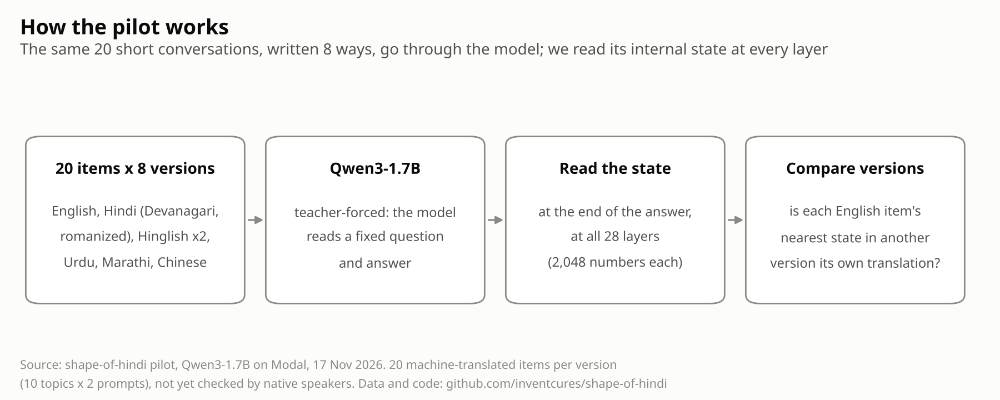

**First, the picture.** The field note's figures were rotating 3D clouds: every token of 900 conversations at the final layer, one colour per language, with English as a thin sheet and Chinese as a parallel sheet off to one side. Here is the same kind of map for the pilot. I flattened it to two directions and gave each version its own panel on the same axes, because a spinning 3D cloud on a page hides as much as it shows.

It looks a lot like the original. Chinese sits apart, as it did there. Hindi typed in Roman letters lands in a band along English. The three Devanagari versions, Hindi, Hinglish and Marathi, cover nearly the same ground as each other, and Urdu has its own patch next to them. At the last layer, the map mostly tells you which alphabet the model is about to write in.

The field note also refitted its map on whole conversations and found the sheet opened into lobes. I did that at four depths, using the state where the model's reply ends.

At layer 7 the conversations fall into three clean bands: Urdu script, Devanagari, and everything in Roman or Chinese characters. By layer 14 the bands have run together. By the last layer, the Devanagari and Urdu conversations sit at the same end of the map, away from English. That is the same script-first, language-later story as the similarity numbers below, seen as a picture. Pictures like these are where the field note stopped, and the critics were right that they can mislead, so I treat them as illustrations and let the numbers that follow carry the claims.

**The token tax is real and it is about the script.** Hindi in Devanagari cost 4.1 times as many tokens as the same English conversation, and Marathi 4.2 times. The same Hindi typed in Roman letters cost 1.8 times, and Hinglish in Roman letters 1.4 times. Chinese came in under English. So the tokenizer charges for the alphabet, not the language.

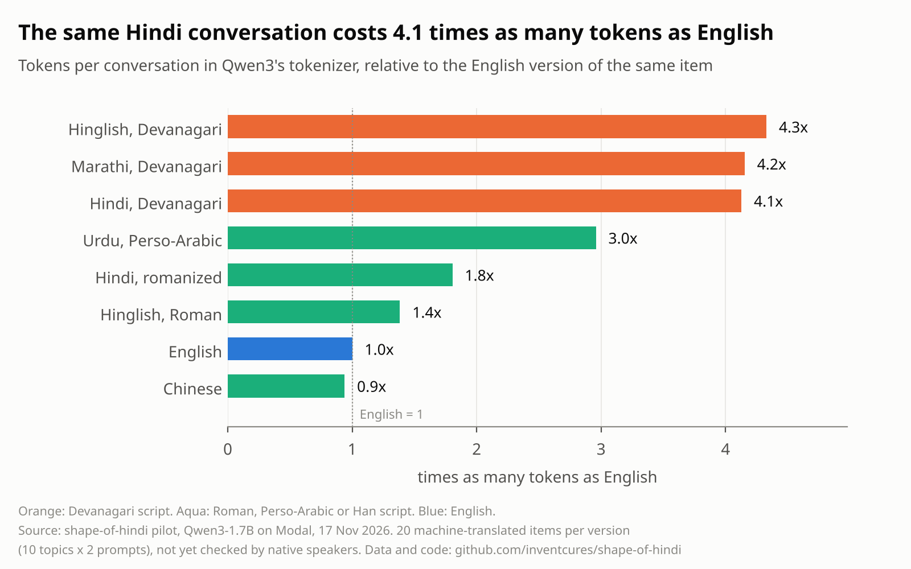

**Hindi lines up with English in the middle, and most of the gap is a single offset.** For each English item I asked whether its nearest Hindi state was its own translation. With the raw states, the answer was yes for 45% of items at layer 16 and 10% at the last layer. After subtracting each language's average state, it was yes for 90% at layer 16 and 65% at the last layer. That is prediction 2 from the plan: a peak in the middle and a fall at the end. It also says that much of what keeps Hindi and English apart inside the model is one shift of the whole cloud, which is easy to remove and easy to miss in a 3D plot.

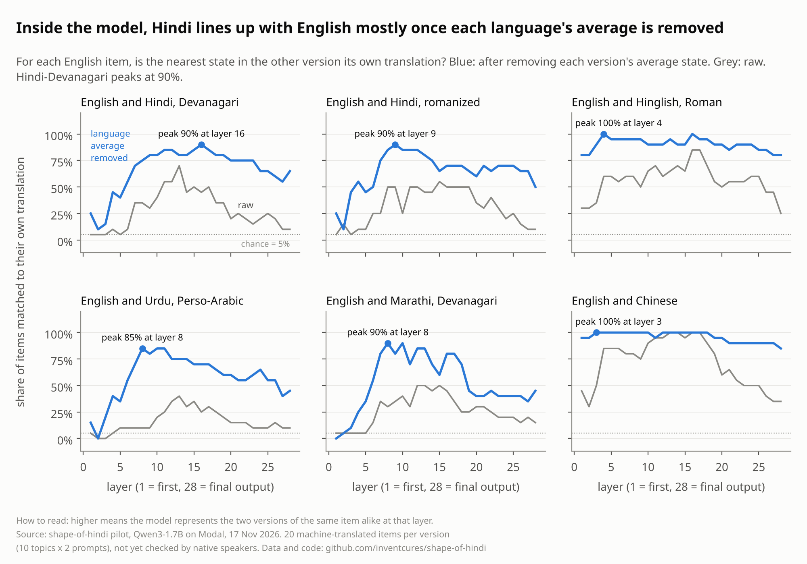

Hindi also sits further from English at the last layer than Chinese does. Raw retrieval there was 10% for Hindi and 35% for Chinese, and centred retrieval 65% against 85%. That fits prediction 1, though Chinese looked suspiciously easy throughout, at 100% for most of the middle. I suspect my Chinese items were close to word-for-word translations, which makes matching easy. Hinglish in Roman script matched English almost perfectly at every layer, which is less interesting than it sounds, because half its words are English. One result went against me. I expected Hindi typed in Roman letters to sit closer to English than Devanagari Hindi in the late layers, since it shares English's alphabet. It didn't. By the similarity measure below it was further from English at 23 of 28 layers, and at the last layer it matched English 50% of the time against 65% for Devanagari.

**Script first, language later, with a tie in the middle.** Prediction 3 was the one I cared about most. I measured how similar the cloud of Urdu states was to the cloud of Hindi states, and the same for Marathi. In layers 1 to 4, Marathi was closer, as you'd expect from the shared alphabet. From layer 5 Urdu pulled ahead, the two were about level from layer 11 to 19, and from layer 20 to the end Urdu was clearly closer, at 0.86 against 0.80 at the last layer. Urdu was closer at 18 of 28 layers. That is the right shape for "the model groups by alphabet at first and by language later", but the middle-layer tie is not what I predicted, and with 20 items I'd not bet much on any one layer.

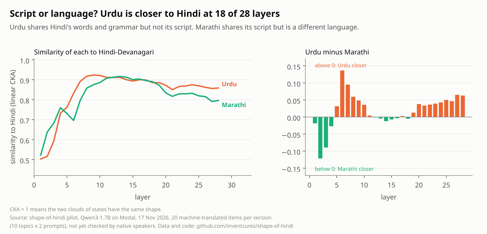

**Two warnings from the data itself.** The top 10 directions of the state cloud predict a conversation's log token count with an R² of about 0.95 to 0.98 at every layer. That sounds damning, but in this pilot length and language are almost the same variable: a simple classifier names the version from the state 93 to 98% of the time, and Devanagari versions are all about four times longer. The pilot cannot separate the two. That is what the length-matched subset and the Gemma-3 comparison in the full plan are for. The second warning is the first token. From layer 3 onward its largest value is over a thousand times that of a typical token, falling to about 9 times by layer 27. Any PCA that includes it would be a picture of that one token, so I dropped it.

What I take from the pilot is that the pipeline works end to end, the token numbers are solid, and the geometry points the way the plan predicted. None of the representation results should be quoted as findings on their own. The next section repeats everything on 1,000 conversations. The figures, the code that draws them and the raw metrics are available on request.

## What 1,000 conversations showed

Twenty items was enough to test the pipeline and not much more, so I scaled up. An open model, Qwen3-32B, wrote 1,200 short English exchanges: 24 domains from health and money to law, farming, religion and ethics, 10 topics in each, half of them rooted in Indian life, and five kinds of question per topic (explain, how to, feedback on a plan, choose between options, and a personal problem). The same model then translated each exchange into ten other versions. Three new ones joined the pilot's eight:

- **formal, Sanskritized Hindi**, the register of government notices and news anchors;
- **Urdu written in Devanagari**, transliterated letter by letter from the Urdu, so the pair differs only in script;
- **Bhojpuri**, spoken by tens of millions in eastern Uttar Pradesh and Bihar.

Items that failed a script or length check in any version were dropped, which left 1,000 items in all 11 versions, 11,000 conversations in all. The whole run, from generation to the last metric, took 1 hour 52 minutes on Modal H100s. The data, code, results and a guide to rerunning it are available on request.

**First, how good are the translations?** I read 12 random items in every version. Chinese was clean. Everyday and formal Hindi had one meaning error in 12: Ayushman Bharat, the health scheme, came out as अयोग्य भारत, "unfit India". Marathi had three, including turning an inter-caste marriage into a marriage within one's caste. Urdu was the weakest, with six of 12 wrong somewhere: JEE became "JE six", stress became tiredness, a music genre became جنس, which means sex or gender. And the Bhojpuri reads more like a mix of Hindi, Bhojpuri and Maithili than like Bhojpuri. These errors are mostly in single words, while the script and register, which most of the geometry tracks, were right in every item I read. Still, keep the Urdu and Bhojpuri caveats in mind below. The full tally is in the data card, available on request.

**The picture, now in 3D.** The field note's figures rotated, so here are rotating versions too. This one is about 66,000 tokens, 6,000 drawn from each version, at the last layer:

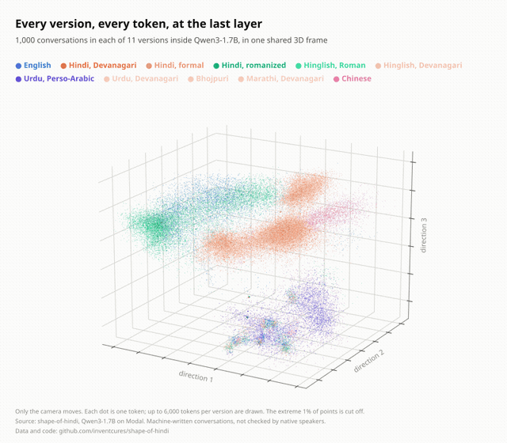

And these are whole conversations, one dot each, at layer 7 and at the last layer:

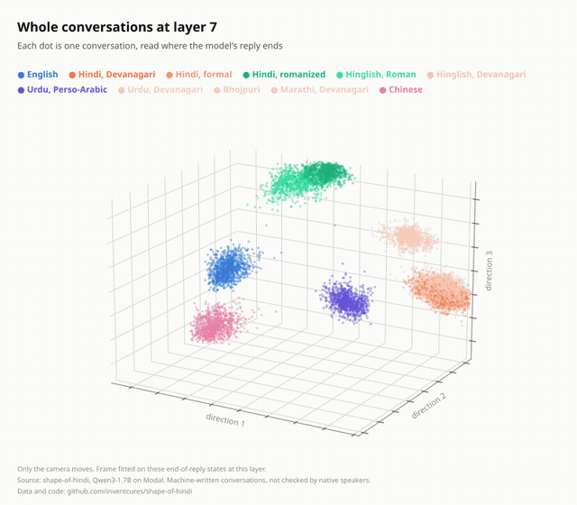

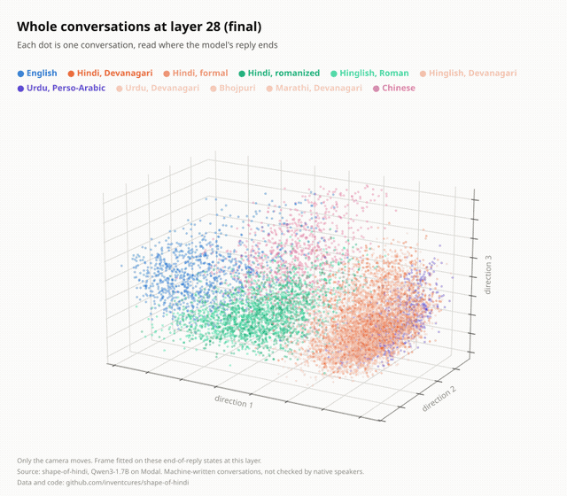

A spinning cloud is fun to watch but hard to read, so here are the same states as flat small multiples. Every token at the last layer, one panel per version:

All six Devanagari versions, from formal Hindi to Bhojpuri to Urdu in Devanagari, cover almost the same ground. Urdu in its own script has its own patch. At the last layer the map still mostly tells you which alphabet comes next.

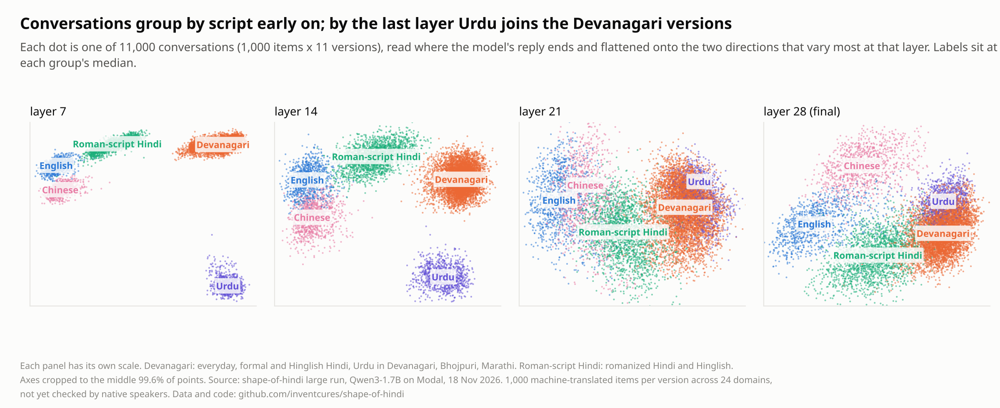

Whole conversations tell the same story as in the pilot, now with 55 times the data. At layers 7 and 14, Urdu is a separate island. By layer 21 it has moved into the Devanagari group, and by the last layer the two overlap. Script first, language later.

**Retrieval, now with a harder test.** With 1,000 candidates, chance is 0.1%, not 5%, so the numbers are lower than the pilot's and not comparable with them. After removing each version's average, everyday Hindi finds its English twin 55% of the time at layer 13, falling to 15% at the last layer. Formal Hindi peaks at 58%, Urdu at 46 to 48% in either script, Bhojpuri at 44%, Marathi at 40%, and romanized Hindi at only 39%. That is prediction 2 again: a peak in the middle and a fall at the end, for every version.

Prediction 1 holds more strongly than in the pilot. At the last layer, Hindi matches English 15% of the time and Chinese 64%. Chinese again looks easy, at 97% in the middle, and I still suspect close, word-for-word translations. The pilot's surprise also held: Hindi typed in Roman letters, which shares English's alphabet, is further from English than Devanagari Hindi at 24 of 28 layers.

**Script or language: a cleaner test.** This is where the new versions earn their place. Compare each version's states with everyday Hindi's, layer by layer:

Two pairs here change only one thing at a time.

- **Same script, different language.** Urdu in Devanagari against Marathi. Both are written in Hindi's alphabet, but Urdu is nearly the same spoken language as Hindi and Marathi isn't. Urdu wins at all 28 layers, by about 0.09 at the end. Language matters.
- **Same language, different script.** Urdu in Devanagari against Urdu in Perso-Arabic. These are the same words, letter for letter. Changing the script costs about 0.07 in the middle and 0.10 at the end. Script matters about as much.

The pilot's version of prediction 3, Urdu in its own script against Marathi, turns out to be a near tie: Urdu is ahead at 8 of 28 layers, mostly early, and Marathi is ahead by at most 0.025 from layer 12 on. The pilot's late lead for Urdu (0.86 against 0.80) did not survive. In that comparison the two effects cancel: Urdu gains for being the same language and loses the same amount for its different alphabet. The Urdu translations being the weakest probably pushes it down a little more. The starkest line is romanized Hindi, which is the same Hindi as the reference in different letters, and still ends up furthest away.

**Who sits with whom.** Here is every pair at layer 14 and at the last layer.

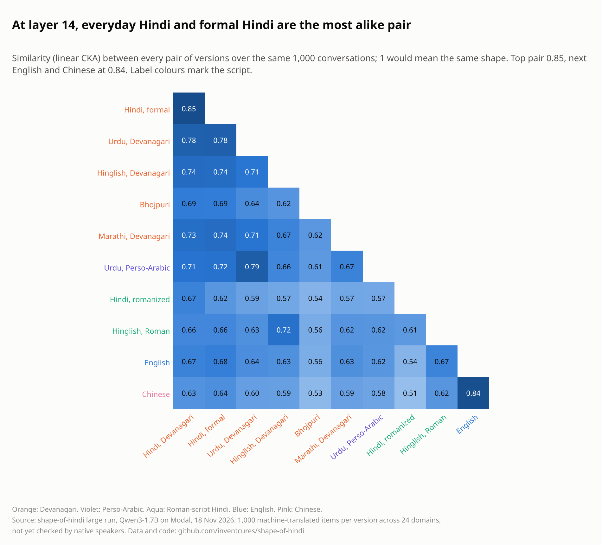

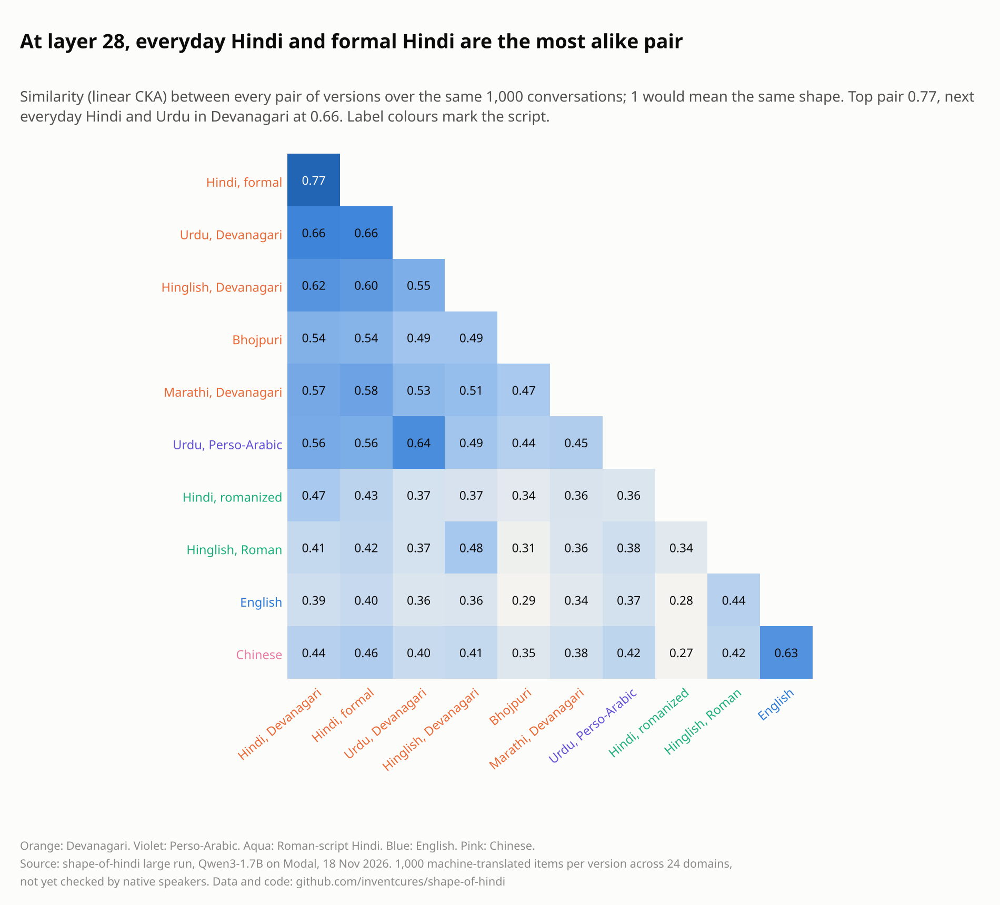

Everyday and formal Hindi are the closest pair at both depths, which is reassuring: a change of register moves the states less than anything else. More surprising, English and Chinese are almost as close in the middle, at 0.84, as the two Hindi registers. Romanized Hindi is the loner by the last layer, under 0.5 with every other version, including the Devanagari Hindi it was transliterated from.

**The length warning, again.** The top 10 directions predict a conversation's token count with an R² of 0.94 to 0.98 at every layer. As in the pilot, that number pools all versions, and the Devanagari versions are both five times longer and grouped together, so length and script are tangled. Untangling them needs a model whose tokenizer charges Hindi and English the same, which is the next run.

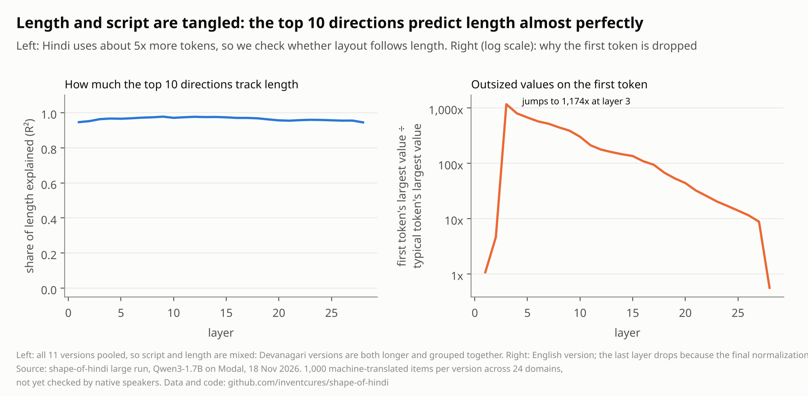

**Check yourself.** Urdu in Devanagari scores 0.66 with Hindi at the last layer, Urdu in Perso-Arabic 0.56 and Marathi 0.57. Using only these three numbers, how much does switching alphabet cost, and how much does switching language cost? *Alphabet: 0.66 − 0.56 = 0.10, comparing the two Urdus. Language: 0.66 − 0.57 = 0.09, comparing the two Devanagari versions. That is why Urdu in Perso-Arabic and Marathi tie: each pays one of the two costs.*

## What Hindi costs in tokens

A language model doesn't read letters or words. It reads tokens, chunks of text from a fixed vocabulary, and everything about running a model is priced in them: the bill, the wait, the memory, the electricity. So when the same sentence takes more tokens in Hindi than in English, a Hindi speaker pays more for the same answer. People call this the token tax.

Here is one question in eight versions, cut into tokens by the tokenizer of Qwen3, the model in this study.

English takes 17 tokens. Hindi in Devanagari takes 66, and the formal, Sanskritized version 95. Hinglish typed in Roman letters takes 18, barely more than English. Across all 1,000 conversations in the large run the averages say the same thing: everyday Hindi costs 4.95 times as many tokens as English, formal Hindi 5.14 times, Urdu 3.64 times, romanized Hindi 2.13 times and Roman Hinglish 1.67 times.

### Why it happens

Text reaches the tokenizer as bytes. In UTF-8, the standard encoding, a Latin letter takes one byte and a Devanagari letter takes three. So "payment" is 7 bytes and "पेमेंट" is 18, even though both have six or seven visible symbols.

A tokenizer is built by finding the byte sequences that appear most often in its training text and giving each one an entry in the vocabulary. English dominates that text, so English gets whole words and common word pieces. Qwen3's vocabulary has 151,669 entries. About 70,000 are pure Latin-letter pieces, 25,557 contain a Chinese character and 3,635 contain Arabic script. Only 71 contain a Devanagari letter.

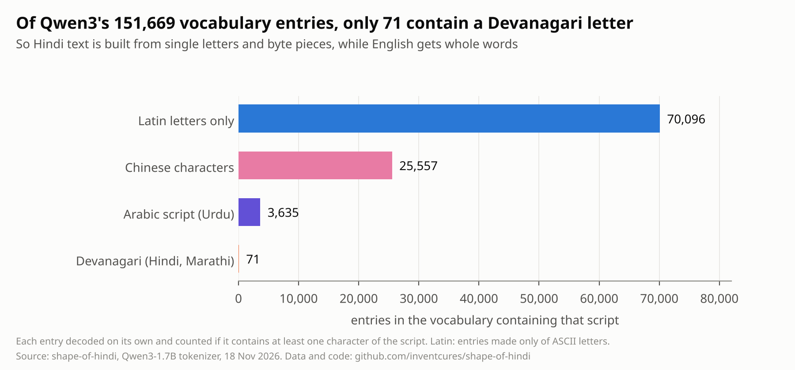

With 71 entries, the tokenizer has nothing bigger than a single letter for most of Hindi, and often not even that. The first word of the Hindi question, यूपीआई, comes out as 7 tokens: य, two raw bytes that only make sense together, प, the vowel sign ी, आ and ई. Nearly half the tokens in the Hindi row are fragments like these. That works out to about one token per character for Hindi, against about four characters per token for English.

Chinese is the counterexample. It is a non-Latin script too, but the Qwen team trained on a lot of Chinese and gave it 25,000 entries, so Chinese costs slightly less than English.

### It depends a lot on the tokenizer

A friend pointed out that this tax has been falling, and they were right. I counted tokens for the same 1,000 conversations under tokenizers from 2020 to 2026.

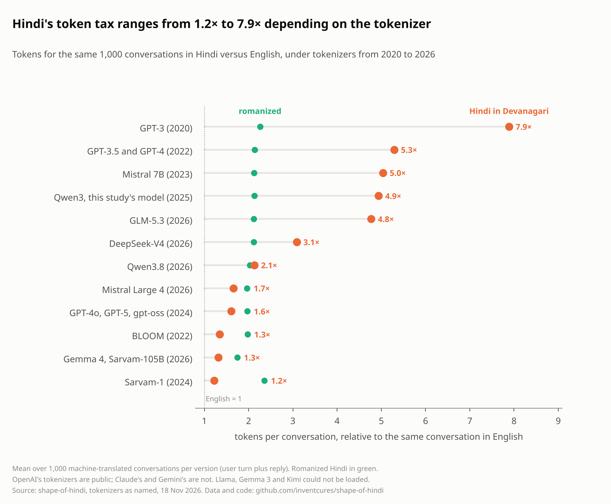

Under GPT-3's tokenizer, Hindi cost about 8 times English. GPT-4's brought that to about 5.3, and GPT-4o's to 1.6. Gemma 4 (and Sarvam's newest model, which uses the same tokenizer) and BLOOM are near 1.3, and Sarvam-1, built for Indian languages, 1.2. The word नमस्कार went from 13 tokens under GPT-3 to 7 under GPT-4, 3 under GPT-4o and 1 under Gemma 4.

But not every recent model has caught up. Qwen3, released in 2025, sits at 4.95. GLM-5.3, released this August, is at 4.8. So the tax is now a design choice, not a law of nature. One more twist: under the newest tokenizers, Hindi typed in Roman letters costs about 2 times English, more than Hindi in Devanagari. The old advice to type romanized Hindi to save tokens has flipped.

### Back of the envelope

Here is what a factor of 5 means in practice, using Qwen3's tokenizer and round numbers.

**Money.** API prices are per token, the same in every language. Say a cheap model charges $0.50 per million output tokens, and a service answers a million questions a day with 70-word replies. An English reply is about 1.15 tokens per word, so about 80 tokens. The day's output is 80 million tokens, which is $40. In Hindi each reply is about 5 times longer in tokens, 400 tokens, so the same service costs $200 a day. That is about $15,000 a year in English against $73,000 in Hindi, for the same answers. With a 1.6 times tokenizer, the Hindi bill drops to about $23,000.

**Waiting.** A model that writes 50 tokens a second finishes the English reply in 1.6 seconds and the Hindi one in 8.

**Memory.** A 32,000-token context window holds about 540 of our English conversations, at 59 tokens each, but only about 110 in Hindi, at 292 each. Long documents, chat history and retrieved sources all run out five times sooner.

**Compute.** A forward pass costs about 2 floating-point operations per parameter per token. For a 1.7-billion-parameter model that is about 3.4 billion operations per token. An English conversation of 59 tokens costs about 0.2 trillion operations, and the Hindi one, at 292 tokens, about 1 trillion. Attention grows with the square of the length, so for long inputs that part of the work grows by 5 × 5 = 25 times, not 5.

**Energy.** A 2026 EMNLP paper measured this directly.[^energy] On a reading-comprehension benchmark with Qwen3-8B, which uses the same tokenizer, Hindi in Devanagari used 0.20 joules per output token against English's 0.10, and 8.5 times as much energy in total. Romanized Hindi used 6.1 times and Urdu 5.0 times. Kannada was worst among Indian languages at 34 times. The cost per token rises too, not only the number of tokens, because longer sequences fill the GPU's memory and leave room for fewer requests at once. A rough check: about 5 times the tokens at 2 times the energy per token gives about 10 times the energy, in the same range as their 8.5.

**Check yourself.** If a tokenizer brings Hindi down to 1.6 times English, and the energy per token falls to 1.2 times English's, about how much more energy does a Hindi reply use? *About 1.6 × 1.2 ≈ 1.9 times, against roughly 10 times with Qwen3's tokenizer.*

There is also a cost that doesn't show up on any bill. A model that sees Hindi as one letter at a time has to spend layers stitching letters back into words before it can work with meaning. That is one reason the length confound matters so much for the geometry in this essay, and one reason I want to repeat the study on a model whose tokenizer treats Hindi fairly.

## The values thread

Anthropic's two values studies are where this stops being only about geometry.

The first, "Values in the Wild", labelled the values Claude expressed in about 308,000 subjective conversations and found 3,307 distinct ones.[^wild] The second compressed those into four axes and profiled Claude across models and the top 20 languages.[^vml] Warmth against rigor varied most. In Hindi, Claude leaned toward polite language, humour and affirming the user's ideas. In English and Russian, it leaned toward challenging assumptions and asking for evidence. The authors' own example is the one that stuck with me: two people asking for feedback on the same business plan, one in Hindi and one in Russian, may come away with different impressions of how good it is.

I find this both fascinating and a little uncomfortable. Hindi conversational norms do lean toward warmth and indirectness, and a model that matches them could be serving its users well. But if a founder in Jaipur gets gentler feedback on a weak plan than a founder in Moscow, that is a real difference in the help they get. Anthropic are careful to say they don't yet know which it is, or where it comes from.

An open model lets us look for a mechanism. The plan builds a warmth direction from English replies written under warm and rigorous instructions, checks that it steers, then projects Hindi and English replies to the same feedback requests onto it. Then it does the same with the three pronouns. If *aap* sits furthest along the warmth direction and *tu* least, the model's sense of social register and its sense of warmth may share machinery.

There's an important trap here. A 2026 study of sycophancy in Hindi found that most of the increase over English came from culturally adapted content, about 14 points for Qwen2.5-7B, and only about 2 from the language itself.[^beacon] So a warmer Hindi reply might be about what people ask in Hindi, not the language. That is why the topics are split into universal and Indian.

## What else I'd run

The repo has a longer list. The ones I'm most excited about:

- **Hinglish switch points.** In "kal mera exam hai aur maine abhi tak syllabus complete nahi kiya", watch the state at "exam", "syllabus" and "complete". Linguists describe Hinglish as Hindi grammar with English content words slotted in. Does the model's state jump toward English at each English word and snap back?
- **The family tree.** IN22 has the same sentences in 22 Indian languages. Build a tree from the model's internal distances and see if it splits Indo-Aryan from Dravidian, or just clusters languages by how many tokens they cost.
- **Gender in the verb.** In Hindi, "मैं गया" and "मैं गई" both mean "I went", but the first is a man speaking and the second a woman. English has no such cue. Does the model remember the user's gender ten turns later, and does it change the advice?
- **Safety in romanized Hindi.** An English refusal direction transfers across 14 languages, none of them Indian.[^refusal] Attack success on Llama-3-8B rose from 0.06 in English to 0.63 in Hinglish with phonetic misspellings.[^haet] I'd like to know whether the model fails to see the harm, or sees it and fails to act.
- **Other script pairs.** Serbian in Cyrillic and Latin, Punjabi in Gurmukhi and Shahmukhi, Chinese simplified and traditional. If Hindi and Urdu behave like these, the finding is about scripts in general.

## Check yourself

I learn best by doing problems, so here are a few. Answers are in the last section of the [paper (PDF)](/files/shape-of-hindi.pdf), with the same numbering.

1. The 3D view keeps 17.6% of total variance, yet English looks 99.3% flat in it. Construct a toy example in three dimensions where a frame keeps a small share of total variance but one group of points looks perfectly planar inside it.
2. In a two-token model with tied embeddings, "the" at (1, 0) and "的" at (0, 1), where does the final state sit when the model is 90% sure the next token is "的"? Why does that make the last layer a poor place to compare languages?
3. You have 600 English and 600 Hindi states. Raw retrieval is 12%. After centring it's 71%. In one sentence, what did centring remove?
4. Hindi costs about 4.75 tokens per word in Qwen3 and English about 1.26. A 50-word English reply becomes how many tokens, and its Hindi translation about how many? If you average states over the reply, why might that matter?
5. Which of these comparisons isolates script: Hindi vs Marathi, Hindi vs Urdu, Hindi vs Hinglish? Which isolates language?
6. A cloud of states has covariance eigenvalues 4, 4, 1 and 1. What is its participation ratio, the effective number of dimensions it uses? The formula is the square of the sum of the eigenvalues divided by the sum of their squares.
7. Suppose the warmth projection is higher for Hindi replies than English ones, but only on Indian-topic items. What would you conclude about where the lean comes from?
8. In the pilot, centred retrieval between Hindi and Urdu at the last layer was 95% and between Hindi and Marathi 80%, out of 20 items each. How many items is that difference? Would you call it evidence that the model groups Hindi with Urdu?

## Where this leaves me

The original field note drew a pretty picture and stopped. I don't think that's a flaw in a field note, but it left the most interesting question open. When a model reads a sentence, how much of what it does depends on meaning, and how much on the alphabet, the token count and the social register the sentence was written in?

Hindi is the right place to ask, because one spoken language arrives in three scripts, mixes freely with English, puts social relationships into its pronouns, and costs five times as many tokens as English in a popular open model. Most of the work is cheap. The pilot ran on a rented GPU in about ten minutes, and the 1,000-conversation run in under two hours. The 1,000 items say the model sorts by script about as much as by language, and that romanized Hindi, the way millions of people actually type, ends up furthest from everything. The slow part now is native speakers checking the translations, above all the Urdu and the Bhojpuri, and that is the part I'd least want to cut. After that, the same run on a model whose tokenizer charges Hindi fairly, to pull length and script apart.

[^op]: operator0x, ["What thousands of conversations look like inside a language model"](https://operator0x.com/field-notes/qwen-conversation-state-space/), field note (November 2026).
[^brief]: Numbers as quoted in a [Hacker News front-page briefing](https://thecontext.dev/en/briefing/) (15 November 2026). I could not load the original page from my research setup.
[^hn]: [Hacker News discussion](https://news.ycombinator.com/item?id=50481321) of the field note (November 2026), 29 comments.
[^vml]: Kearney, Zhang et al., ["Claude's values across models and languages"](https://www.anthropic.com/research/claude-values-models-languages), Anthropic (13 July 2026).
[^wild]: Huang et al., ["Values in the wild"](https://www.anthropic.com/research/values-wild), Anthropic (21 April 2025); [paper](https://arxiv.org/abs/2504.15236) and [dataset](https://huggingface.co/datasets/Anthropic/values-in-the-wild).
[^lape]: Tang et al., ["Language-specific neurons: the key to multilingual capabilities in large language models"](https://arxiv.org/abs/2402.16438), ACL 2024.
[^llamas]: Wendler, Veselovsky, Monea, West, ["Do Llamas work in English? On the latent language of multilingual transformers"](https://arxiv.org/abs/2402.10588), ACL 2024.
[^bio]: Lindsey, Ameisen et al., ["On the biology of a large language model"](https://transformer-circuits.pub/2025/attribution-graphs/biology.html), Transformer Circuits (2025), multilingual circuits section.
[^tongue]: Dumas et al., ["Separating tongue from thought: activation patching reveals language-agnostic concept representations in transformers"](https://arxiv.org/abs/2411.08745), ACL 2025.
[^geom]: Chang, Tu, Bergen, ["The geometry of multilingual language model representations"](https://arxiv.org/abs/2205.10964), EMNLP 2022.
[^neutral]: Libovický, Rosa, Fraser, ["On the language neutrality of pre-trained multilingual representations"](https://arxiv.org/abs/2004.05160), Findings of EMNLP 2020.
[^arith]: Gurgurov et al., ["Language arithmetics: towards systematic language neuron identification and manipulation"](https://arxiv.org/abs/2507.22608), IJCNLP-AACL 2025.
[^romanlens]: Saji et al., ["RomanLens: the role of latent romanization in multilinguality in LLMs"](https://arxiv.org/abs/2502.07424) (2025).
[^latin]: Gurgurov, Saji et al., ["The Latin substrate: how language models represent and mediate script choice"](https://arxiv.org/abs/2605.31363) (2026).
[^energy]: Deng, Shen, Feng, Nwatu, Chung, Chowdhury, Chen, Mihalcea, ["The language–energy divide: measuring energy costs of multilingual LLM inference"](https://aclanthology.org/2026.emnlp-main.2113/), EMNLP 2026. Indian-language figures are from their Table 5, Qwen3-8B on Belebele; the ratios to English are my arithmetic from their totals.
[^tok]: Qwen3-8B, which shares the Qwen3 tokenizer, at 4.75 tokens per Hindi word and 1.26 per English word on FLORES-200, from ["BrahmicTokenizer-131K"](https://arxiv.org/abs/2605.29379) (2026). Romanized Hindi at 0.43 times native-script cost on the Qwen2.5 tokenizer, from Johny, Ghosh, Sam, ["The Indic token tax in 2026"](https://arxiv.org/abs/2611.13058).
[^massive]: Sun et al., ["Massive activations in large language models"](https://arxiv.org/abs/2402.17762) (2024); for Qwen3, Shi et al., ["A single layer to explain them all"](https://arxiv.org/abs/2605.08504), ICML 2026.
[^specious]: Chari and Pachter, ["The specious art of single-cell genomics"](https://doi.org/10.1371/journal.pcbi.1011288), PLoS Computational Biology (2023).
[^clas]: Gurgurov et al., ["CLaS-Bench: a cross-lingual alignment and steering benchmark"](https://arxiv.org/abs/2601.08331) (2026).
[^beacon]: Sattigeri, ["Extending Beacon to Hindi"](https://arxiv.org/abs/2602.00046) (2026).
[^refusal]: Wang et al., ["Refusal direction is universal across safety-aligned languages"](https://arxiv.org/abs/2505.17306), NeurIPS 2025.
[^haet]: Aswal and Jaiswal, ["Haet Bhasha aur Diskrimineshun: phonetic perturbations in code-mixed Hinglish"](https://arxiv.org/abs/2505.14226) (2025).
