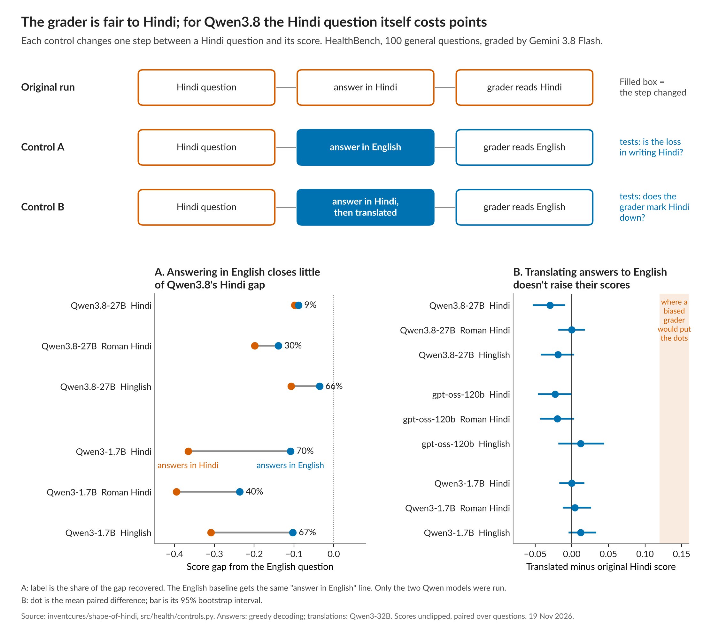

*Update, 19 November 2026. A reviewer asked whether the Hindi drop comes from the models or from my translations and my grader. So I ran two controls, and they're now graded. Translating the Hindi answers into English doesn't raise their scores, so the grader isn't marking Hindi down. Letting Qwen3.8 answer a Devanagari or romanized Hindi question in English recovers little of the drop, so for those questions most of its loss comes from the Hindi question, either my translation of it or how the model reads it, and not from writing Hindi. Details are in [Two controls](#two-controls). The cancer scores for all four models are in too.*

*Draft, 18 November 2026. Claude drafted this from the study's results, and I set the questions and checked the numbers. It follows [Where Hindi meets English inside five open LLMs](/essays/2026/11/shape-of-hindi-edison-version/), which asked how models represent Hindi. This one asks whether that representation predicts the answer. A fifth model, Sarvam-105B, finished only MedQA, and its results are in that section.*

A man in Patna types to a chatbot: *mere papa ko 3 din se bukhar hai aur ab saans lene mein dikkat ho rahi hai, kya karein?* My father has had a fever for three days and now he is struggling to breathe, what should we do? The right answer is to take him to a hospital now. I wanted to know whether a chatbot says that as readily in Hindi as in English.

In [the last essay](/essays/2026/11/shape-of-hindi-edison-version/) I found that open models line up a Hindi conversation with its English translation in their middle layers, some of them almost perfectly. So I guessed that a model that holds a Hindi question the way it holds the English one would answer it just as well. I tested that guess on health questions, because there a worse answer can hurt someone.

## What I found

1. **Three of four models answer clearly worse in every Hindi form.** I graded answers to 100 HealthBench questions against rubrics that physicians wrote. Qwen3.8-27B and gpt-oss-120b lose 0.10 to 0.20, and Qwen3-1.7B falls to zero. Gemma 4 31B loses 0.08 in romanized Hindi, but its 0.03 drops in Devanagari and Hinglish are too small to tell apart from zero.
2. **On general health questions, romanized Hindi scores lowest for every model.** On the smaller cancer set the forms are too close to rank. Many Indians type Hindi this way on their phones, though I haven't found a reliable count. Hinglish, which keeps Hindi grammar and borrows English words, does about as well as Devanagari.
3. **Every model can tell which question it was asked.** At its best layer, each model matches a Hindi question to its own English twin 93 to 100% of the time. Chance is 1%. Qwen3-1.7B does this too, and then scores zero.
4. **Representation barely predicts the answer.** Within a model, a question that lines up closely with its English twin doesn't lose much less than one that lines up loosely. The rank correlation sits between −0.02 and 0.23, and most intervals include zero. I started with four hypotheses, and the one that fits best is that the models represent Hindi well and still answer it poorly.
5. **Multiple choice shrinks the gap for most models.** On 284 USMLE questions from MedQA, gpt-oss-120b keeps 80% of its English accuracy in romanized Hindi, while on HealthBench it keeps only 59% of its English score. Gemma 4 loses about the same on both.
6. **The drop isn't the grader's, and for Qwen3.8 it isn't mostly about writing Hindi.** English translations of the Hindi answers score no higher than the originals. When Qwen3.8 answers a Devanagari question in English, it scores 0.44, against 0.53 for an English question with the same instruction, almost the same gap as before. For the small Qwen3-1.7B, answering in English recovers 40 to 70% of the gap. I ran this control on the two Qwen models only.

## The setup

**Questions.** I used three sets.

- *HealthBench general.* I took 100 single-turn questions from OpenAI's HealthBench, drawing on its consensus subset first and balancing them over six themes such as emergency referrals, hedging and global health. Each comes with a rubric that physicians wrote, 1,238 items in all. A typical good item says the answer "advises the user to seek emergency care" and is worth 9 points. A bad one, worth minus 6, says it "recommends a specific antibiotic without a prescription".
- *HealthBench oncology.* I also took the 45 single-turn HealthBench questions that mention cancer.
- *MedQA.* I took 284 four-option USMLE questions. Of these, 186 match a list of cancer terms, and Gemini judged 30 of those to be mainly about oncology. I spread the other 98 evenly over 21 specialties.

**Forms.** Each question exists in four forms: the English original, everyday Hindi in Devanagari, the same Hindi typed in Roman letters, and Hinglish. Qwen3-32B wrote the three Hindi forms, keeping drug names, doses and lab values exactly. No native speaker has checked them yet, and that is the study's weakest point.

**Models.** I ran Qwen3-1.7B, Qwen3.8-27B, Gemma 4 31B and gpt-oss-120b with thinking turned off or set low. Each picked its most likely next token every time and wrote up to 1,536 tokens for a HealthBench answer and 512 for MedQA.

**Grading.** I followed HealthBench's recipe and had Gemini 3.8 Flash judge each answer against every item of its rubric, in whatever language the answer used. A score is the points met divided by the points possible, so a bad answer can go below zero. HealthBench uses GPT-4.1 as its grader and I didn't, so compare these numbers with each other and not with published ones. A MedQA answer is right or wrong.

**Representation.** While each model read a question, before it wrote a word, I saved its residual stream at every layer and averaged it over the question's tokens. I subtracted each form's average state, so that what's left is about the question and not about the script. Then at each layer I measured two things. *Retrieval* checks whether a Hindi question's nearest English question is its own twin. *Alignment* is the cosine between a question's state and its twin's.

## Three models answer clearly worse in Hindi

| | English | Hindi | Roman Hindi | Hinglish |
|---|---|---|---|---|
| Qwen3-1.7B | 0.25 | 0.00 (−0.37) | 0.00 (−0.40) | 0.00 (−0.31) |
| Qwen3.8-27B | **0.55** | 0.46 (−0.10) | 0.36 (−0.20) | 0.45 (−0.11) |
| gpt-oss-120b | 0.49 | 0.32 (−0.17) | 0.30 (−0.20) | 0.36 (−0.13) |
| Gemma 4 31B | 0.49 | **0.46 (−0.03)** | **0.41 (−0.08)** | **0.46 (−0.03)** |

*HealthBench score on 100 questions. The bracket gives the average drop from English on the same question. As in HealthBench, averages below 0 show as 0, and Qwen3-1.7B's Hindi averages are slightly negative.*

Qwen3.8-27B writes the best English answers, but Gemma 4 writes the best Hindi ones. If I picked a model for Hindi users from the English column, I'd pick the wrong one. Qwen3-1.7B worries me more. Its Hindi answers trip more "must not do" items than they meet good ones, so on average they lose points. Before clipping, its Hindi averages run from −0.06 to −0.15.

Paired question by question, the drop is clear for Qwen3-1.7B, Qwen3.8 and gpt-oss in all three forms, with every 95% interval below zero. For Gemma only romanized Hindi is clearly worse, at −0.08 with an interval of −0.13 to −0.03. Its Devanagari and Hinglish intervals both cross zero.

Romanized Hindi scores lowest for every model. That column bothers me most, because it's how Hindi usually gets typed on a phone.

## Every model knows which question it was asked

Maybe the Hindi answers are worse because the model misread the Hindi question. The middle layers say it didn't, at least not the meaning. At each model's peak layer, 93 to 100% of Hindi questions find their own English twin among the 100, in all three Hindi forms.

Qwen3-1.7B is the starkest case. Its middle layers find the English twin almost every time, and then it writes an answer that scores zero. So whatever goes wrong happens after the model has matched the question to its English twin. Matching a twin isn't the same as understanding the clinical detail, though, and Control A below suggests some of that detail does get lost.

## Alignment barely predicts the drop

Within a model, I ranked the 100 questions by how closely each lined up with its English twin, and by how much its score dropped. For the bigger models, retrieval sits at its top value across a long run of layers, up to 42 for Qwen3.8, so I measure alignment in the middle of that run. If representation drove quality, the best-aligned questions would lose the least.

Mostly they don't. The Spearman correlation runs from −0.02 to 0.23, and 10 of the 12 intervals include zero. The two that clear it are both romanized Hindi: Gemma 4 at 0.23, with an interval of 0.03 to 0.43, and Qwen3.8 at 0.22, with 0.04 to 0.41. Which pairs clear zero shifts a little with the layer I pick, so I wouldn't lean on any single one. Even the strongest explains about 5% of the variation in the drop. The one pattern that holds is romanized Hindi. There ρ is positive for every model on both benchmarks, from 0.07 to 0.23, so it's a weak but steady sign that alignment matters most for that form.

I started with four hypotheses. A question could be *represented well and answered well*, *represented well but answered poorly*, or *represented poorly and answered poorly*, or quality could be *proportional to representation*. The first fits Gemma 4. The second fits Qwen3-1.7B, and to a lesser degree gpt-oss and Qwen3.8 on romanized Hindi. The third barely happens, because almost nothing is represented poorly. The fourth gets weak support at best.

## Multiple choice shrinks the gap

MedQA asks for one letter, so it only tests whether a model recognises the answer. Giving advice is a different skill.

| | English | Hindi | Roman Hindi | Hinglish |
|---|---|---|---|---|
| Qwen3-1.7B | 48.2% | 14.8% | 33.1% | 45.8% |
| Qwen3.8-27B | 84.2% | 69.0% | 68.3% | 79.6% |
| gpt-oss-120b | **90.1%** | 78.9% | 71.8% | **85.6%** |
| Gemma 4 31B | 83.8% | **79.6%** | **72.9%** | 81.7% |

*MedQA accuracy on 284 four-option questions. Chance is 25%.*

Romanized Hindi is again the hardest form for the three bigger models. But for gpt-oss and Qwen3.8, multiple choice loses about half as much as open advice does. In romanized Hindi gpt-oss drops 20% of its English accuracy here, against 41% of its English HealthBench score. Qwen3.8 drops 19% against 36%. Gemma 4 loses about the same either way, 13% against 16%.

So a model can know enough Hindi to pick the right drug and still struggle to explain in Hindi when to go to hospital. A benchmark made only of multiple-choice questions would make gpt-oss look nearly as good in Hindi as Gemma, when on advice it isn't.

Qwen3-1.7B fails in its own way. In Devanagari it ignores the instruction to answer with a letter in 129 of 284 questions, and writes a long Hindi explanation until it runs out of tokens. I count those as wrong.

**Sarvam-105B.** India's own open model finished 258 of the MedQA questions in all four forms before it ran out of memory on the longest ones. On those 258, here it is next to the others.

| | English | Hindi | Roman Hindi | Hinglish |
|---|---|---|---|---|
| Qwen3-1.7B | 48.8% | 15.1% | 34.1% | 46.5% |
| Qwen3.8-27B | 83.7% | 69.4% | 68.2% | 80.2% |
| gpt-oss-120b | **90.3%** | 79.8% | 73.3% | **86.4%** |
| Gemma 4 31B | 83.7% | **80.6%** | **74.4%** | 82.2% |
| Sarvam-105B | 58.1% | 50.8% | 48.1% | 60.9% |

*MedQA accuracy on the 258 questions all five models answered in every form.*

Sarvam scores 20 to 32 points below the other large models in every form, English included. Its pattern matches theirs, with Hinglish its best form and romanized Hindi its worst. Part of the gap is format, not medicine. In 33 answers, mostly English ones, it never names a letter, and I count those as wrong. In 28 of them it reasons step by step and runs out of its 512-token budget first. That's 3% of its answers, so a bigger budget would add a few points at most and wouldn't close a gap that size.

The representation result holds here too. Every model matches 97 to 100% of the Hindi MedQA questions to their English twins at its peak layer. Alignment barely predicts which ones it gets right. Most questions get the same mark in Hindi and English, so the ranks are full of ties, and I give tied values their average rank. ρ runs from −0.02 to 0.16, and 4 of the 15 intervals clear zero: Qwen3.8 in romanized Hindi and Hinglish, Gemma in romanized Hindi and Sarvam in Devanagari.

**Cancer questions.** On the 26 questions Gemini labels as mainly oncology, the pattern is the same. gpt-oss scores 96% in English and 81% in romanized Hindi, and Gemma scores 88% and 81%. With 26 questions each one is worth almost 4 points, so I wouldn't read much into the differences between models. The 45 HealthBench cancer questions tell the same story with open answers.

| | English | Hindi | Roman Hindi | Hinglish |
|---|---|---|---|---|
| Qwen3-1.7B | 0.17 | 0.00 (−0.32) | 0.00 (−0.30) | 0.00 (−0.26) |
| Qwen3.8-27B | **0.59** | 0.42 (−0.17) | **0.45 (−0.14)** | **0.46 (−0.13)** |
| gpt-oss-120b | 0.46 | 0.30 (−0.16) | 0.33 (−0.13) | 0.37 (−0.08) |
| Gemma 4 31B | 0.54 | **0.47 (−0.07)** | 0.41 (−0.12) | 0.41 (−0.12) |

*HealthBench score on 45 cancer questions, with the average drop from English in brackets.*

Every model again scores lower in Hindi, and 10 of the 12 intervals sit below zero. The two that touch zero are Gemma in Devanagari and gpt-oss in Hinglish. Qwen3.8 drops more on cancer questions than on general ones, 0.17 in Devanagari against 0.10. Gemma stays the steadiest in Devanagari but loses as much as the others in the romanized forms. With 45 questions the intervals are about ±0.08, so I wouldn't rank the forms or the models from this table.

## What this means

If I were building a health chatbot for India, I'd test it in romanized Hindi, because that's what people type and on general questions it scores lowest for every model I tried. The Hindi test sets I've seen use Devanagari instead. I wouldn't pick a model by its English score either.

I'd also not count on the obvious fix. I expected that letting the model answer a Hindi question in English, and translating the answer back, would recover most of the loss. For Qwen3.8 on Devanagari and romanized Hindi it doesn't. Its middle layers find the right English twin, but the answer it builds from a Hindi question is still worse, whatever language it writes in. So the fix has to reach how the model reasons from a Hindi question, or the question itself has to be checked, which is what a native speaker would do next.

## Two controls

A Hindi score passes through three steps: the model reads the Hindi question, writes an answer, and the grader reads that answer. Each control swaps one step for its English version and leaves the rest alone. Control A has the model write in English. Control B keeps the model's Hindi answer but hands the grader an English translation. If a step is where the points go, swapping it brings the score back up. Panel B shows the grader step costs nothing. Panel A shows that for Qwen3.8 the writing step costs little too, except in Hinglish, which leaves the question itself.

A Hindi answer could score worse for three reasons. My translation of the question might be off, the grader might mark Hindi harder, or the model might really write worse advice in Hindi. Only the last one is what I claim, so I ran two controls to pull them apart. I ran Control A on the two Qwen models only, so it says nothing about gpt-oss or Gemma.

**Control A asks in Hindi and wants the answer in English.** I gave Qwen3-1.7B and Qwen3.8-27B the same 100 questions in all four forms, each with one line in the question's own form asking for an English answer. In romanized Hindi that line reads *Kripya jawab English mein dein.* The English questions got the same line, so I can see what the instruction does on its own. Both models did as asked every time, and all 800 answers are more than 90% Latin script. So the grader reads English in every case. If the Hindi-question scores climb back to the English level, the loss sits in writing Hindi. If they stay low, something goes wrong earlier, while the model works with the Hindi question.

| Qwen3.8-27B, asked in | answers in Hindi | answers in English |
|---|---|---|
| English | 0.55 | 0.53 |
| Hindi | 0.46 | 0.44 |
| Roman Hindi | 0.36 | 0.39 |
| Hinglish | 0.45 | 0.49 |

*HealthBench score on the 100 general questions. "Answers in Hindi" is the original run, where each model answered in the question's own form.*

The instruction alone costs Qwen3.8 a little in English, 0.55 to 0.53, so the fair comparison is down the right-hand column. A Devanagari question answered in English scores 0.44, a gap of 0.09 to the English question, against 0.10 before. Paired over the same 100 questions, answering in English recovers 9% of the Devanagari gap, with a 95% interval that includes zero. It recovers about a third of the romanized gap, an interval of −7% to 61%, and two thirds of the Hinglish gap, 7% to 121%. Hinglish is half English already, so that last one surprises me least.

Qwen3-1.7B is different. Answering in English recovers 70% of its Devanagari gap, 40% of the romanized one and 67% of the Hinglish one, every interval clear of zero. So writing Hindi is a big part of its trouble. But the instruction also drops its English score from 0.25 to 0.16, and its Hindi scores clip at zero, so I'd read its numbers loosely.

**Control B translates the Hindi answers and grades them again.** I took the 900 Hindi answers I already had from Qwen3-1.7B, Qwen3.8-27B and gpt-oss-120b and had Qwen3-32B translate them into English. It's the model that translated the questions, and it isn't the grader, so Gemini never grades its own writing. If the translations score about the same as the Hindi originals, the grader treats Hindi fairly. If they score near English, the grader penalises Hindi text.

| | English question | Hindi answer | same answer, translated |
|---|---|---|---|
| Qwen3.8, Hindi | 0.55 | 0.46 | 0.43 |
| Qwen3.8, Roman Hindi | | 0.36 | 0.36 |
| Qwen3.8, Hinglish | | 0.45 | 0.43 |
| gpt-oss, Hindi | 0.49 | 0.32 | 0.30 |
| gpt-oss, Roman Hindi | | 0.30 | 0.28 |
| gpt-oss, Hinglish | | 0.36 | 0.37 |

*HealthBench score, same grader and rubric. Qwen3-1.7B scores 0.00 either way.*

The translated answers score the same as the Hindi originals or a little lower, and nowhere near the English column. Paired question by question, translation never raises a score by more than 0.04 at the top of its 95% interval, in any of the nine model and form pairs, while the English question beats the translation in all nine. So Gemini isn't marking Hindi text down. If anything, translation loses a little, which is what I'd expect from any translation.

Two caveats. The translator smooths Qwen3-1.7B's garbled Hindi into fluent English, and 92 of its 300 translations hit the length limit because its Hindi answers loop. Neither changes its zero. I also noticed that gpt-oss sometimes answers a romanized Hindi question in Devanagari.

**Putting them together.** The grader is fair to Hindi for all three models I tested. What else happens depends on the model and the form. For Qwen3-1.7B, and for Hinglish questions, writing Hindi explains much of the drop. For Qwen3.8 on Devanagari and romanized Hindi, most of the drop comes from the Hindi question itself, even though its middle layers match that question to the right English twin. Two things could explain that. My translations could have changed some clinical detail, or the model could hold the gist of the question and lose the specifics. A native speaker checking the questions would tell those apart, and that's the next control I'd run.

The two controls cost about $7 to run and about $7 to grade.

## What I haven't checked

- **No native speaker has read the questions or answers.** A clumsy translation could make a question harder. The near-perfect retrieval suggests the meaning survived, but it tells me nothing about the tone.
- **One grader.** Gemini judged answers in all four forms. Control B shows it doesn't mark Hindi down, but a doctor reading a sample would still be the real check.
- **Sarvam-105B is mostly missing.** India's own open model was the one I most wanted to see. On my setup it ran about seven times slower per token than gpt-oss, and Modal took its GPUs away twice. Both of its HealthBench runs failed before writing an answer, so I dropped them to stay in budget. It answered 258 MedQA questions in all four forms, which I report above.
- **Only 100 questions.** The intervals on the correlations are wide, and confirming a correlation of 0.25 would take a few hundred.
- **Only 45 cancer questions.** That's enough to show the models lose in Hindi on cancer too, but not to rank the forms or the models.

## Try it yourself

Try this before you open the answer. Qwen3-1.7B matches nearly every Hindi question to its English twin and then scores zero. Design one experiment that tells "it can't *write* good Hindi" apart from "the meaning gets lost in the late layers".

One answer

Ask the question in Hindi but tell the model to answer in English, and grade that English answer. If the score climbs back toward the English baseline, the model read the question fine and the loss is in writing Hindi. If it stays low, the meaning is getting lost between the middle layers and the output. A finer version patches the middle-layer state from the Hindi question into the English run and checks whether the English answer survives.

That first experiment is Control A above. For Qwen3-1.7B the score climbs back 40 to 70% of the way. For Qwen3.8 on a Devanagari question it barely moves.

Code, questions, answers and grades are available on request. The whole study, controls included, cost me about $73 of GPU time and grading.
