*This is a second edition of [The shape of Hindi](/essays/2026/11/shape-of-hindi/), rewritten as an experiment in structure. Claude drafted it from the same data, following the shape of a few human-written essays I admire, chiefly Our World in Data's chart explainers and nostalgebraist's logit lens post. The Qwen3-1.7B numbers, figures and caveats are the same as in the first edition, which stays as it was. On 18 November 2026 I added four bigger models, and the section on them is new.*

A woman in Lucknow types into a chatbot: *mera business plan dekh ke batao kaisa hai*. Look at my business plan and tell me how it is. Her cousin in Karachi types the same words in Urdu script: میرا بزنس پلان دیکھ کے بتاؤ کیسا ہے. Her nephew in Pune writes it in Devanagari, but in Marathi, a different language that happens to share Hindi's alphabet. A fourth person writes the whole thing in English.

To a Hindi speaker the first two are the same sentence, the third a close relative and the fourth a translation. I wanted to know whether a language model sees them that way.

**Status.** Five open models. Qwen3-1.7B got a 20-item pilot, then 1,000 items in 11 versions, 11,000 conversations in all. Qwen3.8-27B, Gemma 4 31B, gpt-oss-120b and Sarvam-105B then read the same 11,000. Every non-English text was written by another model and no native speaker has checked it. The Urdu and Bhojpuri translations are the weakest part, and I say below how weak they are.

## Overview

1. **Every model lines up Hindi and English in its middle layers.** Remove each version's average state, and an English conversation's nearest Hindi state is its own translation 55% of the time in Qwen3-1.7B and 99% in Gemma 4, against 0.1% by chance. In every model, that rate falls off toward the last layer.
2. **Cheap Hindi tokens go with good alignment, but don't guarantee it.** Qwen3-1.7B charges Hindi five tokens per English token and aligns worst. Sarvam-105B and Gemma 4 both charge 1.3, yet Sarvam aligns at 66% and Gemma at 99%.
3. **In the small model the alphabet costs as much as the language. In the bigger ones neither matters much.** In Qwen3-1.7B, sharing Hindi's script and sharing its language each raise similarity to Hindi by about 0.1. In the four bigger models both gains sit near zero.
4. **Romanized Hindi is a loner only in some models.** It ends up furthest from Devanagari Hindi in Qwen3-1.7B and gpt-oss, but second-closest in Qwen3.8 and Gemma.
5. **Hindi costs about five times as many tokens as English in Qwen3-1.7B**, almost all of it because Devanagari takes three bytes a letter and the tokenizer has 71 Devanagari entries out of 151,669. The other four charge 1.3 to 2.1 times.

I start with the five-model comparison, then look at Qwen3-1.7B up close, explain how I got the data, and end with what I'd do next.

## Five models, one question

I first ran all of this on one small model, Qwen3-1.7B. One small model can't tell you much about models in general, so I ran the same 11,000 conversations through four bigger open ones. They are Qwen3.8-27B, Gemma 4 31B, gpt-oss-120b and Sarvam-105B, which Sarvam built for Indian languages. They have between 28 and 64 layers, so every chart below puts depth on one scale, from 0 at the first layer to 1 at the last.

I also tried DeepSeek V4.1 Flash. It loaded onto eight GPUs and then failed, because the transformers library can't read its architecture yet. GLM-5.3 would have cost more than the rest of the study put together. Both will have to wait.

### Every model finds the translation, some almost always

Here is the test from the overview, run on every model. For each English conversation I take the state where the reply ends, subtract each version's average, and ask whether the nearest Hindi state is that conversation's own translation. Chance is 1 in 1,000.

*Every model lines Hindi up with English somewhere in the middle. Gemma 4 gets it right 99 times in 100.*

In every model the match rate rises to a peak and then falls. The heights differ a lot, and Gemma's 99% surprised me. I didn't expect any model to get 986 of 1,000. Qwen3-1.7B peaks at 55%, Sarvam at 66%, gpt-oss at 85%, Qwen3.8 at 91% and Gemma 4 at 99%. The timing differs too. gpt-oss peaks a fifth of the way in and has dropped to 14% by its last layer. Gemma still finds 62% at its last layer.

Here is the best score for every version, not just Hindi.

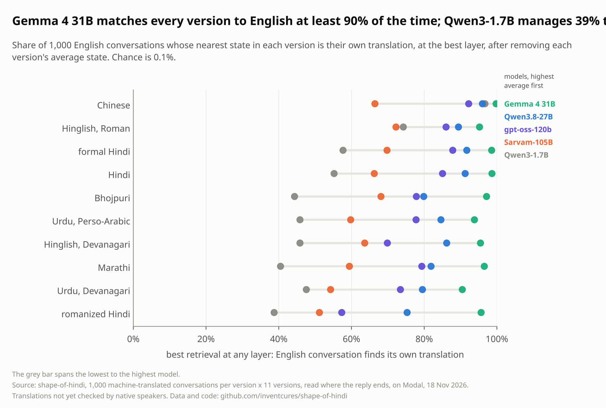
*Gemma 4 matches every version to its English original at least 90% of the time. Qwen3-1.7B manages 39% to 97%.*

Romanized Hindi is the hardest version for four of the five models. Gemma matches it 96% of the time anyway.

### Cheap tokens go with good alignment, but don't guarantee it

The tokenizer is the first thing I suspected. Qwen3-1.7B charges Hindi five tokens for every English one. The others charge 1.3 to 2.1.

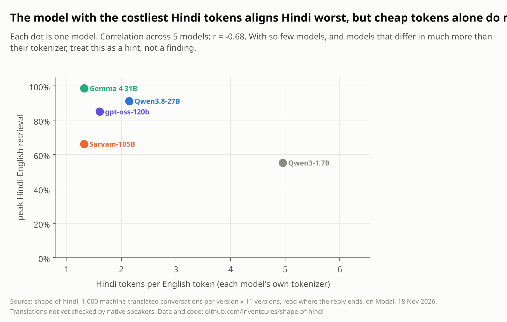
*The model with the costliest Hindi tokens aligns Hindi worst. Sarvam shows that cheap tokens alone are not enough.*

The correlation across the five is −0.68, but Qwen3-1.7B does most of the work, and it is also by far the smallest model. Sarvam charges Hindi exactly what Gemma does, 1.3 tokens, and lines it up with English 66% of the time against Gemma's 99%. So token cost alone doesn't decide alignment. Size, training data and architecture differ too, and five models can't pull those apart.

Cheap tokens do help with one problem I couldn't solve in the small model. In Qwen3-1.7B every Devanagari conversation is about five times longer than its English twin, so length and script move together, and the top directions of the state cloud predict length almost perfectly. In the models with cheaper Hindi tokens, length explains much less.

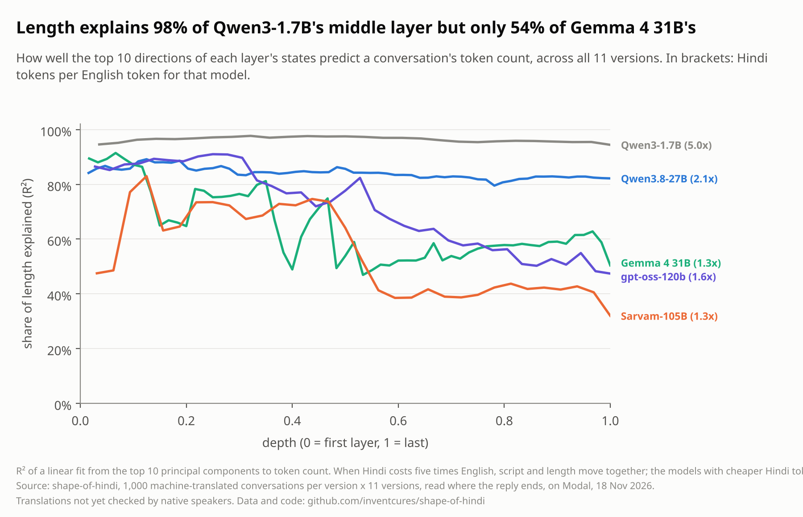
*Length explains 98% of Qwen3-1.7B's middle layer and 54% of Gemma 4's.*

### The script effect was a small-model effect

The headline of the first edition was that changing the alphabet costs as much as changing the language. In Qwen3-1.7B, sharing Hindi's script raises similarity to Hindi by 0.10 at the last layer, and sharing its language raises it by 0.09. I measured both with two controlled pairs. Urdu in Devanagari against Marathi holds the script fixed, and the two Urdus hold the language fixed.

*Only Qwen3-1.7B clearly rewards a shared script and a shared language.*

In the four bigger models neither effect holds up. At the last layer all eight gains land within 0.09 of zero, and six of them are negative. In Gemma, sharing Hindi's language *lowers* similarity by 0.09. I don't trust that sign, because the Urdu translations had the most errors in my spot check and I haven't computed error bars yet. The gap between the small model and the big ones is still clear. Script matters in Qwen3-1.7B and barely matters in the others.

### Bigger models merge the scripts into one cloud

The maps show this best. Each dot is one conversation, flattened onto the two directions that vary most at that layer.

*Qwen3-1.7B splits Hindi by script in its middle layers. Qwen3.8 and Gemma put every script in one cloud.*

In Qwen3-1.7B's middle layer, Hindi in Devanagari, Hindi in Roman letters and Urdu in Perso-Arabic sit on three separate islands. In Qwen3.8 and Gemma they share one cloud, and only English and Chinese stand apart. Then Gemma's last layer splits them again into tight groups, one per script. That fits the idea that the last layer is mostly about the next token, and the next token has to be written in some script.

Here is Gemma's middle layer in 3D.

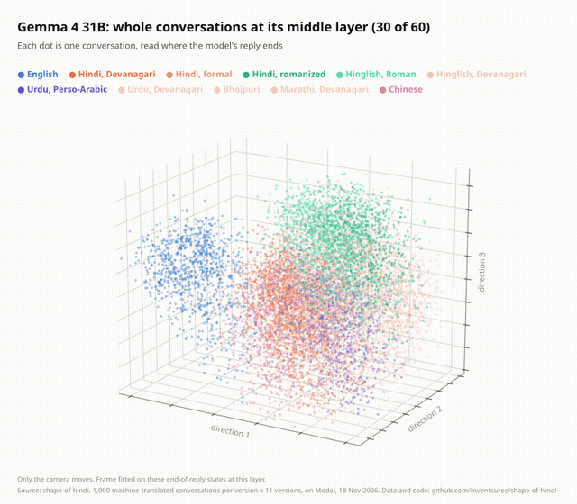
*Gemma 4's middle layer. English sits apart, and every form of Hindi and Urdu shares one cloud.*

### Formal Hindi is always the nearest neighbour

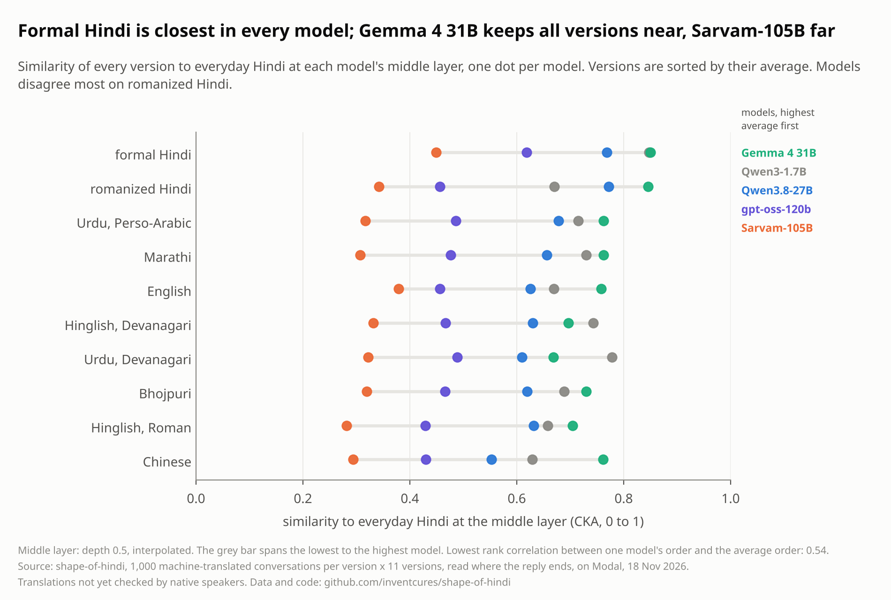
*Formal Hindi sits closest to everyday Hindi in every model. How close everything else sits depends on the model.*

In every model, formal, Sanskrit-heavy Hindi is the version nearest everyday Hindi, though Qwen3.8 and Gemma tie it with romanized Hindi. Past that the order shuffles. Chinese is last or second-to-last in four models, but Gemma puts it level with English and Marathi. The similarity values vary more than the ranking does. Gemma keeps every version between 0.67 and 0.85 in its middle layer, and Sarvam keeps them all between 0.28 and 0.45.

### Romanized Hindi is a loner in some models and a neighbour in others

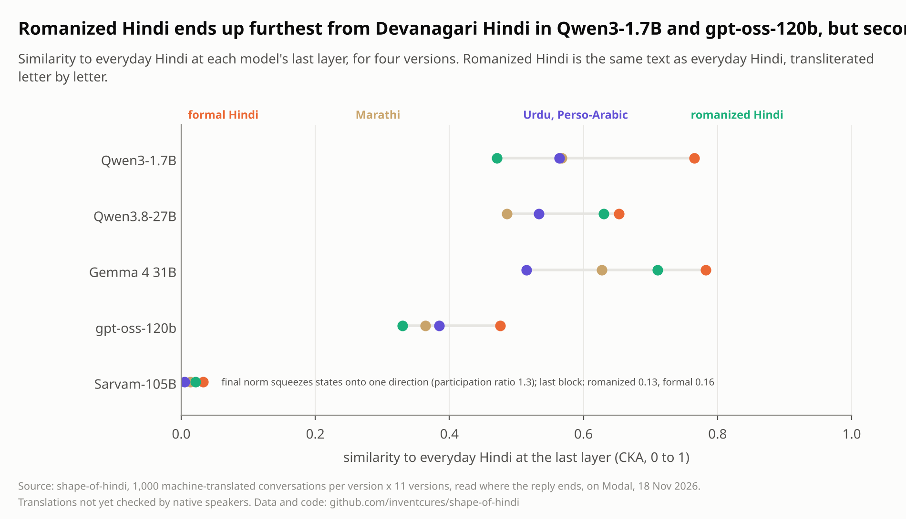
*Each row is a model. Look where the romanized Hindi dot falls in each row.*

In Qwen3-1.7B and gpt-oss, romanized Hindi ends up furthest from the Devanagari Hindi it was copied from. In Qwen3.8 and Gemma it comes second, behind only formal Hindi, at 0.63 and 0.71. My guess is that those two saw far more Hindi typed in Roman letters during training, which is how most people in India actually type it. I can't see their training data, so I can't check.

### Things only one model does

Three results show up in just one model each.

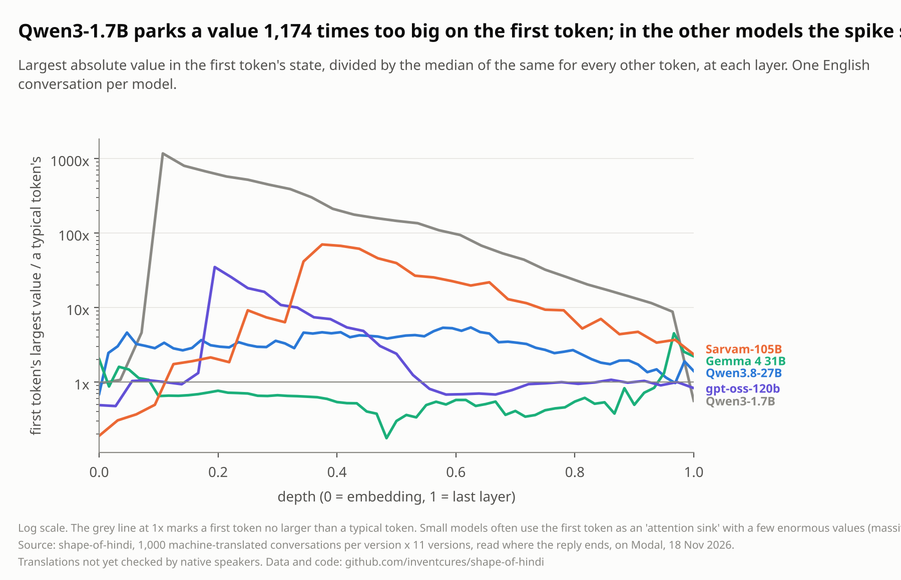
*The vertical axis is on a log scale.*

The huge first-token value I had to cut out of every Qwen3-1.7B map is much smaller in the other models, and Gemma barely has one. Small models are known for this.[^massive]

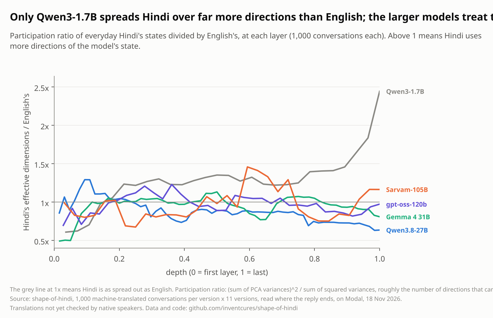
*Above 1, Hindi uses more directions than English. Below 1, fewer.*

In Qwen3-1.7B's last layer, Hindi conversations spread over 2.4 times as many directions as English ones. In the other four models the ratio stays between 0.6 and 1.5. My guess is that a small model has less room for a language it rarely sees.

Sarvam is the strangest of the five. It was built for Indian languages and has one of the cheapest Hindi tokenizers here, yet it keeps every version further from Hindi than any other model does.

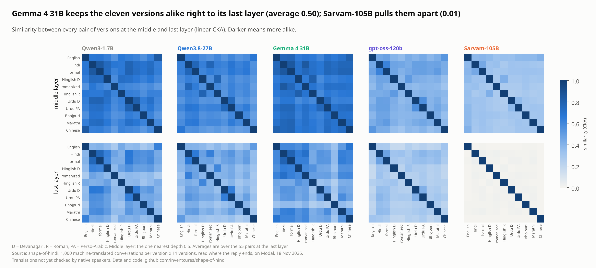
*Darker means more alike. The diagonal compares each version with itself.*

At Sarvam's very last step, the final normalization, every conversation lands on almost the same direction. The participation ratio drops from about 45 to 1.3, and every similarity drops to zero. One block earlier the numbers are low but ordinary, 0.09 to 0.18. A single huge direction like this is a known trap for similarity measures,[^rogue] and I haven't checked whether it comes from the model or from how its custom code returns the last layer. So I draw no conclusions from Sarvam's last layer.

### What holds across all five

Not much, and less than I expected. Every model lines Hindi up with English best somewhere between a fifth and a half of the way in, and less well at the end. Every model puts formal Hindi nearest everyday Hindi. Past that, how well the versions align, whether the script matters and where romanized Hindi lands all change with the model you ask. If I had stopped at Qwen3-1.7B, I would have written a confident essay about scripts that mostly doesn't hold.

## Qwen3-1.7B up close

The rest of the essay looks at the small model in detail, since that is where I started and where I have the most checks. Keep in mind that its script effect and its lonely romanized Hindi did not carry over to the bigger models.

### Hindi and English meet in the middle layers, then part

For each of the 1,000 English conversations, I took the model's state where the reply ends and asked: among the 1,000 Hindi states at the same layer, is the nearest one this conversation's own translation? With raw states the answer is almost never yes, under 6% at every layer. The two languages sit in different places.

Then I subtracted each version's average state, so that only the differences between conversations remain. Now the answer is yes 55% of the time at layer 13. Most of what separated Hindi from English was one shift of the whole cloud.

*Every version rises to a peak in the middle and falls toward the end. Blue: after removing each version's average. Grey: raw.*

Every version has the same shape. Formal Hindi peaks at 58%, Urdu at 46% and 48% in its two scripts, Bhojpuri at 44%, Marathi at 40% and romanized Hindi at 39%. Hinglish in Roman letters peaks early, at 74% by layer 4, because half its words are English to begin with. Chinese reaches 97%, which I find suspicious; I think the Chinese translations were close to word for word, which makes matching easy.

This is what four years of interpretability work predicts. Early layers deal with spelling and script, middle layers hold a shared space for meaning, and late layers convert back into one language's tokens.[^lape][^llamas][^bio] Wendler and colleagues found Llama-2's middle layers decode a Chinese prompt's concept *in English*.[^llamas] Chang, Tu and Bergen found each language sits in a shifted copy of a shared space, so subtracting the averages lines them up.[^geom] The numbers here are the Hindi version of that.

**How to read the 55%.** The pilot found 90% with 20 items. That is not a drop. With 20 candidates, chance is 5% and the nearest wrong answer is usually far away. With 1,000 candidates, chance is 0.1% and there are many near misses. The two numbers answer different questions.

### In this model, the alphabet costs about as much as the language

This is the question Hindi is best placed to answer, because one spoken language comes in two scripts and one script carries several languages. I compared each version's 1,000 states with everyday Hindi's, using linear CKA, which scores 1 when two clouds of points have the same shape and lower as they differ.[^cka]

*Urdu in Devanagari stays closest to Hindi. Marathi and Urdu in its own script tie. Romanized Hindi drifts furthest after layer 10.*

Two pairs in this chart change only one thing.

| Comparison | Held fixed | Changed | Similarity to Hindi, last layer |
|---|---|---|---|
| Urdu in Devanagari vs Marathi | script | language | 0.66 vs 0.57 |
| Urdu in Devanagari vs Urdu in Perso-Arabic | language | script | 0.66 vs 0.56 |

So the closer language buys 0.09, and the shared script buys 0.10. In the middle layers the gaps are smaller, about 0.05 and 0.07 at layer 14, but the pattern holds: Urdu in Devanagari beats Marathi at all 28 layers.

That explains the result I had predicted wrongly. Before running anything, I wrote that Urdu in its own script would sit closer to Hindi than Marathi in the middle layers, because Urdu and Hindi are one spoken language. In the pilot that looked half right. With 1,000 items it is a tie: Urdu is ahead at 8 of 28 layers, all before layer 12, and Marathi is ahead by at most 0.025 after that. Urdu in Perso-Arabic gains for sharing Hindi's language and loses about the same for its alphabet. Marathi does the reverse.

Two cautions. First, the Urdu translations are the weakest in the set, which probably lowers Urdu's numbers a little. Second, I have not yet tested whether 0.09 and 0.10 differ, or computed a floor from shuffled pairs, which needs the full state files. Liu and colleagues found that adding transliterated text raises similarity even between unrelated sentence pairs, so part of any script effect may be a shift that affects every pair.[^liu] Read the two numbers as "about the same size", not as one beating the other.

### Here, romanized Hindi ends up alone

Here is every pair of versions at the last layer.

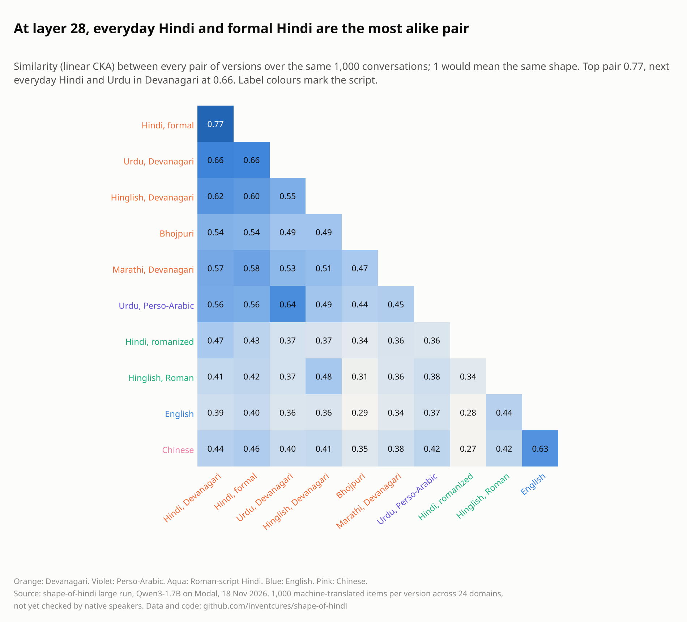
*At the last layer, romanized Hindi scores under 0.5 with every other version, including the Hindi it was transliterated from.*

Everyday and formal Hindi are the closest pair, at 0.77, so a change of register moves the states less than anything else. Romanized Hindi scores 0.47 with the Devanagari Hindi it was copied from letter by letter, and less with everything else. Against English it is further away than Devanagari Hindi at 24 of 28 layers.

I had expected the opposite. Romanized Hindi shares English's alphabet and costs half as many tokens as Devanagari, so I thought it would drift toward English. RomanLens found that some models pass through romanized pieces on their way to writing Devanagari,[^romanlens] which made me think romanized text might be the model's comfortable middle ground. It isn't, at least not in Qwen3-1.7B.

Why might that be? One plausible reason is that there is no standard way to spell Hindi in Roman letters. The same word appears as *nahi*, *nahin* and *nhi*, so the model sees each word in many scattered spellings and never builds one solid representation. Keshava Guha made the same point about readers in a 2015 debate on whether Hindi should switch to Roman script.[^guha] Shoaib Daniyal had argued it should, because Roman Hindi already dominates phones and packaging.[^daniyal] The model, it seems, sides with Guha. That is a guess, not a measurement.

The middle layers are kinder. At layer 14 every version scores 0.51 or more with every other, everyday and formal Hindi reach 0.85, and English and Chinese 0.84.

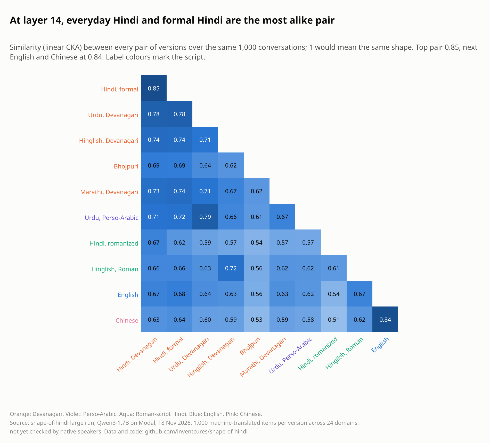
*In the middle layers every pair is more alike, and English and Chinese are as close as two registers of Hindi.*

### The maps show the same story, if you read them carefully

The field note that started this project was a set of rotating 3D clouds.[^op] Here are their Hindi counterparts. First, a warning in the spirit of Distill's guide to misreading t-SNE: these pictures keep only three of 2,048 directions. **Distance between islands is not similarity; the CKA numbers above are.** The maps are for intuition.

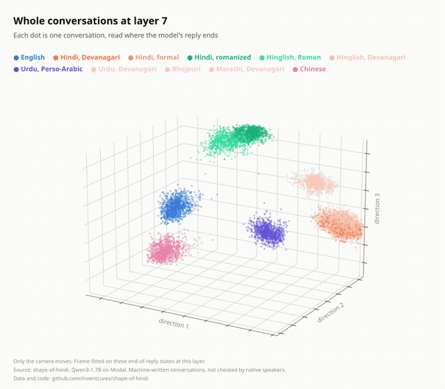
*At layer 7, conversations sort by alphabet into separate islands. Each dot is one conversation.*

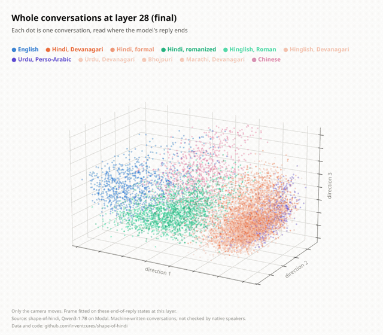
*By the last layer, Urdu has moved into the Devanagari group.*

Spinning clouds are fun to watch and hard to read, so the flat version is the one to trust:

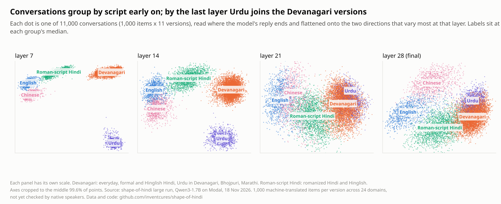
*Script first, language later: Urdu is a separate island at layers 7 and 14 and joins the Devanagari versions by layer 21.*

And every token at the last layer, one version per panel:

*At the last layer all six Devanagari versions cover the same ground, whatever their language.*

The token map says something the conversation maps don't. At the last layer, Bhojpuri, Marathi, formal Hindi and Urdu in Devanagari are almost indistinguishable. That is because the last layer mostly encodes the next token: Qwen3 uses the same matrix to read tokens in and write them out, so the final state is pulled toward whatever character comes next. If the next character is Devanagari, the state lands in the Devanagari region, whatever the language.

### The same question costs five times as many tokens

A language model reads tokens, chunks of text from a fixed vocabulary, and everything about running one is priced in them. Here is one question in eight versions, one box per token in Qwen3's tokenizer:

*English takes 17 tokens; everyday Hindi 66 and formal Hindi 95. Hollow boxes are letters split into raw bytes.*

Across the 1,000 conversations, everyday Hindi costs 4.95 times as many tokens as English. Following Petrov and colleagues, that ratio is just the token count of the Hindi text divided by the token count of the English text with the same meaning, here computed on the totals.[^petrov] The cost has two parts, and one line of arithmetic separates them:

> tokens ratio = bytes ratio × tokens-per-byte ratio

| Version | Bytes vs English | Tokens per byte vs English | Tokens vs English |
|---|---|---|---|
| Chinese | 0.98 | 1.00 | 0.99 |
| Hinglish, Roman | 1.24 | 1.35 | 1.67 |
| Hindi, romanized | 1.27 | 1.68 | 2.13 |
| Urdu, Perso-Arabic | 1.99 | 1.83 | 3.64 |
| Hindi, Devanagari | 2.87 | 1.73 | 4.95 |
| Hindi, formal | 2.99 | 1.71 | 5.14 |

The first column is the script's fault. A Latin letter takes one byte in UTF-8 and a Devanagari letter three, so the Hindi text is 2.87 times as many bytes before any tokenizer touches it. Arnett and colleagues call this the byte premium.[^arnett] The second column is the vocabulary's fault. Qwen3's vocabulary has 151,669 entries; about 70,000 are Latin-letter pieces and only 71 contain a Devanagari letter.

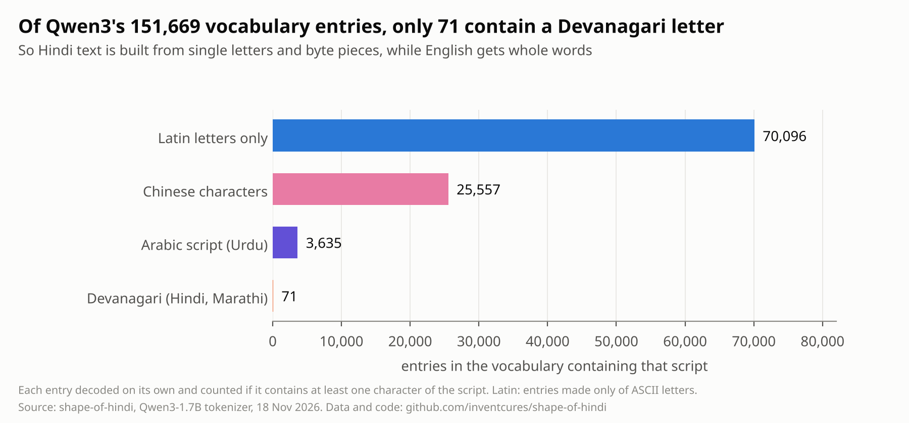
*Only 71 of Qwen3's 151,669 vocabulary entries contain a Devanagari letter.*

So Hindi pays twice: about 2.9 for the script and 1.7 for the vocabulary. Urdu is the cleanest check, because it is nearly the same language. It pays less for bytes, 1.99, since Urdu writes fewer vowels, and slightly more per byte, and ends at 3.64. Chinese shows what a well-stocked vocabulary does: about the same bytes as English and the same tokens.

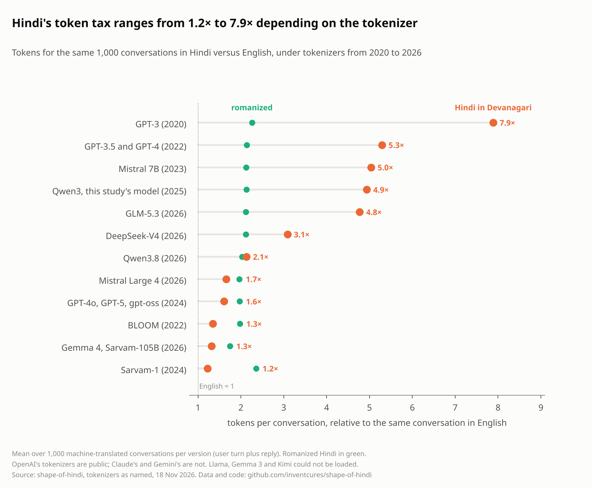
*The same 1,000 conversations cost 7.9 times English under GPT-3's tokenizer and 1.2 times under Sarvam-1's.*

The vocabulary part is a design choice, and many teams have made it. On the same conversations Hindi costs 7.9 times English under GPT-3's tokenizer, 5.3 under GPT-4's, 1.6 under GPT-4o's, 1.3 under Gemma 4's and BLOOM's, and 1.2 under Sarvam-1's. Qwen3, at 4.9, and GLM-5.3, at 4.8, have not caught up. Under the newest tokenizers romanized Hindi costs about twice English, more than Devanagari, so the old advice to type in Roman letters to save tokens has flipped. Here "cost" means token count under one tokenizer, nothing more.

#### What five times means

Using Qwen3's tokenizer and round numbers:

- **Money.** At $0.50 per million output tokens, a service answering a million questions a day with 70-word replies pays about $40 a day in English and $200 in Hindi. That is $15,000 a year against $73,000. With a 1.6 times tokenizer the Hindi bill is about $23,000.
- **Waiting.** At 50 tokens a second, the English reply takes 1.6 seconds and the Hindi one 8.
- **Memory.** A 32,000-token context holds about 540 of our English conversations, at 59 tokens each, and about 110 Hindi ones, at 292.
- **Compute.** A forward pass costs about 2 operations per parameter per token. For 1.7 billion parameters, an English conversation costs about 0.2 trillion operations and a Hindi one about 1 trillion. Attention over long inputs grows with the square of length, so that part grows 25 times.
- **Energy.** Deng and colleagues measured Qwen3-8B, which uses the same tokenizer, on a reading test. Hindi used 0.20 joules per output token against English's 0.10, and 8.5 times the energy in total.[^energy] Five times the tokens at twice the energy per token is ten times, close to their figure.

## How I made the data, and how good it is

An open model, Qwen3-32B, wrote 240 topics across 24 domains, from health and money to farming, law and religion. Half the topics are rooted in Indian life. For each topic it wrote five short exchanges, one per kind of question: explain, how to, feedback on a plan, choose between options, and a personal problem. Then it translated each exchange into seven versions and transliterated three more, so that romanized Hindi, Devanagari Hinglish and Devanagari Urdu each differ from a partner only in script. I kept an item only if all 11 versions passed a script and a length check, which left 1,000 of 1,200. Generation and the full study took 1 hour 52 minutes on rented H100 GPUs.

Then I read 12 random items in every version myself, the way The Pudding admits its counts are "directionally accurate" and says where they are not.

| Version | Items with a meaning error | Example |
|---|---|---|
| Chinese | 0 of 6 | none |
| Hindi, everyday and formal | 1 of 12 | the health scheme Ayushman Bharat became अयोग्य भारत, "unfit India" |
| Hinglish | 2 of 12 | one question changed meaning; one item left in English |
| Marathi | 3 of 12 | an inter-caste marriage became a marriage within one's caste |
| Bhojpuri | 3 of 12 | most items mix Hindi, Bhojpuri and Maithili forms |
| Urdu | 6 of 12 | JEE became "JE six"; a music genre became جنس, sex or gender |

The errors are mostly single words. The script and register, which is what most of the measurements track, were right in every item I read. But read the Urdu results with that 6 in 12 in mind, and read "Bhojpuri" as "a Hindi-like eastern variety". The full tally is in the [data card](https://github.com/inventcures/shape-of-hindi/blob/claude/project-thread-m93dhm/docs/04-data-card.md).

## What could fool these numbers

- **Length and script move together in Qwen3-1.7B.** The top 10 directions of the state cloud predict a conversation's token count with R² of 0.94 to 0.98 at every layer. Every Devanagari version is both five times longer than English and grouped together, so in this model I can't tell length from script. The bigger models, with fairer tokenizers, loosen the tangle to 0.54 to 0.86 in the middle layer, and their script effect disappears with it.
- **The first token.** From layer 3 its largest value is about 1,170 times a typical token's. I dropped it everywhere, or every map would be a picture of that one token.[^massive]
- **Teacher forcing.** The model reads fixed questions and answers. This measures how it represents a text, not what it would write.
- **Five models, one dataset.** The four bigger models differ from Qwen3-1.7B in size, tokenizer, training data and architecture all at once, so I can say what changes but not why.
- **Sarvam's last layer.** Its final normalization squeezes every conversation onto one direction. I haven't checked whether that is the model or its custom loading code, so I leave its last layer out of every conclusion.
- **No error bars yet.** Effects of 0.05 between models may be noise.

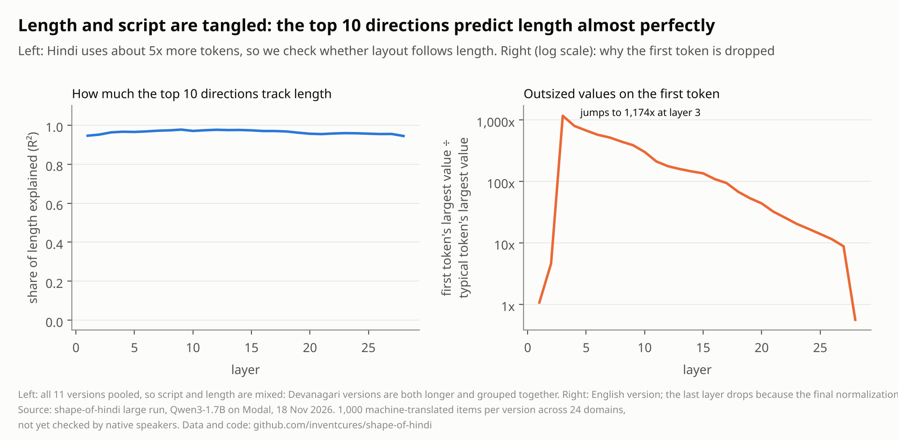
*Length is almost perfectly predictable from the top directions, because script and length are tangled in this model.*

## Where this came from, and the values question

The project started from operator0x's field note, which mapped about a thousand English, Chinese, German, Croatian and Python conversations inside this same model and found Chinese sitting off to one side.[^op] Its Hacker News thread raised good objections: the last layer mostly encodes the next token, length can dominate such maps, and someone suggested Urdu as a natural experiment.[^hn] This study is my attempt to take those objections seriously.

The other starting point was Anthropic's July 2026 finding that Claude leans furthest toward warmth when it replies in Hindi, and furthest toward rigour in Russian.[^vml] If a founder in Jaipur gets gentler feedback on a weak plan than one in Moscow, that is a real difference in the help they get. A 2026 study warns that most of such a gap can come from what people ask about in Hindi rather than from the language itself.[^beacon] With an open model, the next step is to build a warmth direction from English replies, check that it steers, and see where Hindi and English replies to the same request fall along it, and where the pronouns *aap*, *tum* and *tu* fall.

## What I'd do next

1. **Have native speakers check a fixed sample** of the translations, starting with Urdu and Bhojpuri, and rerun with a stronger translator.
2. **Add DeepSeek V4.1 Flash and GLM-5.3** once the transformers library can load them, and check whether Sarvam's last-layer collapse is real.
3. **Put a floor under every chart**, from shuffled pairs, and test whether 0.09 and 0.10 differ, as Moosa and colleagues did for transliterated Indic text.[^moosa]
4. **Follow the Hinglish switch points.** In *kal mera exam hai aur maine abhi tak syllabus complete nahi kiya*, does the state jump toward English at each English word and snap back?

## Check yourself

1. Urdu in Devanagari scores 0.66 with Hindi at the last layer, Urdu in Perso-Arabic 0.56 and Marathi 0.57. Which two numbers isolate the cost of the alphabet, and why do the other two tie?
2. With 20 candidates, chance retrieval is 5%. With 1,000 it is 0.1%. Why would a real 90% with 20 candidates become something much lower with 1,000, even if the model has not changed?
3. Urdu text is 1.99 times as many bytes as English and Hindi 2.87, yet both are almost the same spoken language. Name one reason in the scripts themselves.
4. A tokenizer brings Hindi to 1.6 times English, and the energy per token falls to 1.2 times English's. About how much more energy does a Hindi reply use?
5. Sarvam-105B and Gemma 4 both charge Hindi 1.3 tokens per English token, yet Gemma lines Hindi up with English 99% of the time and Sarvam 66%. What does that pair tell you about the −0.68 correlation between token cost and alignment, and what would you need to test the tokenizer on its own?

*Answers. 1: 0.66 and 0.56, the two Urdus; Urdu in Perso-Arabic pays for its alphabet and Marathi for its language, about equally. 2: with more candidates there are more near misses, so the nearest neighbour is more often a similar but wrong item. 3: Urdu script usually leaves short vowels unwritten, and its letters take two bytes in UTF-8 against Devanagari's three. 4: about 1.6 × 1.2 ≈ 1.9 times. 5: that cheap tokens are not enough, and the correlation leans on one small model. To isolate the tokenizer you'd train or fine-tune the same model with two tokenizers and hold everything else fixed.*

The code, data, results and figures are in the [shape-of-hindi repo](https://github.com/inventcures/shape-of-hindi), with a [guide to rerunning everything](https://github.com/inventcures/shape-of-hindi/blob/claude/project-thread-m93dhm/REPRODUCE.md). The longer [paper (PDF)](/files/shape-of-hindi-new-edition.pdf) has the methods and the full literature.

When the woman in Lucknow types *mera business plan dekh ke batao kaisa hai*, every model I tried files her sentence next to the English one somewhere in its middle layers, and then pulls it away again. How tightly depends on the model. At its best layer Gemma 4 almost never loses the match. Qwen3-1.7B loses it nearly half the time, and if she had typed in Devanagari it would have charged her five times as much to answer.

[^cka]: Kornblith, Norouzi, Lee, Hinton, ["Similarity of neural network representations revisited"](https://arxiv.org/abs/1905.00414) (2019). Linear CKA compares two sets of paired points by the similarity of their inner-product structure, and it behaves sensibly when there are fewer points than dimensions, as here, with 1,000 points in 2,048 dimensions.
[^liu]: Liu et al., ["How transliterations improve crosslingual alignment"](https://arxiv.org/abs/2409.17326) (2024). They measured Hindi–Urdu similarity in encoder models.
[^moosa]: Moosa, Akhter, Habib, ["Does transliteration help multilingual language modeling?"](https://arxiv.org/abs/2201.12501), Findings of EACL 2023.
[^petrov]: Petrov, La Malfa, Torr, Bibi, ["Language model tokenizers introduce unfairness between languages"](https://arxiv.org/abs/2305.15425), NeurIPS 2023.
[^arnett]: Arnett, Chang, Bergen, ["A bit of a problem: measurement disparities in dataset sizes across languages"](https://arxiv.org/abs/2403.00686) (2024). They list Hindi's byte premium over English at 2.37 on their corpus; mine is 2.87 on these conversations.
[^daniyal]: Shoaib Daniyal, ["Why Hindi needs to discard Devanagri and adopt the Roman script"](https://amp.scroll.in/article/748337/scroll_in), Scroll.in, 14 August 2015.
[^guha]: Keshava Guha, [reply to Daniyal](https://scroll.in/article/748592/), Scroll.in, August 2015.
[^op]: operator0x, ["What thousands of conversations look like inside a language model"](https://operator0x.com/field-notes/qwen-conversation-state-space/), field note (November 2026).
[^brief]: Numbers as quoted in a [Hacker News front-page briefing](https://thecontext.dev/en/briefing/) (15 November 2026). I could not load the original page from my research setup.
[^hn]: [Hacker News discussion](https://news.ycombinator.com/item?id=50481321) of the field note (November 2026), 29 comments.
[^vml]: Kearney, Zhang et al., ["Claude's values across models and languages"](https://www.anthropic.com/research/claude-values-models-languages), Anthropic (13 July 2026).
[^wild]: Huang et al., ["Values in the wild"](https://www.anthropic.com/research/values-wild), Anthropic (21 April 2025); [paper](https://arxiv.org/abs/2504.15236) and [dataset](https://huggingface.co/datasets/Anthropic/values-in-the-wild).
[^lape]: Tang et al., ["Language-specific neurons: the key to multilingual capabilities in large language models"](https://arxiv.org/abs/2402.16438), ACL 2024.
[^llamas]: Wendler, Veselovsky, Monea, West, ["Do Llamas work in English? On the latent language of multilingual transformers"](https://arxiv.org/abs/2402.10588), ACL 2024.
[^bio]: Lindsey, Ameisen et al., ["On the biology of a large language model"](https://transformer-circuits.pub/2025/attribution-graphs/biology.html), Transformer Circuits (2025), multilingual circuits section.
[^tongue]: Dumas et al., ["Separating tongue from thought: activation patching reveals language-agnostic concept representations in transformers"](https://arxiv.org/abs/2411.08745), ACL 2025.
[^geom]: Chang, Tu, Bergen, ["The geometry of multilingual language model representations"](https://arxiv.org/abs/2205.10964), EMNLP 2022.
[^neutral]: Libovický, Rosa, Fraser, ["On the language neutrality of pre-trained multilingual representations"](https://arxiv.org/abs/2004.05160), Findings of EMNLP 2020.
[^arith]: Gurgurov et al., ["Language arithmetics: towards systematic language neuron identification and manipulation"](https://arxiv.org/abs/2507.22608), IJCNLP-AACL 2025.
[^romanlens]: Saji et al., ["RomanLens: the role of latent romanization in multilinguality in LLMs"](https://arxiv.org/abs/2502.07424) (2025).
[^latin]: Gurgurov, Saji et al., ["The Latin substrate: how language models represent and mediate script choice"](https://arxiv.org/abs/2605.31363) (2026).
[^energy]: Deng, Shen, Feng, Nwatu, Chung, Chowdhury, Chen, Mihalcea, ["The language–energy divide: measuring energy costs of multilingual LLM inference"](https://aclanthology.org/2026.emnlp-main.2113/), EMNLP 2026. Indian-language figures are from their Table 5, Qwen3-8B on Belebele; the ratios to English are my arithmetic from their totals.
[^tok]: Qwen3-8B, which shares the Qwen3 tokenizer, at 4.75 tokens per Hindi word and 1.26 per English word on FLORES-200, from ["BrahmicTokenizer-131K"](https://arxiv.org/abs/2605.29379) (2026). Romanized Hindi at 0.43 times native-script cost on the Qwen2.5 tokenizer, from Johny, Ghosh, Sam, ["The Indic token tax in 2026"](https://arxiv.org/abs/2611.13058).
[^massive]: Sun et al., ["Massive activations in large language models"](https://arxiv.org/abs/2402.17762) (2024); for Qwen3, Shi et al., ["A single layer to explain them all"](https://arxiv.org/abs/2605.08504), ICML 2026.
[^rogue]: Timkey and van Schijndel, ["All bark and no bite: rogue dimensions in transformer language models obscure representational quality"](https://arxiv.org/abs/2109.04404), EMNLP 2021.
[^specious]: Chari and Pachter, ["The specious art of single-cell genomics"](https://doi.org/10.1371/journal.pcbi.1011288), PLoS Computational Biology (2023).
[^clas]: Gurgurov et al., ["CLaS-Bench: a cross-lingual alignment and steering benchmark"](https://arxiv.org/abs/2601.08331) (2026).
[^beacon]: Sattigeri, ["Extending Beacon to Hindi"](https://arxiv.org/abs/2602.00046) (2026).
[^refusal]: Wang et al., ["Refusal direction is universal across safety-aligned languages"](https://arxiv.org/abs/2505.17306), NeurIPS 2025.
[^haet]: Aswal and Jaiswal, ["Haet Bhasha aur Diskrimineshun: phonetic perturbations in code-mixed Hinglish"](https://arxiv.org/abs/2505.14226) (2025).
