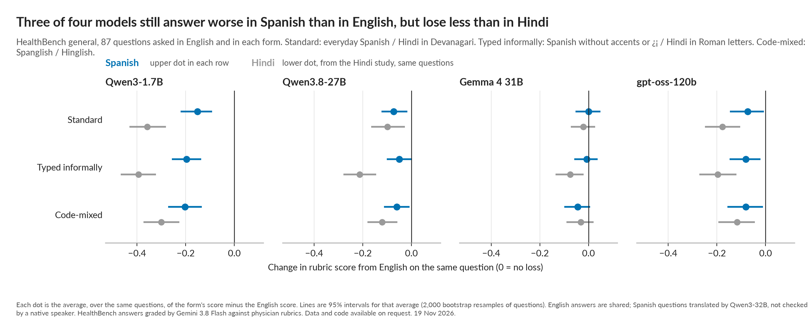
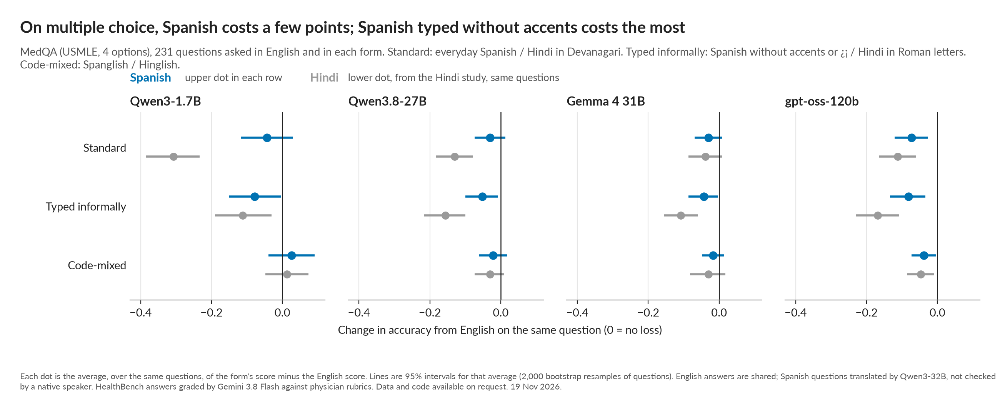
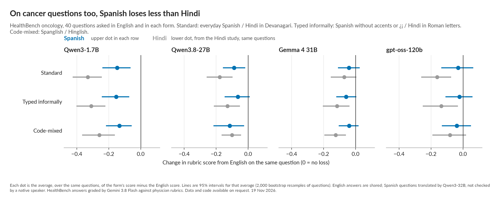
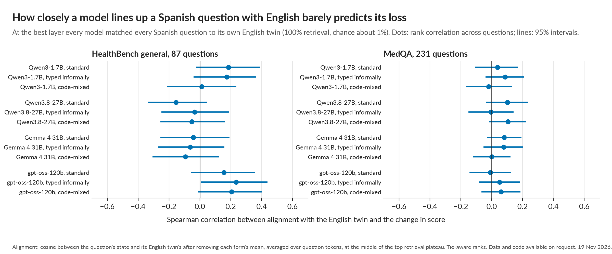

*Draft, 19 November 2026. Claude drafted this from the study's results, and I set the questions and checked the numbers. It reruns [Understood in Hindi, answered worse](/essays/2026/11/health-qa-in-hindi/) in Spanish, on the same questions, with the same models, grader and code.*

A mother in Houston types to a chatbot: *Mi toddler está choking en un small toy, no hay breathing, ¿hago back blows?* My toddler is choking on a small toy and isn't breathing, do I do back blows? The right answer starts with calling emergency services, and what to do next depends on the child's age. In the Hindi study, three of four open models gave worse health advice in Hindi than in English. So I wanted to know whether that's a Hindi problem or a not-English problem.

Spanish is a good test. Hindi is thin in most training data, uses its own script, and many people type it in Roman letters anyway. Spanish is one of the best-covered languages there is, it uses the same alphabet as English, and it still has its own informal and mixed forms. If the models lose as much in Spanish as in Hindi, the Hindi result is about not-English in general. If they lose nothing, it's about how much Hindi they've seen.

## What I found

1. **Three of four models still answer worse in Spanish than in English.** It's the same three as in Hindi. On 87 general HealthBench questions, Qwen3.8-27B and gpt-oss-120b lose 0.05 to 0.08, and Qwen3-1.7B loses 0.15 to 0.20. Gemma 4 31B loses nothing I can tell apart from zero, as in Hindi.
2. **They lose about half as much as in Hindi.** On the same questions, gpt-oss drops 0.07 in Spanish against 0.18 in Devanagari Hindi. Qwen3-1.7B drops 0.15 against 0.36, and doesn't fall to zero. Across the three sets, the Spanish drop is clearly smaller than its Hindi twin in 19 of 36 model and form pairs, and clearly bigger in none.
3. **Spanish typed without accents costs the most on multiple choice.** On 231 MedQA questions, dropping accents and ¿ ¡ costs every model 4 to 8 points of accuracy, with every interval below zero. It's the only form that does that for all four.
4. **Spanglish costs about as much as standard Spanish.** On open questions the two drops are within 0.05 of each other for every model, so mixing in English medical words neither rescues nor sinks the answer. On multiple choice it does a little better than standard Spanish.
5. **Every model knows which question it was asked.** At its best layer, each model matches 100% of the Spanish questions, in all three forms, to their own English twins. Chance is 1% or less.
6. **Representation still barely predicts the answer.** On the general and MedQA sets, the rank correlation between how closely a question lines up with English and how much it loses runs from −0.15 to 0.23, and 23 of 24 intervals include zero.

So the gap isn't only a Hindi problem. A model can know a language well and still give worse advice in it, only by less.

## The setup

Everything is the same as in the Hindi study except the language. I reused its questions, models, decoding settings, grader and analysis code, and its English answers.

**Questions.** I took the English originals of the Hindi study's three sets: 100 general HealthBench questions with physician rubrics, 45 HealthBench questions that mention cancer, and 284 four-option USMLE questions from MedQA. Qwen3-32B, the model that wrote the Hindi forms, wrote the Spanish ones. A question stays in only if it passed my checks in every form. That kept 87 general, 40 cancer and 231 MedQA questions. Most of the drops are Spanglish attempts that came back as plain Spanish three times in a row. All the Hindi comparisons below use the same kept questions.

**Forms.**

| Form | Example (the opening question) | Hindi twin |
|---|---|---|
| Spanish | *mi bebé se está ahogando con un juguete pequeño, no respira, ¿debo darle golpes en la espalda?* | Hindi in Devanagari |
| Typed informally | *mi bebe se esta ahogando con un juguete pequeño, no respira, debo darle golpes en la espalda?* | Hindi in Roman letters |
| Spanglish | *Mi toddler está choking en un small toy, no hay breathing, ¿hago back blows?* | Hinglish |

The informally typed form is the Spanish one with the accents and ¿ ¡ stripped and the letters lowercased, by a fixed rule rather than a model. So the only difference between those two is how they're typed. That's a cleaner test than Hindi had, where a model wrote the romanized form. I kept ñ, because most people keep it.

**Models.** Qwen3-1.7B, Qwen3.8-27B, Gemma 4 31B and gpt-oss-120b, with thinking off or low and greedy decoding, up to 1,536 tokens for HealthBench and 512 for MedQA. I left out Sarvam-105B, which is built for Indian languages.

**Grading.** Gemini 3.8 Flash judged every answer against every rubric item, with the line telling it which languages to expect changed from Hindi to Spanish. Because that line changed, I graded the English answers again with it. Two gradings of the same English answers differ by at most 0.02 on average, with rank correlations of 0.94 to 0.96, so the grader is steady.

**Representation.** The same as before: the residual stream at every layer, averaged over the question's tokens, with each form's average removed. *Retrieval* checks whether a Spanish question's nearest English question is its own twin. *Alignment* is the cosine between them.

## Three models still answer worse

| | English | Spanish | Typed informally | Spanglish |
|---|---|---|---|---|
| Qwen3-1.7B | 0.21 | 0.06 (−0.15) | 0.02 (−0.20) | 0.01 (−0.20) |
| Qwen3.8-27B | **0.52** | 0.45 (−0.07) | **0.47 (−0.05)** | **0.46 (−0.06)** |
| gpt-oss-120b | 0.47 | 0.40 (−0.07) | 0.39 (−0.08) | 0.39 (−0.08) |
| Gemma 4 31B | 0.46 | **0.46 (0.00)** | 0.45 (−0.01) | 0.42 (−0.04) |

*HealthBench score on 87 general questions. The bracket gives the average drop from English on the same question.*

Paired question by question, the drop is clear for Qwen3-1.7B and gpt-oss in all three forms, and for Qwen3.8 in Spanish and Spanglish. Its informal-Spanish interval just touches zero. None of Gemma's three intervals clears zero.

The picture puts each Spanish drop next to the Hindi drop on the same questions. Spanish sits closer to zero almost everywhere. The biggest change is in the informal forms. Romanized Hindi was the worst form for every model, while Spanish typed without accents costs at most 0.05 more than proper Spanish on these open questions, and for Qwen3.8 a little less.

Qwen3-1.7B is the clearest case. In Hindi its answers averaged below zero, which means they tripped more "must not do" items than they met good ones. In Spanish they're poor but positive. It's a small model, and Spanish is far better covered than Hindi in most training data.

## Multiple choice: accents matter

| | English | Spanish | Typed informally | Spanglish |
|---|---|---|---|---|
| Qwen3-1.7B | 45.5% | 41.1% | 37.7% | 48.1% |
| Qwen3.8-27B | 83.1% | 80.1% | 77.9% | 81.0% |
| gpt-oss-120b | **89.2%** | 81.8% | 81.0% | **85.3%** |
| Gemma 4 31B | 85.7% | **82.7%** | **81.4%** | 84.0% |

*MedQA accuracy on 231 four-option questions. Chance is 25%.*

Here the informally typed form is the only one that costs every model, 4 to 8 points, with every interval below zero. That surprised me, because on open questions it cost little extra. My guess is that the models learned medicine from properly accented text. A long exam question with every *á* and *ó* stripped looks less like that text than a short phone message does. I haven't tested this.

gpt-oss loses the most in Spanish, about 7 points. Spanglish costs every model the least, probably because it keeps the English medical terms the questions turn on.

## Cancer questions

| | English | Spanish | Typed informally | Spanglish |
|---|---|---|---|---|
| Qwen3-1.7B | 0.17 | 0.03 (−0.15) | 0.02 (−0.15) | 0.04 (−0.13) |
| Qwen3.8-27B | **0.57** | **0.48 (−0.09)** | **0.50 (−0.06)** | 0.45 (−0.12) |
| gpt-oss-120b | 0.45 | 0.42 (−0.03) | 0.42 (−0.02) | 0.41 (−0.04) |
| Gemma 4 31B | 0.50 | 0.46 (−0.04) | 0.45 (−0.06) | **0.46 (−0.04)** |

*HealthBench score on 40 cancer questions, with the average drop from English in brackets.*

With 40 questions the intervals are about ±0.08, so only the biggest drops are clear: Qwen3-1.7B in every form and Qwen3.8 in Spanish and Spanglish. gpt-oss lost 0.16 on these questions in Devanagari Hindi and loses 0.03 in Spanish.

## Every model knows the question, and it still barely matters

At each model's best layer, 100% of the Spanish questions find their own English twin, in every form and in every set. In Hindi the range was 93 to 100%. So the models match a Spanish question to its English twin at least as reliably as a Hindi one.

And just as in Hindi, a question that lines up closely with its English twin doesn't lose much less than one that lines up loosely. On the general HealthBench questions the rank correlation runs from −0.15 to 0.23, and only gpt-oss on informally typed Spanish clears zero, at 0.23 with an interval of 0.01 to 0.44. On MedQA it runs from −0.02 to 0.10, and none clears zero. On the 40 cancer questions one of 12 clears zero, gpt-oss in Spanglish at 0.31. With 87 questions I could miss a correlation of 0.2, but not a strong one.

## Two controls

I ran the same two controls as in Hindi, on the 87 general questions. Each swaps one step between a Spanish question and its score for an English version.

**Control A asks in Spanish and wants the answer in English.** Qwen3-1.7B and Qwen3.8-27B got every question with one line asking for an English answer, written in the question's own form: *Por favor, responde en inglés.* The English questions got the same line, in English. 93 to 99% of the answers came back in English.

| Asked in | Qwen3.8, original answer | Qwen3.8, answers in English | Qwen3-1.7B, original answer | Qwen3-1.7B, answers in English |
|---|---|---|---|---|
| English | 0.52 | 0.51 | 0.21 | 0.14 |
| Spanish | 0.45 | 0.46 | 0.06 | 0.08 |
| Typed informally | 0.47 | 0.46 | 0.02 | 0.06 |
| Spanglish | 0.46 | 0.48 | 0.01 | 0.10 |

*HealthBench score on 87 general questions. "Original answer" is the main run, where each model answered in the question's own form.*

For Qwen3-1.7B, answering in English recovers 57 to 79% of the gap, every interval clear of zero. Writing Spanish is a big part of its trouble, as writing Hindi was. For Qwen3.8 the Spanish gaps are only 0.05 to 0.07 to begin with, and answering in English leaves them at 0.02 to 0.05. That's too small a gap for 87 questions to say how much is recovered: the intervals run from below zero to above 100%.

**Control B translates the Spanish answers and grades them again.** Qwen3-32B translated the Spanish answers of Qwen3-1.7B, Qwen3.8 and gpt-oss into English, and Gemini graded the translations with the same rubric.

| | English question | Spanish answer | same answer, translated |
|---|---|---|---|
| Qwen3.8, Spanish | 0.52 | 0.45 | 0.45 |
| Qwen3.8, typed informally | | 0.47 | 0.46 |
| Qwen3.8, Spanglish | | 0.46 | 0.45 |
| gpt-oss, Spanish | 0.47 | 0.40 | 0.40 |
| gpt-oss, typed informally | | 0.39 | 0.38 |
| gpt-oss, Spanglish | | 0.39 | 0.36 |

*HealthBench score, same grader and rubric. Qwen3-1.7B scores −0.01 to 0.06 either way.*

Translation never raises a score by more than 0.04 at the top of its 95% interval, in any of the nine model and form pairs, and the English question beats the translation in all nine, though for gpt-oss in Spanish only just. So Gemini isn't marking Spanish down, just as it didn't mark Hindi down. The drop is in the answers.

The two controls cost about $13.50 of GPU time, almost twice what I'd planned, and about $6 to grade.

## What this means

The Hindi study left me with two readings: models answer worse in Hindi because they've seen little Hindi, or they answer worse in any language that isn't English. Spanish says it's some of both. The models have seen plenty of Spanish, they match every Spanish question to its English twin, and three of four still give worse advice, by about half as much as in Hindi.

If I were building a health chatbot for Spanish speakers, I'd still test it in Spanish, and for multiple-choice style checks I'd test the accent-free Spanish people type on their phones. I wouldn't assume a good English score carries over, though it carries over much better than it does to Hindi.

## What I haven't checked

- **No native speaker has read the questions or answers.** Qwen3-32B wrote every Spanish question. It sometimes renders *toddler* as *bebé*, and first aid for a choking baby differs from first aid for a choking toddler.
- **Fewer questions than in Hindi.** Keeping only questions that passed in every form left 87, 40 and 231. Most of the dropped ones are Spanglish attempts that came back as plain Spanish, so the questions that are hardest to code-mix are the ones missing.
- **One grader.** Gemini judged everything. Grading the same English answers twice gives nearly the same scores, but a doctor reading a sample is still the real check.
- **One kind of Spanish.** I asked for neutral Latin American Spanish. Spain's Spanish, or any one country's, might do differently.

## Try it yourself

Before you open the answer: typing Spanish without accents cost nothing extra on open questions but 4 to 8 points on multiple choice. What would you run to tell "long exam text without accents is unfamiliar" apart from "the model misreads specific medical words without their accents"?

One answer

Strip the accents from only the medical words in the exam questions and leave the rest of the text alone, then do the reverse. If stripping only the medical words costs most of the 4 to 8 points, the model misreads those words. If stripping everything else costs as much, the problem is the unfamiliar text as a whole.

Code, questions, answers and grades are available on request. The Spanish run cost about $64 of GPU time on Modal, more than I planned, partly because a restart made one model answer every question twice, and about $18 of grading.
