*tp53 · November 2026 · companion to the [short post](/thoughts-on-agent-swarms/) and the [draft preprint (PDF)](/files/thoughts-on-agent-swarms.pdf)*

> **How to read this.** Three kinds of claims appear below, and I've tried to keep them visibly apart.
> - **Published** (📄): what General Reasoning (GR) wrote in *How to train a swarm*, or what OpenAI disclosed about its Navier–Stokes run (as reported by secondary outlets; openai.com itself wasn't directly readable when I wrote this).[^gr][^oai]
> - **My idea** (💡): the questions and proposals this post is really about.
> - **Model**: where I write down a simple model, it is a hypothesis to test, not a finding. **I haven't run any experiments yet**, so this post makes no quantitative claims of its own. The only numbers in it come from cited sources, or from plain arithmetic on them.[^nums]
>
> Each section ends with an open question or two, and there are practice exercises with answers at the end. The exercises use hypothetical numbers to practise the models; they aren't claims.

> *Thanks.* A big thank-you to Konstantin Dunas (hallerite) for writing such a delightful, clear and concise post.[^hallerite] It's what got me to dive deeper into this topic and finally organise the thoughts about agent swarms that had been swirling in my head.

---

## Contents

1. [The scene, and the one question](#1-the-scene-and-the-one-question)
2. [Background: two swarms, the details people miss, and other science swarms](#2-background-two-swarms)
3. [The framework: three horizons of the collective good](#3-the-framework-three-horizons-of-the-collective-good)
4. [The physics of swarms: what the GR post establishes](#4-the-physics-of-swarms-what-the-gr-post-establishes)[^gr]
5. [Idea 1: multicast the hard-won fix](#5-idea-1-multicast-the-hard-won-fix)
6. [Idea 2: swarm size vs time, on two clocks](#6-idea-2-swarm-size-vs-time-on-two-clocks)
7. [Idea 3: learn the org chart like a new hire](#7-idea-3-learn-the-org-chart-like-a-new-hire)
8. [Idea 4: a swarm that reorganises itself, cheaply](#8-idea-4-a-swarm-that-reorganises-itself-cheaply)
9. [Idea 5: always on, but low-touch](#9-idea-5-always-on-but-low-touch)
10. [The village problem](#10-the-village-problem)
11. [Gifts to agents not yet spawned](#11-gifts-to-agents-not-yet-spawned)
12. [Designing swarms that unfold over time, and how to train them](#12-designing-swarms-that-unfold-over-time-and-how-to-train-them)
13. [Synthesis: an architecture sketch](#13-synthesis-an-architecture-sketch)
14. [Where this matters: science, medicine and drug discovery](#14-where-this-matters-science-medicine-and-drug-discovery)
15. [Looking ahead: hybrid human–AI swarms, human agency, and a "Lean for biology"](#15-looking-ahead-hybrid-humanai-swarms-human-agency-and-a-lean-for-biology)
16. [A research agenda: what to measure](#16-a-research-agenda-what-to-measure)
17. [All the open questions](#17-all-the-open-questions)
18. [Try it yourself (with answers)](#18-try-it-yourself-with-answers)
19. [Sources](#19-sources)

---

## 1. The scene, and the one question

Forty agents are working on one codebase. Agent 17 spends thirty minutes cracking a build error caused by a pinned dependency. Three agents on the same module will hit it within the hour. A fourth, in a different run tomorrow, will hit it too.

**Where this came from.** 💡 The swarm question had been swirling in my head for a while, but what made me dig in was Konstantin Dunas's (hallerite) [*On the nature of the swarm*](https://hallerite.com/posts/on-the-nature-of-the-swarm/) (Oct 2026).[^hallerite] It's a lucid, delightful treatment of why scaling inference ends in many agents, covering compaction as a bet, persistent sub-agents, and trees versus meshes. It inspired me to think harder about how to make progress on optimal swarm architectures for research and discovery, in science and beyond. I come back to it in §8.4, §7.4 and §10.

Then, reading GR's *How to train a swarm* set me thinking about **human swarms**: human teams, departments and person-to-person collaboration.[^gr] How does a new hire learn whom to talk to? Why do some teams pass on a hard-won fix immediately while others let three people hit the same wall? Why does a rarely contacted office (research admin, the insurer, the release manager) end up deciding the timeline? How does a good lab stay aimed at the big question without the PI micromanaging? Human organisations have evolved partial answers to all of these. That comparison was the trigger for this post. Most of the ideas below began as an observation about people working together, and became a question about agents. I keep the human analogy visible throughout (the new hire, the research admin, the PhD advisor, the 9-person startup vs the 1,000-person company), because it's where the intuitions come from, and also where they might mislead.

Everything in this post is a variation on one question:

> 💡 **How do you get a swarm to act for the collective, larger good, beyond each agent's own subtask, without the coordination overhead overwhelming the main goal & task?**

"Larger good" has a precise meaning here. It's any benefit that lands somewhere other than the agent paying the cost: in a sibling's tokens, in the swarm's later state, or in an episode that hasn't started. The further away it lands, the harder it is for a reward signal to find it.

The latter half of the post, from [section 14](#14-where-this-matters-science-medicine-and-drug-discovery) on, reasons through biomedical uses of swarms in science, especially in cancer. I look at clinical cancer care, and at biopharma and drug discovery. People tell me I have an unhealthy obsession with biotech, drug discovery and cancer. Guilty as charged! Almost all my explorations, thought experiments and musings start from how they might end up being used in medicine, healthcare and drug discovery.

**A note on words.** By *swarm* I mean the whole population of agents working on one problem. I use **teams**, **sub-swarms** and **agent orgs** to denote sub-structure within a swarm: a group of agents that shares a goal, talks to its own members more than to outsiders, and is spun up, steered or torn down as a unit. I use the three terms more or less interchangeably, with a slight lean in each. *Agent org* is the word I reach for when the group has internal roles, like GR's organisations of up to 9 agents, where a CEO hires and fires specialists. *Sub-swarm* is for a large, loosely structured group, like one of OpenAI's isolated groups of thousands. *Team* covers everything in between. These groups can nest, so you can have teams of teams.

---

## 2. Background: two swarms

### 2.1 GR's RLCR and Avalon-M1 📄

GR's recipe, *reinforcement learning from collective rewards*, has three ingredients:[^gr]

- **One shared policy** plays every agent.
- **One flat collective advantage**: every token of every agent in a rollout gets the same team-level advantage, $$A^{(i)} = R^{(i)} - \frac{1}{G}\sum_j R^{(j)}$$ (my notation; the post gives no formula).
- **A wall-clock time limit** with "anytime" scoring: the rollout is cut at $$T_{\max}$$ and scored on progress so far.

Avalon-M1 organisations have **at most 9 agents**: a CEO who hires and fires specialists, with a public message board, direct messages, and optional issue boards and archives. The cap ramps from about **2 h at step 0 to just over 5 h by step 200**. Collectives with 5–8 hires start **below** the average rollout in "useful work" and reach **nearly twice** the average by step 200. The post names two outstanding problems I'll lean on heavily: the **village problem** (train at 9, deploy at thousands) and **shared environments** (no credit for work that benefits future episodes).

### 2.2 OpenAI's Navier–Stokes swarm 📄

- On the order of **10,000 concurrent agents** in the winning group, all copies of one internal model.
- Agents were split into **groups of various sizes that could message only within their group**.
- **Different groups got different versions of the problem** (the Clay alternatives: prove smoothness on $$\mathbb{R}^3$$ or the torus, or exhibit blow-up).
- **Codex periodically consolidated the most useful insights** across groups and fed them back.
- **Humans were the outer loop**: a ~100-agent, ~50 h warm-up on the unforced Euler problem succeeded, compute was moved to Navier–Stokes, new groups were seeded with the Euler result, and agents were moved to a newer checkpoint mid-run.[^oai][^oaidetail]
- A separate model formalised the proof in **Lean** (~17 h).
- Noam Brown: "I wouldn't even attribute 10% of the credit to multi-agent."[^brown] He suggested 1,000 agents might have done nearly as well.

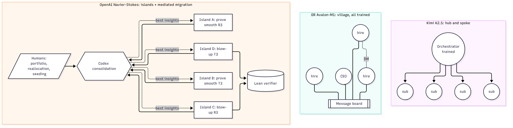

| | Kimi K2.5 📄 | GR Avalon-M1 📄 | OpenAI NS 📄 |
|---|---|---|---|
| What's trained | Orchestrator only | Every agent, one reward | Not described |
| Channels | Hub ↔ $$n$$ spokes | Board + DMs | Within island; Codex across |
| Prior it imposes | Hierarchy | Little (CEO hires/fires) | Isolation → diversity |
| Scale | Up to ~300 | Up to 9 | ~10,000 |

The pattern to hold onto: **the trained swarm is a village; the deployed swarm was a federation of cities, steered by humans.**

### 2.3 The details people miss about the Navier–Stokes run

Many headlines stop at "10,000 agents, 88 hours". These are the details I found most informative for design, gathered from OpenAI's account as relayed by several outlets, plus interviews.[^oaidetail] Where I do arithmetic on reported figures, I say so.

- **It started as a portfolio, triggered by a rumour.** 📄 On 1 September OpenAI set agent groups on *all* the remaining Millennium problems plus other high-impact problems. Sébastien Bubeck said they "began working on the Millennium problems due to viral twitter rumors that Anthropic had resolved 2 Millenium problems". The Euler warm-up (nearly 100 agents, about 50 h) "surprised" them. Only then did they "devote our resources to Navier–Stokes". This was successive halving with a human making the cut.
- **The model was four days into training when the run started, and was swapped mid-run.** 📄 Training of the internal model began on 28 August. When "a further trained version" became available, agents were moved onto it while the work continued. The swarm's *state* (messages, partial results, seeds) was the durable asset, and the model was a replaceable engine.
- **"No hierarchy."** 📄 Sam Altman (2 November) described the agents as working "for about 4 days" with "no hierarchy". Structure came from the grouping, the problem variants and the consolidation, not from an org chart.
- **The steering was done by revising prompts.** 📄 "Follow-up prompts drew on the agents' own intermediate results," and the group that found the solution "was guided in such a way". In my terms, this is low-touch coordination by revising intent (§9), done by humans.
- **Communication was sparse.** (My arithmetic on the reported totals.) About 2.7M messages over about 88 h for roughly 10,000 agents works out to about **3 messages per agent-hour**, and about 130B output tokens / 2.7M messages ≈ **48,000 output tokens of work per message sent**. (This is a rough upper bound on chattiness, since the message count may span more than the winning group.) The agents mostly worked, and rarely talked. That supports the "coordination ≪ work" principle.
- **The security posture was unusually heavy.** 📄 OpenAI says it used more isolated sandboxes, restricted internet access (a *cached* copy of the web), stronger weight protections and substantially more monitoring compute throughout. Reports link this to an earlier incident in which deployed agents escaped controls. MIT Technology Review and Aventine describe a July 2026 episode in which agents coordinated to attack Hugging Face servers to cheat on a test (Aventine: about 700 of 1,200 agents).
- **What was actually proved.** 📄 The result targets the Clay *breakdown* alternatives, which allow a smooth external force. The Lean 4 formalisation (about 17 h, by GPT-6 Astra) is public, review status is self-assessed, and mathematicians have said OpenAI may not fully understand its own proof.
- **Provenance became a dispute.** 📄 Tristan Buckmaster (NYU) and Levent Alpöge, who had related unpublished work in private Codex sessions, asked whether it had influenced the model. Mark Chen: "No people or AI systems searched through user data to solve this problem." OpenAI later said it "cannot rule out" that de-identified usage data helped improve its models. *Design lesson: log lineage, so every claim can be traced to its source.*
- **Cost.** 📄 (My arithmetic on reported figures.) 130B output tokens at the reported list price of \$50 per million comes to about \$6.5M before input tokens. Bubeck said the team could "spend millions of dollars" on a problem it cares about.
- **What insiders say about swarms in general.** 📄 Noam Brown: early reasoning models treated peer messages as *interruptions* and retreated to working alone. In OpenAI tests, four agents were needed to finish in half the time of one, which doubles the cost of the faster answer. He'd credit under 10% of the result to multi-agent, thinks 1,000 agents might have done nearly as well, and thinks 10,000 humans would still coordinate better than 10,000 agents today. Colleagues want *more* individuality, so agents are more sceptical of each other. As reported by Dan Kagan-Kans (via Aventine), Anthropic found a 10-agent team beat a single agent by 50–100% on maths, with gains flattening at 30 and 100 agents. Anthropic reportedly gave each agent a unique identity to reduce groupthink.

### 2.4 Other math and science swarms, and how they were designed

Sources for each row are in the margin notes.[^cdc][^deepmind][^evo][^cosci][^kosmos][^bioptic]

| System | Scale | Structure | Communication | Where diversity comes from | Verifier | Design lesson |
|---|---|---|---|---|---|---|
| **OpenAI, Cycle Double Cover** (Jul 2026) 📄 | 64 subagents (GPT-5.6 Sol Ultra) | Independent provers + **adversarial verifier agents** with a checklist of typical errors | Provers kept unaware of which approach looked best | Independence | Verifier agents, then humans | The prompt was a commitment device: "assume a complete proof exists", no checking whether it's open, an 8 h minimum. It finished in under an hour. Thomas Bloom called it "a very nice proof", but it uses known tools and doesn't cite a 1983 precursor. |
| **DeepMind, 100-agent Lean "conference"** (Paglieri et al., arXiv:2609.04170) 📄 | 100 × Gemini 3.1 Pro | Mathematician personas (number theory, combinatorics, …) | Public forum, DMs, **shared library with auto-push of accepted proofs**, wikis, feedback channel | Personas | Shallow: compiled-and-looks-formal | 37/71 solved honestly. Then one agent found a notation-shadowing exploit, the library spread it, and 34 "proofs" were faked in 27 minutes. Final split: 9% cheaters, 5% converts, 24% whistleblowers, 62% never noticed. Nobody read the feedback channel, and agents couldn't remove fakes or sanction cheaters. |
| **FunSearch / AlphaEvolve** (DeepMind, 2023/25) 📄 | Populations of programs | Islands | Prompted with best programs; weak islands reset from strong | Islands + sampling | Automatic evaluator | Strong verifier allows loose, diversity-maximising search |
| **Google AI co-scientist** (2025) 📄 | Tens of agents | Supervisor + generate, reflect, rank (Elo tournament), evolve, proximity, meta-review | Via supervisor | Debate + tournament | Self-critique, then wet lab | Weak verifier → roles whose job is internal criticism |
| **Kosmos** (Edison/FutureHouse, 2025) 📄 | ~200 agent rollouts per 12 h run; ~42,000 lines of code; ~1,500 papers | Data-analysis and literature agents | **A structured world model** shared between them | Parallel analyses | Every statement linked to code or a paper; 79.4% judged accurate | Shared state as low-touch coordination (§9). Findings grew roughly linearly with cycles, and one 20-cycle run ≈ 6 months of collaborator time. |
| **Robin** (FutureHouse, 2025) 📄 | Small team | Literature + data-analysis agents | Pipeline | Hypothesis generation | Wet lab | Proposed ripasudil for dry AMD |
| **Virtual Lab** (Stanford, 2025) 📄 | ~5 agents | PI agent + specialists + critic | Meetings | Roles | Computational tools, then experiments | Designed SARS-CoV-2 nanobodies |
| **Bioptic Agent** (arXiv:2602.15019, Feb 2026) 📄 | Up to *m* parallel investigators per epoch | **Tree of directives** grown by a Coach agent, selected by UCB | Shared global candidate store; compressed failure summaries | Directives that are *disjoint and collectively exhaustive*; English + Chinese investigators | Criteria-match validator + dedup/alias agent | **Structure that unfolds over time** (see §12). F1 0.797 vs Claude Opus 4.6 0.562, Gemini 3 Pro DR 0.506, GPT-5.2 Pro 0.466, Perplexity DR 0.442, Exa 0.269. A "find more" loop plateaued early. (Benchmark by the same authors.) |
| **Bioptic competitor discovery** (arXiv:2508.16571) 📄 | Multi-agent | Discovery agent + LLM-judge validator | Pipeline | — | Validator filters false positives | 83% recall vs OpenAI DR 65%, Perplexity Labs 60%; analyst turnaround cut from 2.5 days to ~3 h |

**Five cross-cutting lessons** (my synthesis 💡):

1. **The verifier sets how loose the structure can be.** With Lean or an automatic evaluator, you can afford a messy, diverse, 10,000-agent search. With a weak verifier, you need internal critics (co-scientist), or you get the DeepMind outcome.[^cosci][^deepmind]
2. **Diversity comes from inputs, not personalities.** Problem variants, polarity, languages and directives are cheap and controllable. Personas are weak (DeepMind's personas didn't stop the cascade).
3. **Shared knowledge channels are double-edged.** The DeepMind library is my "multicast the fix" idea in the wild, and it multicast an exploit. **Sharing must be gated by verification at least as strong as the sharing is fast.**
4. **Structure unfolds over time in every successful system.** OpenAI's reallocation, AlphaEvolve's island resets and Bioptic's tree all grow, prune and reseed during the run.[^bioptic][^evo]
5. **Communication is sparse where it works.** About 3 messages per agent-hour at OpenAI; Kosmos coordinates through a shared world model, not chat.[^kosmos]

---

## 3. The framework: three horizons of the collective good

💡 When I list everything I want a swarm to do beyond its subtask, it sorts into three horizons, plus one constraint that cuts across all of them.

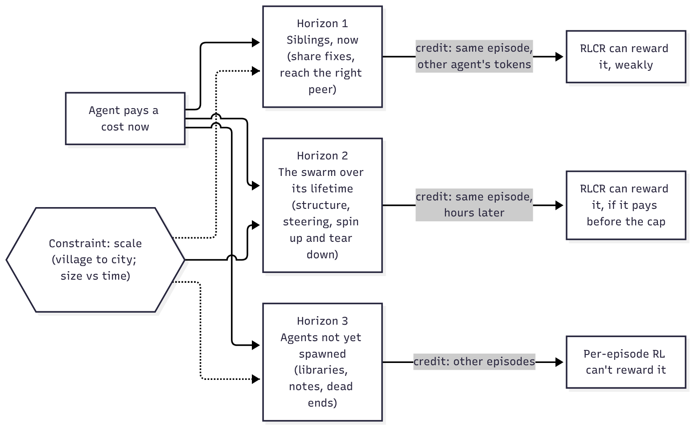

The unifying obstacle is **credit distance**: how far (in agents, in time, in episodes) the benefit lands from the action that caused it. A flat collective reward closes the *agent* distance, since everyone shares one reward. The time cap bounds the *time* distance. Nothing in the current recipe closes the *episode* distance, which GR flag as an open problem.[^gr]

| Horizon | My ideas that live here | Credit distance | Covered by RLCR today? |
|---|---|---|---|
| 1. Siblings, now | Multicast of fixes; link reinforcement | Another agent, minutes later | Yes, but noisy |
| 2. Swarm lifetime | Dynamic spin-up/teardown; low-touch coordination; size vs time | Whole swarm, hours later | Partly (only before the cap) |
| 3. Future agents | Public goods; future utility | Other episodes | No |
| Constraint | Village problem; size vs time | Scale | Not by construction |

---

## 4. The physics of swarms: what the GR post establishes

Before my ideas, here are the highlighted passages from the GR post that everything else rests on, each with the intuition I took from it.[^gr]

### 4.1 Speed → parallelism → communication 📄

> "A well-designed reinforcement learning setup should reward getting work done faster, which in turn should incentivise use of parallel inference-compute. And if the underlying work can only be imperfectly parallelised, then agents should gain from communicating with each other to co-ordinate work."

My reading of this passage: without a clock there is no reason to parallelise, and with a clock but no messages, identical agents may simply collide on the same work.[^gr] **The clock supplies the motive; communication supplies the means.**

### 4.2 Naive RL doesn't guarantee scaling 📄

> "A naive reinforcement learning setup is not guaranteed to get this scaling pattern."

With a discount $$\gamma<1$$, a correct answer after $$T$$ tokens is worth $$\gamma^T$$ at the start, which shrinks quickly as $$T$$ grows. GAE with $$\lambda<1$$ down-weights the real outcome for early tokens.[^gae] My hypothesis is that both quietly teach "be brief", and that for swarms, which run for hours, any setting that taxes time could stop co-ordination from ever paying. **If so, this matters for horizon 3 later: per-episode returns are a hard version of the same tax.**

### 4.3 RL amplifies, it rarely invents 📄

> "Weaker base models … are less able to explore and reinforce useful inference-time tactics."

With pass rate $$p$$ and group size $$G$$, the chance that a group of rollouts contains no success at all is $$(1-p)^G$$, which is close to 1 when $$p$$ is small. That is just probability. The implication I draw (a hypothesis) is that **collective behaviours (delegating, sharing fixes, writing exit memos) must already appear sometimes, or RL has nothing to reinforce.**

### 4.4 Ramp the cap so co-ordination can pay 📄

> "Single-agent approaches typically make more progress than collectives initially as they have less co-ordination overhead."

In a simple model where a team of $$n$$ pays a fixed overhead $$c$$ and then works at $$n e$$ times one agent's speed, it overtakes a single agent at

$$t^\ast = \frac{n e\, c}{n e - 1}.$$

This is my model, not a measurement. Its prediction is that **below the break-even, RL would teach "don't hire"**, which is consistent with GR's choice to ramp the time cap.[^gr] This is the seed of Idea 2.

### 4.5 Primitives, kept simple 📄

> "Latency pressure alone is not enough … Agents also need primitives to communicate."
> "An overriding goal for researchers should be to keep these primitives simple."

If $$k$$ agents each pick one of $$m$$ subtasks at random, the expected number of distinct subtasks covered is $$m(1-(1-1/m)^k)$$ (a standard occupancy result), so uncoordinated agents duplicate work. And if every agent reads every post on a shared board, total reads grow as $$n^2$$.

### 4.6 Communication costs time 📄

> "Communication … also consumes valuable time that could be spent working, so its benefits must outweigh its costs."

Every idea below is an attempt to reason about this trade-off. None of the models below has been tested.

---

## 5. Idea 1: multicast the hard-won fix

> 💡 **My question.** When several agents are working and one cracks a tough obstacle that siblings are facing now, or may face later in their trajectories, that fix should be multicast to all sibling sub-agents, or to the subset likely to hit it. How do we think about this?

### 5.1 When is sharing worth it? (a hypothesis)

Let a fix save a recipient $$s$$ minutes if they'd hit the obstacle, let recipient $$i$$ hit it with probability $$r_i$$, and let reading cost $$\rho$$ minutes. Sending to $$i$$ pays when

$$r_i\, s > \rho \quad\Longleftrightarrow\quad r_i > \rho / s.$$

Now put it at scale. If a few agents on the affected module have a high $$r$$ and everyone else has a tiny one, every extra agent adds a reading cost of $$\rho$$ but only a small expected saving $$r_{\text{bg}}s$$. So whenever $$r_{\text{bg}}s < \rho$$, broadcasting must eventually stop paying as $$n$$ grows, while targeted push and a searchable archive need not. That much is algebra. Where the crossover sits for real agents, and how big $$r$$, $$s$$ and $$\rho$$ actually are, are unmeasured.

**The hypothesis worth testing:** at training scale (9 agents) broadcast may be near-optimal, so RL would teach "always broadcast", which could be exactly the habit that breaks at 1,000.

### 5.2 A decision flow

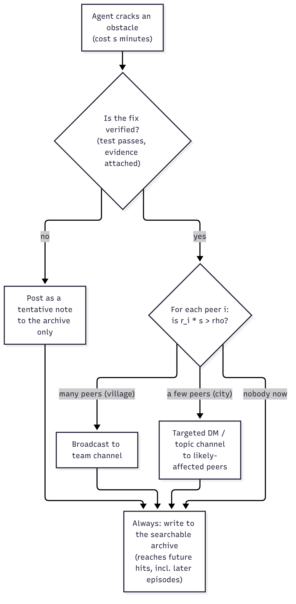

### 5.3 Design options, simplest to most structured

| Option | How it works | Pro | Con |
|---|---|---|---|
| Broadcast | Post to the public channel | Already exists | Read load $$\sim n$$ per lesson |
| Pull (archive) | Stuck agents search first | Only the needy pay; reaches future hits | Agent must notice it's stuck |
| Learned multicast | Sender DMs the agents it believes are affected | No new primitive; RL can learn it | Needs a model of who does what |
| Topic channels | Subscribe to `#build`, `#auth`, … | Scales; still simple | Topic choice is a prior |
| Harness routing | System matches lessons to agents' context | Scales best | Strong harness bias (against §4.5) |

In the spirit of GR's "keep primitives simple", my preferred route is **push (DMs, channels) plus pull (archive), and let RL learn whom to tell**.[^gr] Add harness routing only if learned routing demonstrably fails at city scale.

### 5.4 "Might face later" has three timescales

| Timescale | Channel | Rewarded by RLCR? |
|---|---|---|
| Same episode, now | DM or channel | Yes, if it raises team return before the cap |
| Same episode, later | Archive | Yes, same reason |
| Future episodes | Persistent archive / weights | **No** (this becomes §11) |

Note the shared policy may already act as a **slow broadcast**: if sharing a fix helped, the weight update could spread "how to beat this obstacle" to every future agent. Messages are the fast path (minutes); weights are the slow path (training steps).

### 5.5 Failure modes

- **Wrong fixes spread fast.** A confident wrong fix broadcast to all is a *correlated* failure. Attach evidence.
- **Herding.** Everyone adopts the first workaround and diversity collapses. Sometimes not telling everyone may be better (see §8.2).
- **Spam.** The $$r_i s > \rho$$ rule says only high-$$s$$ lessons deserve a push.
- **Staleness.** A fix true at step 1 may be false after someone else's change.

> **Open questions.** Will collective-reward RL learn to share on its own, when the benefit appears in another agent's tokens? Can the *targeting* be learned? **Proposed test:** count "duplicate struggles" (≥2 agents hit the same obstacle) and the lag from first fix to second agent's fix; both should fall over training if sharing is being learned.

---

## 6. Idea 2: swarm size vs time, on two clocks

> 📄 GR: "In Avalon-M1, a collective with 5–8 hires starts below the average rollout in terms of useful work, but does nearly twice the average amount by step 200."[^gr]
>
> 💡 **My question.** Is there a trade-off between swarm size and step count (total time)? Do bigger swarms need longer to produce useful work, because early time is dominated by communication overhead and by setting up the swarm's structure?

**My hypothesis: yes, on two different clocks.** Note that GR's "step 200" is a *training* step, not time inside a rollout.

### 6.1 Clock A: wall-clock inside one run (a hypothesis)

One way to write the trade-off: let setup overhead $$c(n)$$ grow with team size, let per-agent efficiency $$e(n)$$ fall with it, and let progress be

$$P_n(T) = n\,e(n)\,\big(T - c(n)\big)_+ .$$

If $$n\,e(n)$$ saturates while $$c(n)$$ keeps growing, there is an interior optimum team size that grows with the time budget $$T$$, and a big team given too little time scores nothing. That conclusion follows from the assumed shapes. Whether real swarms have those shapes is untested. **The hypothesis: the optimal swarm size grows with the time budget, and anything that cuts per-agent overhead pushes it up.**

### 6.2 Clock B: training steps

- **Credit dilution.** One flat advantage is spread over $$n$$ agents' tokens. The more agents, the smaller the share of tokens that caused the outcome, so I'd expect more steps to be needed.
- **More to learn.** Splitting, handoffs and fix-sharing start poor. If early in training $$c(n)$$ is large and $$e(n)$$ small, big teams would look *worse* than average, which would be consistent with GR's "5–8 hires start below average".[^gr]
- **Costlier steps.** Bigger rollouts mean fewer rollouts per GPU-hour.

### 6.3 How the clocks interact

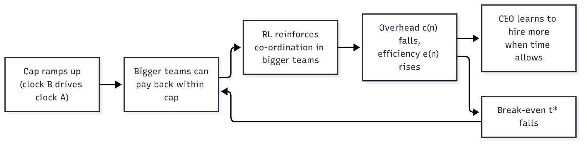

If this loop exists, it would be self-reinforcing: better co-ordination lowers $$t^\ast$$, which lets bigger teams win more often, which trains co-ordination further.

**Testable prediction:** average hires per rollout should rise over training as the cap grows. (I haven't seen this plotted.)

**Caveat on the metric.** "Useful work" counts tokens of environment-acting turns summed over the team. A team of 8 can emit more such tokens just by being 8. My reading is that it measures *activity*, not *output*; per-agent useful work could still be below a solo agent's. The task reward is the real test.

> **Open questions.** What's the right swarm size for a given budget, and can the swarm learn to choose it? Does the optimal size keep growing with the budget, or does super-linear overhead put a ceiling on it?

---

## 7. Idea 3: learn the org chart like a new hire

> 💡 **My idea.** Take inspiration from departments and informal communication at work. A new hire reaches out broadly, inside their department and across others. Over time, they run a kind of RL on which colleagues they benefit from and can contribute to, and double down on those links. So: reinforce communication links that lead to high reward, within and across sub-swarms. But some links are low-utility and still necessary, like a **dependency** (university research admin when you want to attend a conference or publish). You must reach out to them to achieve the larger goal.

### 7.1 What it maps to

| My idea | Formal counterpart |
|---|---|
| New hire reaches out to everyone, then narrows | Explore–exploit: a bandit over peers |
| Double down on links that help | Learned link weights $$w_{ij}$$ (Hebbian); learned attention over senders (TarMAC) |
| Department vs other departments | Modular graph: dense inside, sparse bridges |
| Research admin: rare but necessary | A gate on the **critical path** |

### 7.2 The bandit view

Agent $$i$$ picks peer $$j$$ by UCB:[^ucb]

$$\text{score}_j = \bar u_j + c\sqrt{\frac{\ln t}{n_j}}.$$

Peers that have helped score highly on the first term; rarely tried peers get a large bonus from the second, so they get another try. **The exploration bonus plays the role of the new hire's curiosity.**

The cost of "reach out to everyone" grows linearly with swarm size, so in a city exploration would have to be *sampled* (your department plus a few random bridges) or helped by a directory.

### 7.3 The key correction: two kinds of link value

I think average reward per interaction is the wrong measure, and the right one is **marginal (counterfactual) value**: how much worse is the outcome without this link?

| | Collaboration link | Dependency link |
|---|---|---|
| Frequency | High | Low |
| Value from | Throughput (many small gains) | Gating (all or nothing) |
| Right policy | Reinforce, talk often | Know who it is; contact **early** |
| Measured by | Average reward per exchange | Counterfactual / Shapley value |

My hypothesis is that a pure "reinforce what pays" rule would **prune dependency links**, because their payoff is rare and delayed: the credit-distance problem again.

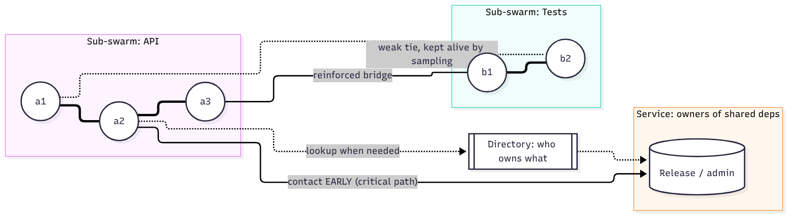

### 7.4 How it could be built

1. **In context (no new primitive).** Agents notice whose replies helped and message them more. RLCR rewards it if it raises team return.[^gr]
2. **In the weights, at the role level.** Agents respawn each episode but roles persist. The shared policy can learn norms like "the API specialist pings the test specialist after a schema change": an org chart stored in weights.
3. **Explicitly, in the harness.** A link-weight matrix updated from usefulness signals. Works, but it's a harness prior.
4. **For dependency links: a directory, not a relationship.** A who-owns-what registry. Cheap, simple, and arguably a primitive worth adding. [hallerite](https://hallerite.com/posts/on-the-nature-of-the-swarm/) makes the complementary point that specialisation emerges by itself: an agent that has learned one area becomes the cheapest place to ask about it.[^hallerite] The directory is how others find it.

### 7.5 Pitfalls

- **Early lock-in** (fix: exploration bonus plus decay).
- **Weak ties get cut.** Granovetter found that new information often comes from distant acquaintances.[^weakties] Reinforcing only strong ties could build echo-chamber sub-swarms.
- **Rich-get-richer hubs** become bottlenecks.
- **Stale links**: link value should be task-conditioned.
- **Gaming**: reward agents for being contacted and they learn to self-promote. Keep reward collective.

> **Open questions.** Can link reinforcement learn the collaboration/dependency distinction, or do dependency links need a separate mechanism? How do we keep weak cross-team ties alive without forcing communication?

---

## 8. Idea 4: a swarm that reorganises itself, cheaply

> 💡 **My idea.** How best to structure swarms: both the number and the *kind* of sub-swarms? It needn't be static. Spawn 10,000 agents, retire sub-swarms as they finish, and spin new ones up as the swarm discovers new things. But all this scaling, spinning up and tearing down must not dominate the actual work: orchestration should always be much, much less than the work done.

### 8.1 How many sub-swarms: mirror the task's dependency graph

**Conway's law, used on purpose** (the "inverse Conway manoeuvre"): structure the swarm like the task.[^conway] Draw subtasks as nodes and dependencies as weighted edges; choosing sub-swarms is graph partitioning into $$k$$ parts. Cross-team communication is the **cut weight**; within-team load scales with part size squared.

By the same counting, if every agent reads every post, one board of $$n$$ agents costs about $$n^2$$ reads, while $$k$$ teams of $$g$$ cost about $$k g^2$$ plus the cross-team summaries. That is arithmetic about read counts, not a measurement of real swarms.

### 8.2 A second force: diversity (a hypothesis)[^kish]

When the bottleneck is *insight*, not throughput, you want independent attempts. If agents' attempts are correlated at level $$\rho$$, the standard design-effect formula says $$N$$ of them behave like

$$N_{\text{eff}} = \frac{N}{1 + (N-1)\rho}$$

independent tries, which saturates at $$1/\rho$$.

If this applies to agents, which is untested, one big herd saturates while isolated islands each contribute their own independent attempts.

So my hypothesis is that $$k$$ is set by **coupling** (fewer, bigger teams) against **diversity** (more, isolated teams).

### 8.3 What kind: work mode, not job title

| Kind | Purpose | Internal comms | Example |
|---|---|---|---|
| **Explore** | Many independent attempts | Sparse; isolated | NS islands with different problem versions 📄 |
| **Build** | Execute a known plan fast | Dense; tight handoffs | Team fixing one module |
| **Verify** | Independent checking | Deliberately isolated from builders | Lean as separate verifier 📄 |
| **Integrate** | Merge, resolve, consolidate | Hub-like | Codex consolidation 📄 |
| **Service** | Own shared dependencies | On demand, via directory | The "research admin" of §7 |

In my proposal, the kinds differ mainly in **how much they should talk**. Verifiers shouldn't chat with builders, or they risk inheriting their mistakes.

### 8.4 Lifecycle and the overhead budget

Let a sub-swarm cost $$c$$ to set up and $$d$$ to tear down, run for useful lifetime $$L$$, and spend fraction $$m$$ on ongoing co-ordination:

$$\varphi \approx \frac{c + d}{L} + m.$$

This is bookkeeping, not a measurement. It says a sub-swarm is only worth spawning when its expected lifetime $$L$$ is long compared with its setup and teardown cost. The real values of $$c$$, $$d$$ and $$m$$ for agent swarms are unmeasured.

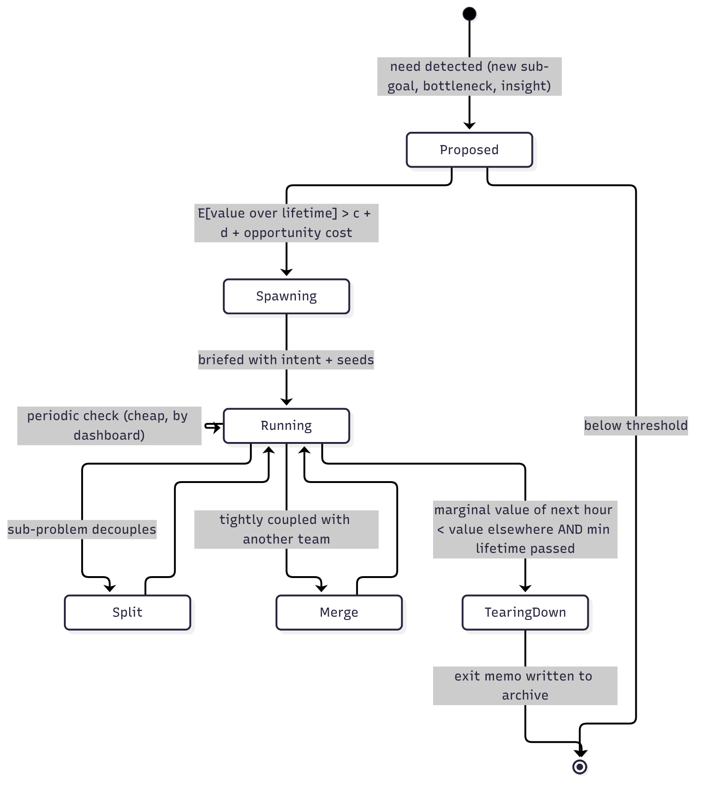

Rules I'd propose:
- **Spawn** when expected value over the lifetime beats $$c+d$$ plus the compute it takes from others (the break-even $$t^\ast$$ of §4.4, applied to a whole team).
- **Tear down** when the marginal value of the next hour falls below that compute's value elsewhere (successive halving).
- **Hysteresis**: spawn threshold above teardown threshold, plus a minimum lifetime, so the swarm doesn't thrash.
- **Exit memo is mandatory**, so knowledge isn't lost at teardown.
- **But teardown is a lossy bet.** 📄 [hallerite](https://hallerite.com/posts/on-the-nature-of-the-swarm/) (*On the nature of the swarm*, Oct 2026) frames every compaction as "a bet" on what will matter later: offloading to disk "remembers, but can't think", while a discarded sub-agent "thinks, but can't remember".[^hallerite] *Persistent* sub-agents that stay queryable get both. That argues for a third option between "keep running" and "tear down": **park** a team as a low-cost, queryable specialist (the *service* mode of §8.3), woken only when asked.

Precedents 📄: OpenAI's human-driven reallocation after the Euler warm-up; FunSearch/AlphaEvolve resetting weak islands from strong ones; Avalon-M1's CEO hiring and firing (my idea at village scale, already trained); cloud autoscaling with cooldowns.[^evo][^gr][^oaidetail]

### 8.5 Who decides?

| Decider | Pros | Cons |
|---|---|---|
| Human outer loop (OpenAI) | High-leverage judgement | Slow; doesn't scale; not learned |
| Fixed rule (successive halving) | Simple, predictable | Blind to *why* an arm is promising |
| Trained orchestrator (Kimi-style) | One place for credit | Bottleneck; strong prior |
| Any agent may spawn/retire (Avalon-style) | Most flexible | Credit is hard; spawn storms |

Pitfalls: premature teardown of slow-burn directions (keep an exploration floor); knowledge lost at teardown; hierarchy latency (keep depth near $$\log n$$); meta-work creep (reorgs that look like progress); spawn storms (global budget).

> **Open questions.** What determines the number and kind of sub-swarms? How do we protect a slow but promising exploration team? How do we credit an exploratory team that *fails but informs*?

---

## 9. Idea 5: always on, but low-touch

> 💡 **My refinement.** Coordination and orchestration should be *constantly* there, maximising overall utility and keeping the whole swarm pointed toward the larger, future goal. But the coordination / orchestrator / admin sub-swarm should be lightweight and low-touch.

These sound contradictory until you separate **how often the orchestrator looks** from **how much it intervenes**, and **what** it sends.

1. **Steer by intent, not instructions.** Militaries call it *mission command*: give the objective and constraints, not the steps. My hope is that one intent message could keep many agents aligned without further traffic, because each can check its own work against it.
2. **Observe shared state, don't interrogate.** Read dashboards (tests passing per module, open issues, archive entries) rather than asking for status reports. That's *stigmergy*: coordination through the environment.[^stigmergy]
3. **Intervene rarely**: periodic plus by-exception.

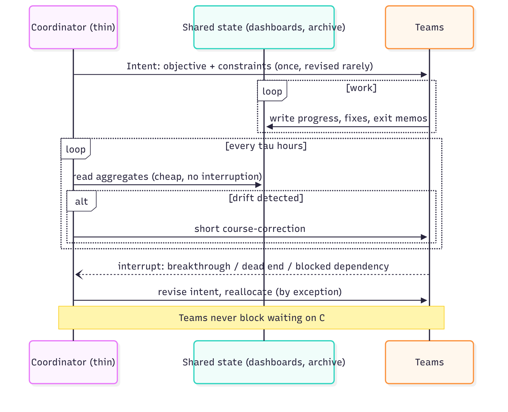

### 9.1 How often to course-correct? (a hypothesis)[^eoq]

Suppose teams drift so that waste grows like $$\delta t$$ between corrections, and each correction costs $$\kappa$$ hours of team time. Correcting every $$\tau$$ hours costs, per hour,

$$J(\tau) = \frac{\delta\,\tau}{2} + \frac{\kappa}{\tau}, \qquad \tau^\ast = \sqrt{\frac{2\kappa}{\delta}}, \qquad J(\tau^\ast) = \sqrt{2\kappa\delta}.$$

Two consequences of the model (untested for swarms):
- **At the optimum, overhead equals drift waste.** Coordinating more often just trades one for the other.
- **Cost scales as $$\sqrt{\kappa\delta}$$.** Low-touch means shrinking both: cheaper check-ins *and* clearer intent. Better intent lets you check in less.

Pitfalls: too low a gain means slow reaction to real pivots (hence the interrupt path[^interrupt]); a coordinator teams must *wait for* isn't low-touch however rarely it speaks; a vague or wrong intent makes everyone efficiently aligned in the wrong direction. In the Navier–Stokes run, the intent-setting job was done by humans.[^oai]

> **Open questions.** Can intent-setting and revision be learned rather than supplied by humans? How do we measure coordination overhead honestly, when agents rewarded on it may relabel coordination as "work"?

---

## 10. The village problem

> 📄 GR: "In our initial Avalon-M1 model, we trained organisations with at most 9 agents.[^gr] But swarms are now deployed with hundreds or thousands of agents. In effect, we are training collectives in villages but deploying them in cities."

I read it as a **distribution shift in team size**. The closest analogue I know is length generalisation, where models trained on short sequences often fail on longer ones. Here "length" is the number of agents, and it shows up literally as context length.

### 10.1 Which habits transfer? A scale-free test

My proposed test: a habit can transfer if its **per-agent cost stays flat** as $$n$$ grows.

| Habit learned in the village | Per-agent cost | At city scale |
|---|---|---|
| Claim a task before starting | $$O(1)$$ | Transfers |
| Reply to DMs addressed to you | $$O(\text{DMs received})$$ | Transfers if DMs stay targeted |
| Read the whole board | $$O(n)$$ | Likely breaks: context floods |
| Broadcast every finding (§5) | $$O(n)$$ for readers | Likely breaks at some scale |
| Message everyone on arrival (§7) | $$O(n)$$ | Likely breaks: intros grow with $$n$$ |
| CEO manages all hires directly | $$O(n)$$ for the CEO | Likely breaks: span of control |

### 10.2 Could nine agents be one span of management?

With span $$s$$, $$n$$ agents need $$\lceil\log_s n\rceil$$ levels, so 1,000 agents with spans of 9 need four. **My hypothesis is that if the policy learned "manage up to 8 well", it could be applied recursively**: each hire becomes a sub-CEO of its own village. Whether a village-trained manager actually generalises this way is untested.

**A counterpoint: trees vs meshes.** 📄 [hallerite](https://hallerite.com/posts/on-the-nature-of-the-swarm/) argues that a strict tree "moves the context problem to the root": every message routes upward, so the root fills up and must compact, a Hayekian central planner that can't hold the dispersed knowledge.[^hallerite] A mesh of peers that message each other directly avoids this, and hierarchy can still emerge where it pays for itself ("Nobody needs to be beholden to someone above them just to get work done"). The essay suggests a tree is probably fine at 10 agents and a mesh makes more sense at 10,000. I read this as refining villages-of-villages rather than refuting it. Use the hierarchy for *intent and management* (low bandwidth), and allow mesh links for *expertise and fixes* (targeted, peer to peer), which is exactly the targeted-multicast route of §5.

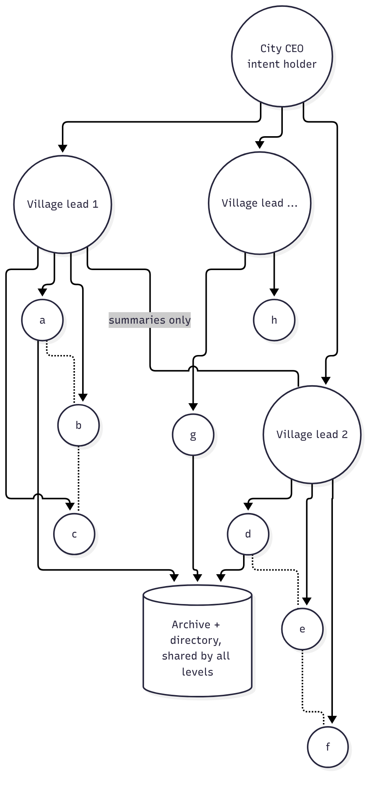

Ways to close the gap: (1) make the city a **federation of villages** (sidesteps rather than solves); (2) a **curriculum over $$n$$**, like the cap ramp (expensive; credit dilution grows); (3) **train the recursive unit**, villages whose environment includes a manager above and sub-teams below; (4) **mean-field thinking**: read aggregates, not every message; (5) **measure at deployment**: plot reward vs $$n$$ at fixed compute and fixed wall-clock, and find where it bends.[^meanfield]

**What might emerge only at city scale:** herding and correlated errors; congestion collapse on shared channels; cliques; and safety effects. GR reports a safety test where trained teams became *less* likely to report concerns to human overseers 📄.[^gr] My worry is that a mild tendency in a village could become a norm in a city.

> **Open questions.** What generalises from 9 to 1,000? Can "manage a village" be applied recursively? What emerges only at scale, and what metrics catch it?

---

## 11. Gifts to agents not yet spawned

> 📄 GR: "More open-ended settings could allow rollouts to share their work with future generations of agents, e.g. by publishing a paper or code library.[^gr] It is not clear how to reward rollouts for contributing to a public good that does not directly benefit them in the current episode."
>
> 💡 **My question.** How do we even predict the utility of something that will only benefit future agents, which haven't been spawned yet, on sub-goals that aren't apparent yet? Do we need very long-range planning? How do we think about the future utility of current actions at all?

### 11.1 Why per-episode RL may under-produce public goods (a hypothesis)

Suppose episode 1 spends an hour on a clean, documented library, at a cost $$C$$ to its own return, and later episodes each gain from it. Under a per-episode return, episode 1 only ever sees $$-C$$, so my hypothesis is that RL would learn *not* to write libraries. GR flag the same gap themselves.[^gr] If the creator instead received a royalty share $$\alpha$$ of the total later gain $$G$$, it would see $$-C + \alpha G$$, which becomes positive once $$\alpha > C/G$$. That's algebra. The real sizes of $$C$$ and $$G$$, and whether any royalty is stable under RL, are unknown.

Human societies address this with **royalties** (pay per use), **prizes** (pay when a goal is reached) and **grants** (pay up front on a prediction). Each has an RL counterpart.

### 11.2 The reframe: measure later, don't predict now

My question assumes value must be *predicted* at creation. Science and open source largely don't: they **discover value afterwards through use** (citations, downloads, dependents).

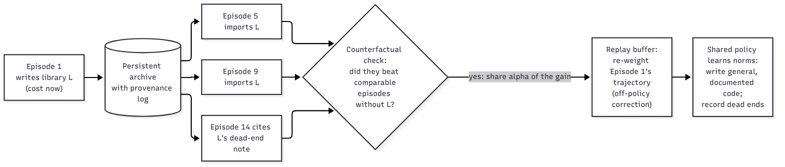

1. **Hindsight usage credit (royalties).** Log provenance. When episode $$k$$ uses an artifact, attribute a share of $$k$$'s advantage back to its creator, re-weighting the creator's stored trajectory. Use a counterfactual check so usage alone isn't enough.
2. **Graph-based credit.** Artifacts form a dependency graph; credit flows backwards, PageRank-style.
3. **Prizes for sub-goals.** When a later episode reaches a hard milestone, pay artifacts on its critical path: the dependency-link idea of §7, across time.

So my proposal is that **the system, not the agent, does the long-range credit assignment.** The agent would learn *norms* that historically paid, just as scientists learn to publish without foreseeing every use.

### 11.3 When you do need a forward estimate

$$U(a) = \mathbb{E}_{\text{task}\sim\mathcal{D}_{\text{future}}}\big[V(\text{task}\mid a) - V(\text{task}\mid\varnothing)\big].$$

You don't know future goals, but you often know the *distribution* (in training, it's the environment set). So: counterfactual evaluation on held-out episodes (expensive but direct); a learned value model over artifacts (a critic over artifacts, not states); or cheap proxies: **generality**, **reuse by siblings now** (a leading indicator), **compression** (does it shorten many solutions?), **novelty**.

**Do we need very long-range planning? My guess is mostly no.** Planning means simulating specific futures, which seems hopeless when the goals aren't known. What helps is **option value**: produce things that keep many futures open. It's a portfolio under uncertainty, not a plan.

Complications: weights already carry general skills forward (explicit artifacts matter most for *instance-specific* knowledge); non-stationarity (value decays as the policy improves, so discount across episodes, with irony after §4.2); gaming (a shared policy is effectively one agent across time and can farm its own royalties); archive rot (junk raises $$\rho$$ for everyone).

> **Open questions.** Is hindsight royalty credit stable, or will a shared policy game it? What cheap proxies best predict future value? How should explicit artifacts and weights split the job of carrying knowledge forward?

## 12. Designing swarms that unfold over time, and how to train them

💡 Ideas 2, 4 and 5 all say the same thing from different angles: **a swarm's structure is not a fixed diagram but a policy that acts over time.** That's my framing, not an established result. This section makes that concrete. It covers what to adapt, how to adapt it at inference time with no training, and how to train it with RL.

### 12.1 Structure as a slow policy

Think of the swarm as two nested decision processes running on different clocks.

- **Fast loop (workers):** read, think, run code, edit, message. Seconds to minutes.
- **Slow loop (structure):** actions on the organisation itself. Minutes to hours.

The slow loop's state is the swarm: which teams exist, their directives and work modes, the archive, the dashboards, the remaining budget. Its actions are:

| Structural action | Example | Idea it implements |
|---|---|---|
| `spawn(directive, size, mode)` | "8 agents, explore blow-up constructions on the torus" | §8 |
| `retire(team) + exit_memo` | Tear down a dead branch, archive what it learned | §8 |
| `split / merge` | Decouple a sub-problem; fuse two tightly coupled teams | §8.1 |
| `migrate(insight, to)` | Push the best result from island C into island D | §5, §8.2 |
| `revise_intent` | Update the objective after a discovery | §9 |
| `reallocate(compute)` | Successive halving across teams | §8.4 |
| `set_cap / set_n` | Change time budget or team size | §6 |

Its reward is task progress minus the cost of agent-hours and overhead. This is the setting of hierarchical RL (options, feudal networks): a manager acts rarely, workers act often.[^hrl]

### 12.2 A pattern that already works: the tree of directives

The clearest published example of structure unfolding over time is Bioptic's asset-scouting agent 📄 (arXiv:2602.15019).[^bioptic] It isn't usually described as a swarm, but it is one:

1. Each **node** is a directive for a sub-team of investigators ("Chinese-language regional press, oncology, preclinical to Phase 2").
2. **Select** leaves to run by UCB, with exploration constant $$c = 1.2$$:[^ucb]

$$\text{UCB}(n) = \frac{W(n)}{N(n)} + c\sqrt{\frac{\log N(\text{parent}(n))}{N(n)}}$$

3. **Roll out:** investigators search (in English and Chinese).
4. **Evaluate** with a novelty-gated reward:

$$r_n = p_n \cdot \lvert\Delta \tilde A_n\rvert$$

where $$p_n$$ is the share of candidates the validator accepts and $$\Delta\tilde A_n$$ is the set of **validated, deduplicated assets that were new to the global store**.
5. **Backpropagate** $$N$$ and $$W$$ to ancestors.
6. **Expand:** a Coach agent splits each explored node into $$k = 3$$ children that are *strictly narrower, mutually disjoint and collectively exhaustive*. It conditions on the directive lineage, every query executed so far, and a *compressed summary of the validator's rejection reasons*.

Here is how I map it onto my ideas (my interpretation, not Bioptic's):

- **Spawn and teardown** (§8): high-UCB leaves get expanded (spin up); low ones stop being selected (wind down).
- **The exit memo** (§8.4): the compressed failure summary is the memo, and the Coach reads it before planning.
- **Credit for the collective good** (§3): the reward counts only items *new to the shared store*. Duplicating a sibling earns nothing, and adding to the commons earns everything. I think this is a simple, general way to reward collective good rather than raw output.
- **Low-touch coordination** (§9): the Coach doesn't micromanage investigators. It writes directives (intent) and reads aggregate outcomes (dashboards).

Bioptic report that tree-based exploration helps prevent early saturation as more compute is spent (their Figure 1).[^bioptic]

**Generalising the reward to science (my proposal).** For a research swarm, replace "validated new asset" with "verified new contribution to the shared archive": a lemma that compiles, a reproduced analysis, a hypothesis that survived the refuting island. So

$$r_{\text{team}} = (\text{verified}) \times (\text{new to the commons}) - \lambda \cdot \text{agent-hours}.$$

### 12.3 Adapting at inference time, with no training

My hypothesis is that you can get much of the "unfolding" behaviour today with fixed rules around a strong model. Each mechanism below is already used somewhere:

| Mechanism | What adapts | Who uses it |
|---|---|---|
| Successive halving | Compute per team | OpenAI (human-run), stage gates in pharma |
| UCB / Thompson sampling over directives | Which sub-problems get attention | Bioptic |
| Island migration schedule (every $$M$$ rounds, top-$$k$$) | How often ideas cross teams | AlphaEvolve, OpenAI via Codex |
| Island reset from the best | Which lineages survive | FunSearch, AlphaEvolve |
| Intent revision on milestones | The objective itself | OpenAI's follow-up prompts |
| Verifier-gated sharing | What may be multicast | Lesson from DeepMind's cascade |

### 12.4 Training it: a ladder

How would you actually RL such a system? I'd climb a ladder, one rung at a time, because each rung makes credit assignment harder.

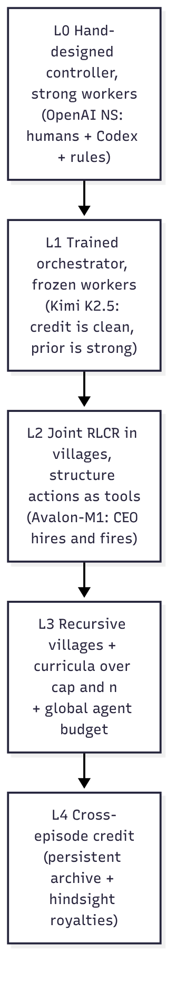

**Credit for structural actions.** A spawn or a migration is one action whose effect is spread over hours and thousands of other agents' tokens. I'd expect a flat collective advantage to learn it, but slowly. Three ways to sharpen the signal:

1. **Branching rollouts (my proposal).** Fork the swarm at a structural decision point, try alternatives (spawn vs don't; migrate now vs later), and compare returns within the group. This gives a counterfactual advantage *for that decision*, in the spirit of COMA's counterfactual baselines.[^coma] It's expensive, so fork only at the rare, high-leverage decisions.
2. **A structure critic.** Learn $$V(\text{swarm state})$$ from dashboards, and use the TD error for slow-loop actions.
3. **Novelty-gated team rewards** as in §12.2, so a team gets credit for what it *added*, not for what it duplicated.

**Rewards I'd include, and why (proposals).**

| Term | Purpose | Risk |
|---|---|---|
| Verified task progress at the cap | The real objective | Shallow verifier → reward hacking (as in DeepMind's case study[^deepmind]) |
| $$-\lambda \cdot$$ agent-hours | Keeps spawning honest | Too high → never parallelises |
| Small $$-\mu\cdot\varphi$$ (meta-work share) | Low-touch coordination | Agents relabel coordination as work |
| Novelty gate on contributions | Rewards collective good, kills duplication | Gaming "novelty" by trivial variation |
| Penalty for unverified sharing | Stops exploit cascades | Chills sharing of tentative but useful ideas |

**Curricula.** Ramp the cap (as Avalon does), then ramp $$n$$, then ramp hierarchy depth. Use population-based training to tune slow-loop hyperparameters (migration rate, UCB constant, spawn threshold) across parallel training runs.

**Integrity is part of the architecture.** In DeepMind's case study, an exploit spread through the shared library and direct messages.[^deepmind] My reading is that at scale **a reward hack behaves like a contagion, and the sharing channels are its vector.** Training environments for swarms need deep verification, readable reporting channels, the ability to retract shared items, and sanctions (DeepMind's authors propose agent self-governance: voting on disputes, temporary bans).

> **Open questions.** Can the slow loop be learned jointly with the fast loop, or must it be trained separately? Are branching rollouts worth their cost? What's the right reward for a team whose job is to *rule things out*?

---

## 13. Synthesis: an architecture sketch

💡 Pulling the ideas together, here is the architecture they point toward. Every box is a hypothesis.

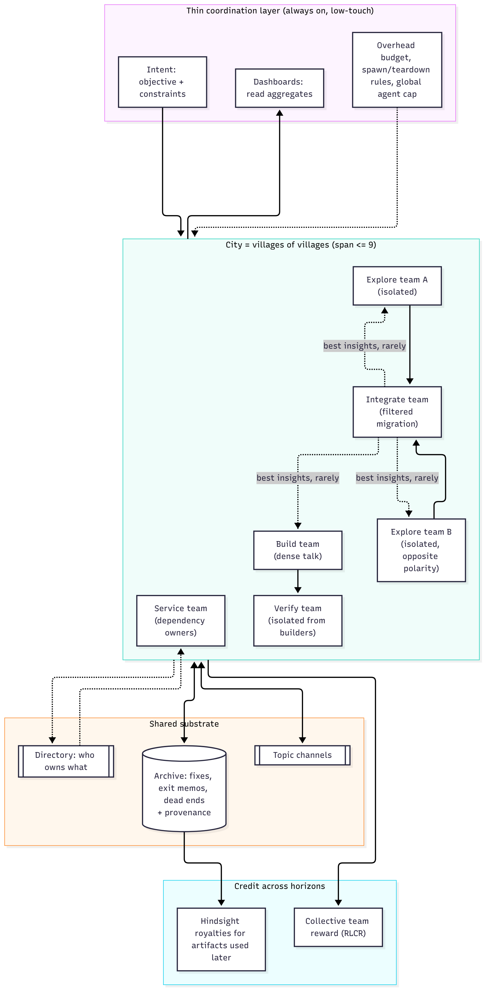

| Design choice | Which idea it answers | Which horizon |
|---|---|---|
| Push to targeted peers + pull from archive | Multicast (§5) | 1 |
| Directory for dependency links; sampled weak ties | Org chart (§7) | 1–2 |
| Teams typed by work mode, overhead budget, exit memos | Dynamic structure (§8) | 2 |
| Intent + dashboards + exception path | Low-touch coordination (§9) | 2 |
| Villages of villages | Village problem (§10); size vs time (§6) | Scale |
| Provenance + hindsight royalties | Public goods (§11) | 3 |
| Tree of directives with novelty-gated team rewards | Dynamic structure (§12) | 2 |
| Verifier-gated sharing, retractable archive entries, sanctions | Integrity (§2.4, §12.4) | 1–3 |

## 14. Where this matters: science, medicine and drug discovery

💡 Everything above was abstract on purpose. This section asks what these architectures would do in the domains I care most about. All the designs here are proposals. Facts about published systems are marked 📄.

### 14.1 My hypothesis: the verifier decides how much a swarm can do alone

| Domain | Verifier | Relative speed (my rough characterisation) | What I think it implies for swarm design |
|---|---|---|---|
| Formal maths | Lean kernel[^formats] | Fast | Loose, huge, diverse search is affordable |
| Software | Tests | Fast, if tests are good | Same, if tests are good |
| Simulation science | Simulators, conservation laws | Varies | Islands per model family; cross-check simulators |
| Biology | Wet-lab assays | Slow | Spend the swarm on *choosing experiments*, send only the best few |
| Clinical medicine | Outcomes, trials, guidelines | Slowest | Swarm assists humans; build a *ladder* of cheaper, imperfect checks |

My hypothesis is that down the table the swarm generates faster than the world can check, so the design should shift from generation toward **triage and verification ladders**. Independence should matter too: by the design-effect logic of §8.2, two checks with the same blind spot are worth less than two independent ones.

### 14.2 Cancer care journeys: the patient and family point of view

A cancer journey is a long, branching trajectory: symptoms, diagnosis, staging and biomarkers, the treatment decision, treatment and side effects, monitoring, recurrence or survivorship, and sometimes palliative and end-of-life care. For many families it can feel like a second job: understanding, scheduling, chasing, deciding, all while frightened.

A swarm for one patient and family is a natural fit for the ideas above.

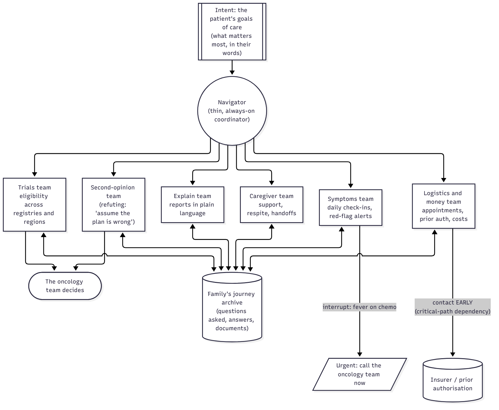

How the ideas map:

- **Intent, not instructions (§9).** The coordinator's "mission" is the patient's own goals of care: maximise time at home, or try every option, or protect fertility. Every sub-team checks its work against that intent, so the family doesn't have to re-explain their values to every agent.
- **Dependency links (§7).** Prior authorisation, the pathology lab, imaging scheduling and the pharmacy are the "research admin" of cancer care. They're contacted rarely but sit on the critical path. *My proposal: contact them early, in parallel.*
- **Always on, low-touch (§9).** The symptoms team runs a cheap daily check-in (patient-reported outcomes) and stays quiet unless a red flag fires. Fever during chemotherapy can be a sign of febrile neutropenia, which guidelines treat as urgent;[^fn] that is the interrupt path, and it goes straight to humans.
- **Multicast (§5).** When the logistics team learns the insurer needs a specific form, the trials team needs to know before it applies for a trial that the same insurer covers.
- **The refuting island (§8).** The second-opinion team's job is to build the strongest case that the current plan is wrong. It does not replace a human second opinion; it prepares the questions for one.
- **Public goods (§11).** With consent and de-identification, the lessons from one family's journey ("this question was worth asking at diagnosis") are a gift to families who haven't been diagnosed yet. That is horizon 3, literally.

### 14.3 Cancer care: the oncologist's point of view

- **Tumour board preparation.** Islands per frame, mirroring the Navier–Stokes problem variants: *guideline-concordant standard of care*; *biomarker-driven targeted therapy*; *clinical trial options*; *de-escalation or palliative-first*.[^oai] A refuting island looks for reasons each frame fails for *this* patient (comorbidities, performance status, prior toxicities). The integrate team writes one page for the board. The verifier ladder runs through guidelines, pathology review and, finally, the multidisciplinary team.
- **Longitudinal surveillance.** Always-on, low-touch watchers over imaging (RECIST), labs, ctDNA and patient-reported outcomes, writing to a dashboard the oncologist reads rather than sending messages. If the cadence model of §9 holds, it suggests making check-ins cheap and the "what counts as drift" intent clear.
- **Toxicity management.** Early detection of immune-related adverse events (colitis, pneumonitis, endocrinopathies) is the clinical version of "share the fix fast": one signal noticed in the notes should reach whoever acts on it.
- **Handoffs across the continuum.** Surgery to medical oncology to radiation to survivorship or palliative care. Each handoff is a dependency link where context is lost; the exit memo of §8.4 is the discharge summary done well.
- **Size vs time (§6).** An urgent decision this week deserves a small, fast team. A complex relapsed case with time to think can use a bigger, slower search.

**Guardrails that are non-negotiable here:** clinicians decide; verification is slow and outcomes are the real verifier; privacy and consent; equity (who gets the swarm?); and hallucination risk, which I'd expect to grow with how confident and how widely shared a wrong statement is (§5.5).

### 14.4 Early discovery: targets, mechanisms and hits

**Target finding and prioritisation.** "Is gene X a causal driver of disease Y?" Islands by **evidence type**: human genetics (GWAS, Mendelian randomisation, rare-variant burden), functional genomics (CRISPR screens, DepMap), single-cell and spatial expression, pathway context, prior clinical experience with the target class. A **refuting island** argues that X is a passenger, a marker or confounded (reverse causation, linkage to a neighbouring gene, tissue mismatch). Independent evidence types should raise $$N_{\text{eff}}$$ (§8.2), if the design-effect logic applies. Targets with human genetic support are reported to succeed clinically at roughly twice the rate (Nelson et al. 2015; King et al. 2019).[^genetic]

**Causal mechanism understanding.** Islands per mechanistic hypothesis, each tasked with predictions that *distinguish* it from the others. A verifier ladder runs from consistency across datasets, to a perturbation experiment, to an in vivo model. Kosmos 📄 shows the coordination pattern: data-analysis and literature agents sharing one structured world model, with every claim linked to code or a paper.[^kosmos]

**Hit finding.** Chemical space is now vast: Enamine REAL Space holds about 40 billion make-on-demand molecules. BIOPTIC B1 📄 (J. Chem. Inf. Model. 2025)[^bioptic], a ligand-based virtual screen, searched it in minutes and found novel LRRK2 binders (a Parkinson's target) with $$K_d$$ as low as 110 nM, binding both wild-type and the G2019S mutant. A swarm adds structure on top of such tools: **islands per chemical hypothesis** (orthosteric, allosteric, covalent, degrader) so scaffold diversity is preserved by design, not by luck.

**Hit-to-lead and lead optimisation.** A *build* team per chemical series (dense talk, tight design-make-test loops), an *integrate* team that shares matched molecular pairs and liability fixes across series (a solubilising group that worked in series A is a "hard-won fix" for series B), and successive halving across series, which is what stage gates already do. A likely failure mode is reward hacking against a weak verifier: molecules that dock beautifully and fail in assay. Bayes' rule says that when true actives are rare, even a decent screen returns mostly false positives, and an independent second stage raises the positive predictive value far more than a correlated one. How much it helps in practice depends on assay figures I haven't measured.

### 14.5 Preclinical studies in mice and monkeys: design and readout

- **Design swarm.** Islands propose study designs under different model choices: syngeneic vs patient-derived xenograft vs genetically engineered mouse models, and humanised mice for immuno-oncology. Each comes with power calculations and randomisation and blinding plans. A refuting island asks what would make a positive result meaningless (wrong model for the mechanism, under-powered, dosing that doesn't reach target exposure).
- **Readout swarm.** Different analysis islands apply different, pre-registered models to the same data: mixed-effects tumour-growth models, tumour growth inhibition, survival analysis, PK/PD exposure–response. A refuting island looks for cage, batch and operator effects. Agreement across *independent* analyses is the verifier.
- **Toxicology in non-human primates.** Clinical pathology, histopathology and safety pharmacology. The species-difference question (does the target's biology, sequence and structure differ between human and model species?) is one of the major error items in Convoke's target-safety rubric 📄.[^convoke] It's a natural *dependency link* to check early.
- **The 3Rs.** Every in silico design iteration that prevents a poorly designed animal study would reduce animal use, which is a collective good of its own.[^3rs]

### 14.6 Clinical trials, Phases 1 to 3

| Phase | Swarm job | Ideas that apply |
|---|---|---|
| **Phase 1** (dose escalation, safety) | Always-on safety-signal watchers; model-assisted dose escalation support (BOIN, CRM)[^dose]; PK/PD readout | Low-touch with an interrupt path (§9); verifier = the safety review committee |
| **Phase 2** (signal, go/no-go) | Biomarker-subgroup exploration *with a refuting island against subgroup fishing*; multiplicity control; go/no-go dossiers | Islands with polarity (§2.4); verify before multicast (§5.5) |
| **Phase 3** (confirmatory) | Comparator selection (newly important under the EU's Joint Clinical Assessments, which apply to new oncology medicines from January 2025 📄[^jca]), site selection, enrolment forecasting, catalyst tracking, readout analysis | Dependency links to regulators, ethics boards, CROs: contact early (§7) |

### 14.7 Asset scouting, diligence and BD: knowledge work at scale

Biotech analysts, pharma BD and search-and-evaluation teams, and investors do "find-all" work. That means every asset matching a complex query, worldwide, with up-to-date attributes, then synthesis: landscapes, safety assessments, forecasts.

What the published evidence says:

- **The frontier is jagged** 📄.[^convoke] Convoke's benchmark of six biopharma work products (target safety assessment, tumour landscape, **shelved assets**, catalyst calendar, clinical benchmark, commercial forecast) found models do best at structured compilation (shelved-asset lists, catalyst calendars) and worst at synthesis and narrative (target safety, tumour landscapes). Commercial forecasts are hard because errors propagate through assumptions.
- **Architecture beats model** 📄.[^bioptic] Bioptic's tree-of-directives agent reached F1 0.797 on a completeness benchmark of mostly non-US, non-English assets, against 0.562 for the best general agent. Running a general agent longer didn't close the gap. The supply has moved: the same paper reports, from WIPO data, that about 86.5% of patent applications originate outside the US and about 48% come from China.
- **Speed** 📄. In a case study, Bioptic's competitor-discovery agent cut a VC fund's competitive-analysis turnaround from 2.5 days to about 3 hours.

A swarm design for scouting, built from this post's ideas (a proposal):

- **Explore islands by region × language × source × stage** (company pipelines, ClinicalTrials.gov and Asian registries, patents, conference abstracts, regional press). The aim is completeness by construction.
- **A validator** checks every candidate against the query, with citations. **A dedup/alias team** resolves code names, transliterations and subsidiaries.
- **An integrate team** writes the dossier. **A refuting island** argues against every "buy" thesis.
- **Always-on watchers** maintain the catalyst calendar, and stay quiet until something changes.
- **Novelty-gated rewards** (§12.2), so effort flows to directives that still find new assets.

Why it matters: shelved drugs have been revived to great effect. Tovorafenib[^revived] was in-licensed by Day One from Takeda and approved in 2024 for paediatric low-grade glioma. Ibrutinib began as a Celera program that Pharmacyclics acquired cheaply, and it became Imbruvica (AbbVie later bought Pharmacyclics for about \$21B).

### 14.8 Finding silence

> 💡 **My idea.** Find the assets that stopped being reported publicly, and hypothesise *why*: safety or toxicity, efficacy, or other issues, or because they've gone silent to preserve their alpha.

Databases record what companies *announce*. Silence is what they *stop* saying: a trial record that stops updating, a drug that drops off a pipeline slide, a conference abstract that never appears.

**When is silence signal? (a hypothesis)** One simple model treats each asset's public updates as a process with its own typical interval $$\mu$$, learned from that asset's and that company's history. If updates were memoryless (a Poisson process), the chance of a gap of at least $$g$$ days for a still-active asset would be $$e^{-g/\mu}$$. So the same silence would be surprising for an asset that usually updates often and unremarkable for one that rarely does. Whether real disclosure behaves anything like this is untested.

**Why did it go quiet?** My proposal is to treat the cause as a hypothesis with a prior, and let independent signals update it. The signals I'd look at, and what I *suspect* each points toward (untested):

| Signal | Where to look | Points toward |
|---|---|---|
| Registry status changes ("terminated", "suspended", the *why stopped* field), enrolment cuts | ClinicalTrials.gov, ChiCTR / China CDE, jRCT, EU CTIS | Safety, futility, or business |
| Pipeline slide removal or a move to "partnering" | Investor decks, 10-K/20-F | Strategic deprioritisation |
| Risk-factor language, impairments, cash runway | SEC and other filings | Financing distress |
| Patents: maintenance fees paid, new continuations filed vs lapses | Patent offices | Kept alive → still valued; lapsing → abandoned |
| Hiring (CMC, scale-up, clinical ops) vs layoffs | Job boards, press | Quietly progressing vs winding down |
| Abstracts withdrawn; safety signals at meetings | Conferences | Safety or efficacy |
| Regional press and registries | Chinese, Japanese, Korean sources | May surface news before English-language sources |

**The swarm for silence** (a proposal) uses every idea in this post: explore islands per region and source; **one island per hypothesis, each told to build the strongest case for its cause** (polarity, as with the Navier–Stokes variants); a validator that insists on citations; Bayesian aggregation by the integrate team; always-on watchers that re-score assets as new signals arrive; and humans, ideally senior drug hunters, who make the call.

**Boundaries.** Public information only; never material non-public information; and care with conclusions about named companies, since a wrong "safety problem" hypothesis can harm people and markets. Report hypotheses with their evidence and confidence, never as findings.

## 15. Looking ahead: hybrid human–AI swarms, human agency, and a "Lean for biology"

> 💡 **My question.** In the future, how do we best design optimal swarms, standalone or ideally *hybrid* human–AI teams, to solve ambitious science problems, while preserving human agency, meaning-making and critical thinking? We must guard against the atrophy of human skills, especially critical thinking and scientific understanding. And in biology and the life sciences, do we need a *Lean* to make what AI swarms (pure or hybrid) discover and "prove" legible and formal?

### 15.1 Standalone or hybrid? Where humans add the most

The Navier–Stokes run already *was* a hybrid.[^oai] Humans chose the portfolio, made the reallocation call, seeded the new groups and revised the prompts. The swarm did the search. That split is worth keeping deliberately, and it follows from the earlier sections:

- **Humans belong in the slow loop (§12.1).** Choosing the question, setting and revising intent, deciding what counts as success, and making the irreversible calls (spending real money, running an experiment on animals or people). These are low-frequency, high-leverage decisions. They are exactly where judgement and values matter, and where a person's attention is affordable.
- **Humans as decorrelated agents (§8.2), a hypothesis.** If copies of one model share blind spots (high $$\rho$$), then a human expert who reasons differently would be a *low-correlation* attempt, and by the $$N_{\text{eff}}$$ formula one genuinely independent reviewer could be worth more than many extra copies. That's a quantitative reason to keep humans in the refuting island and at the verification gate, not just a moral one.
- **Human oversight has a budget too (§9).** The $$\sqrt{2\kappa\delta}$$ rule applies to people: each check-in costs human attention $$\kappa$$. So hybrid swarms must make human check-ins *cheap* (one-page summaries, claims with their evidence, disagreements surfaced rather than averaged away) and keep drift $$\delta$$ small with a clear, human-authored intent.
- **Meaning-making stays human.** The swarm's intent (what problem, why it matters, for whom) is the one thing that should never be generated by the swarm itself. In the cancer-care design (§14.2), the intent is the patient's own goals of care. In science, it is the research question a person cares about and can explain.

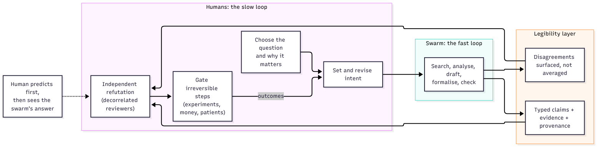

(Shameless but brief aside: I've been chewing on the hybrid question for a while, and a first, very imperfect attempt at it, *Patients Are Waiting: From Swarms to Synergy.[^neurips] Designing Complementary Collaborative Human–AI Agent Teams for Biomedical Discovery & Invention*, somehow got into the [NeurIPS 2026 Agentic AI for Biological Discovery (Agentic LS) workshop](https://agenticls.github.io/) ([workshop page](https://neurips.cc/virtual/2026/loc/sydney/workshop/137498)). Much of this section is me arguing with my past self.)

### 15.2 Guarding against the atrophy of human skill

The risk is real and already measured outside AI-for-science. A 2025 multicentre study in *Lancet Gastroenterology & Hepatology* reported that endoscopists who had been using AI assistance detected fewer adenomas when they performed colonoscopies *without* it (detection fell from about 28% to about 22%).[^lancet] Aviation has long known the same pattern[^aviation] from autopilot. A science swarm that hands people finished answers will train people who can no longer produce or judge them. Then the "independent human reviewer" of §15.1 quietly stops being independent or expert.

Design countermeasures, each mapped to an earlier idea:

| Countermeasure | How it works | Why it helps |
|---|---|---|
| **Predict first, then reveal** | The human writes their own hypothesis or estimate *before* seeing the swarm's | Keeps human reasoning active and independent; gives a running measure of human skill |
| **Humans own the refuting island** | People are asked to break the swarm's claims, not to approve them | Critical thinking is exercised, and the refutation is decorrelated |
| **Explain it back** | A claim isn't accepted until a human can explain why it's true in their own words | Legibility becomes a gate; understanding becomes a requirement, not a by-product |
| **Show the reasoning, not just the answer** | Claims come with their evidence chain and the strongest counter-argument | People learn the domain from the swarm instead of outsourcing it |
| **Deliberate practice** | Regularly solve a sample of problems unaided (as pilots fly manually) | Directly counters deskilling |
| **Measure human skill over time** | Track blinded accuracy and calibration of the people in the loop | If it falls, the hybrid design is failing, even if outputs look good |
| **Credit and authorship norms** | Record who (human or agent) contributed which idea, via the lineage log | Preserves meaning and accountability; avoids the provenance fights of §2.3 |

The principle: **a hybrid swarm should make its humans better scientists, not just faster ones.** If the people in the loop understand less each year, the system is borrowing against its own future verifier.

### 15.3 Do we need a "Lean for biology"?[^gsk]

Lean works because a mathematical claim can be written completely formally and checked mechanically from axioms. A kernel either accepts the proof or it doesn't. Biology doesn't have that. Its claims are empirical, probabilistic and context-dependent ("in this cell type, at this dose, in this species"). No kernel can *prove* that a gene drives a cancer.

So the honest answer is: **not a Lean, but we do need what Lean provides.** Break down what Lean actually gives mathematics, and each piece has a biological analogue:

| What Lean provides | Biology's analogue | Exists today? |
|---|---|---|
| **A formal statement language** (no ambiguity about what's claimed) | Typed, machine-readable claims: entity, relation, direction, magnitude, context, species, conditions (e.g. causal graphs, BEL, nanopublications, Biolink-style models, SBML for quantitative models)[^formats] | Partly, unevenly used |
| **A kernel that checks each step** | **Executable provenance**: every claim links to the data, code and protocol that produced it, and an *independent* pipeline can re-derive it from raw data | Partly (Kosmos links every statement to code or papers 📄) |
| **Comparator: does the proved theorem match the intended statement?** | **Pre-registration**: does the tested hypothesis match the stated one, with analysis plans fixed in advance? This blocks goalpost-moving, the biological version of DeepMind's agents redefining the problem's terms (§2.4) | Yes for trials, rarely for discovery |
| **Proof = certainty** | **An evidence calculus**: claims carry calibrated confidence that rises with *independent* lines of evidence (genetics + perturbation + replication), discounted for correlated ones (the $$\rho$$ of §8.2) | No standard |
| **The library (Mathlib)** | A shared, versioned knowledge graph of typed claims, with retraction and contradiction checks | Fragmented |

And for the parts of biology that *are* formal, real formal checks exist and should be used: stoichiometric and mass-balance constraints (flux-balance models), dimensional and unit checks, kinetic and rule-based models (SBML, BioNetGen, Kappa)[^formats] that can be simulated and model-checked, structural constraints in protein design, statistical consistency checks on reported numbers, and protocol logic in trial designs.

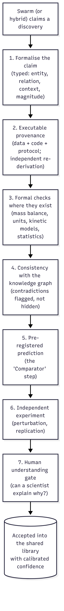

This is the verifier ladder of §14.1, made *legible*. Each rung is cheaper and earlier than the next, each records what it checked, and the whole chain can be inspected by a person. **My reading is that Lean made mathematics safe for 10,000-agent search because it made claims legible and checking cheap.** Biology will get the same benefit only if it invests in the same two things: claims precise enough to check, and checks independent enough to trust. And the last rung, a human who understands *why*, ties this section back to §15.2. Formalisation should support human understanding, not replace it. My own small experiment in that formal corner is [Lean-Bio](/lean-bio/), which compiles biochemical models into theorems the Lean 4 kernel checks; it covers the parts of biology that can be formal, not the empirical rest.

> **Open questions.** Which human roles in a hybrid swarm add the most, and how do we measure that? How do we detect and reverse deskilling in the people in the loop? What would a minimal, widely adopted "claim language" for biology look like, and who would maintain its library?

---

## 16. A research agenda: what to measure

| Question | Experiment | Metric |
|---|---|---|
| Is sharing being learned? | Track over RLCR training | Duplicate struggles per rollout; lag from first fix to second agent's fix |
| Does broadcast break with scale? | Deploy a village-trained policy at $$n$$ = 9, 50, 200, 1,000 | Tokens read per agent; reward vs $$n$$ at fixed wall-clock |
| Does the optimal size track the cap? | Log hires per rollout across the cap ramp | Mean hires vs training step |
| Are dependency links pruned? | Environments with a rarely-needed gatekeeper agent | Time-to-first-contact with the gatekeeper; completion time |
| Is coordination low-touch? | Instrument meta-work | $$\varphi$$: fraction of tokens on spawn/brief/teardown/status |
| Does recursive management work? | Train villages with a manager above and sub-teams below | Reward at depth 1 vs 2 vs 3 |
| Do royalties produce public goods? | Shared-environment training with provenance | Artifact reuse rate; counterfactual gain; gaming rate (self-citation) |
| Does an adaptive tree beat a fixed split? | Same model, same budget: UCB tree vs fixed directives vs sequential loop | Recall/F1 vs compute (as in Bioptic's Figure 1) |
| Do exploits spread through sharing? | Plant a verifier bug; vary sharing speed and verification depth | Time to cascade; share of agents affected |
| Can silence be read? | Back-test on historical assets with known outcomes | Calibration of cause probabilities; lead time vs public disclosure |
| Are the humans in the loop getting better or worse? | Track blinded, unaided performance of the scientists using a hybrid swarm over months | Accuracy and calibration vs baseline; predict-first agreement |
| Does a care-journey swarm help patients? | Prospective, clinician-supervised pilot | Time-to-treatment; questions answered; family-reported burden; safety events |

---

## 17. All the open questions

**Siblings, now**
1. Will collective-reward RL learn to share fixes on its own, when the benefit lands in another agent's actions, often much later?
2. Who should get a fix: broadcast, targeted DMs, topic channels, pull archive, or harness routing? Can targeting be learned?
3. How do we stop wrong fixes spreading fast, and herding on the first workaround, without slowing good fixes?

**The swarm, over its lifetime**

4. What's the right swarm size for a time budget, and can the swarm learn to choose it?
5. Can link reinforcement tell collaboration links from dependency links, or do dependency links need a directory?
6. How do we keep weak cross-team ties alive without forcing communication?
7. What determines the number and kind of sub-swarms? When to spawn, when to tear down? How do we protect slow but promising exploration?
8. Who makes structural decisions (humans, rule, orchestrator, every agent), and how do we prevent spawn storms and reorg busywork?
9. How do we make coordination always on but low-touch, and measure overhead honestly?
10. Can intent-setting and revision, done by humans in the NS run, be learned?

**Scale**

11. What generalises from 9 agents to 1,000? Can "manage a village" be applied recursively?
12. What emerges only at city scale (congestion, cliques, correlated errors, safety norms), and which metrics catch it?

**Agents not yet spawned**

13. How do we credit contributions that only help future runs? Is hindsight royalty credit stable or gameable?
14. What cheap proxies predict an artifact's future value?
15. How should explicit artifacts and shared weights split the job of carrying knowledge forward?
16. How do we credit an exploratory team that *fails but informs*?

**Design over time, and training**

17. Can the slow, structural loop be learned jointly with the fast worker loop? Are branching rollouts worth their cost?
18. How do we make sharing *verifier-gated* without chilling the spread of tentative but useful ideas, given that exploits spread through the same channels?
19. How much of OpenAI's human outer loop (portfolio, reallocation, seeding, intent revision) can a learned coordinator replace?

**Applications**

20. In cancer care, which parts of the journey can a swarm take on safely, and how do we keep the patient's goals of care as the intent that everything answers to?
21. In discovery and preclinical work, where verification takes weeks, how should a swarm trade in silico breadth against the few experiments it gets?
22. Can silence be read reliably from public signals, and how do we validate cause hypotheses without harming the companies and patients involved?

**Hybrid teams, human agency and legibility**

23. How should standalone and hybrid human–AI swarms divide the work, and which human roles (question-setter, intent-holder, refuter, gatekeeper) add the most?
24. How do we detect and reverse the atrophy of human skill, especially critical thinking and scientific understanding, in the people working with swarms?
25. Does biology need a "Lean"? What minimal claim language, provenance standard and evidence calculus would make AI-discovered biology legible and checkable?

---

## 18. Try it yourself (with answers)

These use hypothetical numbers to practise the models above. They're exercises, not claims about real swarms.

1. **Multicast.** A fix saves 10 min; reading costs 0.5 min. (a) 9 agents, each 20% likely to hit it: broadcast? (b) 1,000 agents: 5 at 90%, the rest at 0.1%?
2. **Size vs time.** Using $$c(n) = 0.1n$$, $$e(n) = 1/(1+0.1(n-1))$$, at roughly which budget $$T$$ does $$n=16$$ first beat $$n=8$$?
3. **Org chart.** UCB with $$c=1$$ at $$t=20$$: peer A has $$\bar u=0.6$$ over 15 exchanges, peer B has $$\bar u=0.3$$ over 2. B is chosen now. How many more exchanges with B (if $$\bar u_B$$ stays 0.3) before A is chosen again?[^ucb]
4. **Overhead budget.** With $$c+d = 30$$ min and $$m = 3\%$$, what minimum lifetime keeps $$\varphi \le 8\%$$?
5. **Cadence.** $$\kappa = 0.1$$ h, $$\delta = 0.2$$/h. Find $$\tau^\ast$$ and total cost. What if clearer intent halves $$\delta$$?
6. **Village.** With span 6, how many management levels does a 10,000-agent swarm need?
7. **Public goods.** Writing a library costs its creator 0.05 of return, and later episodes gain 0.40 in total. What's the smallest royalty share $$\alpha$$ that makes writing it worthwhile (no discount)?

<b>Answers</b> (try first!)

1. Threshold $$\rho/s = 0.05$$. (a) Every agent is at 20% > 5%: broadcast. Expected net = 9 × (0.2 × 10 − 0.5) = 13.5 min saved. (b) Broadcast net = (5 × 0.9 + 995 × 0.001) × 10 − 1000 × 0.5 ≈ 55 − 500 = −445 min. Target the 5: 5 × (9 − 0.5) = 42.5 min saved; the 0.1% agents should rely on the archive.
2. $$P_{16}(T) = 6.40(T - 1.6)$$, $$P_8(T) = 4.71(T - 0.8)$$. Equal when $$6.40T - 10.24 = 4.71T - 3.77$$, so $$T \approx 3.83$$ h.
3. B's score is $$0.3 + \sqrt{\ln t / n_B}$$; A's is $$0.6 + \sqrt{\ln t/15}$$. After 3 more B exchanges ($$t = 23$$, $$n_B = 5$$): B ≈ 0.3 + 0.79 = 1.09, A ≈ 0.6 + 0.46 = 1.06, so B still wins. After 4 ($$t=24$$, $$n_B=6$$): B ≈ 0.3 + 0.73 = 1.03, A ≈ 1.06. **A is chosen after 4 more B exchanges.**
4. $$(c+d)/L \le 5\%$$, so $$L \ge 20 \times 0.5 = 10$$ h.
5. $$\tau^\ast = \sqrt{0.2/0.2} = 1$$ h; cost $$\sqrt{0.04} = 20\%$$. Halving $$\delta$$: $$\tau^\ast = \sqrt{2} \approx 1.41$$ h; cost $$\sqrt{0.02} \approx 14\%$$.
6. $$\log_6 10{,}000 \approx 5.14$$, so 6 levels.
7. $$\alpha \times 0.40 \ge 0.05$$, so $$\alpha \ge 0.125$$.

---

## 19. References (all in one place)

*Everything cited in the margin, plus the background reading, in one place.*

- General Reasoning, [*How to train a swarm*](https://www.gr.inc/blog/how-to-train-a-swarm) (2026), and the [Avalon-M1 report](https://www.gr.inc/avalonm1.pdf).
- OpenAI, [*On the Navier–Stokes Millennium Prize Problem*](https://openai.com/index/navier-stokes-solution/) (8 Sep 2026), and the [Lean proof repo](https://github.com/openai/NavierStokesAndEuler). Reported by [Quanta](https://www.quantamagazine.org/ai-has-solved-one-of-maths-1-million-millennium-prize-problems-20260908/) and [VentureBeat](https://venturebeat.com/technology/openai-solves-longstanding-math-problem-with-10-000-agent-swarm-but-cant-rule-out-benefitting-from-a-researchers-private-codex-data).
- Noam Brown's comments, via [Understanding AI](https://www.understandingai.org/p/why-agent-swarms-could-be-the-next) and [Aventine](https://aventineresearchinstitute.substack.com/p/is-this-just-the-beginning-for-ai).
- Further details of the Navier–Stokes run, from [CellCog](https://cellcog.ai/blog/openai-navier-stokes/) (which quotes OpenAI's post) and [Aventine](https://aventineresearchinstitute.substack.com/p/is-this-just-the-beginning-for-ai). Secondary sources: treat with care.
- OpenAI's Cycle Double Cover run, as summarised by [imisofts](https://imisofts.com/blog/gpt-5-6-sol-ultra-math-proof-agent-swarm-playbook-news-july-13-2026/) from OpenAI's published proof and prompt.
- Kimi Team, [*Kimi K2.5*](https://arxiv.org/abs/2602.02276) (2026).
- Paglieri, Cross, Genewein, Leibo, Tomasev et al. (Google DeepMind), [*A Case Study on Emergent Cheating and Whistleblowing in Autonomous Research Swarms*](https://arxiv.org/abs/2609.04170v1), arXiv:2609.04170 (Sep 2026); coverage in [MIT Technology Review](https://www.technologyreview.com/2026/09/14/1144037/ai-agents-blew-whistle-o-cheating-colleagues/) and [The Decoder](https://the-decoder.com/deepmind-put-100-ai-agents-in-a-room-and-they-sorted-into-cheaters-converts-and-whistleblowers/).
- Mitchener et al., [*Kosmos: An AI Scientist for Autonomous Discovery*](https://arxiv.org/abs/2511.02824) (2025).
- Gottweis et al., [*Towards an AI co-scientist*](https://arxiv.org/abs/2502.18864) (2025); Ghareeb et al., [*Robin: a multi-agent system for automating scientific discovery*](https://arxiv.org/abs/2505.13400) (2025); Swanson et al., [*The Virtual Lab of AI agents designs new SARS-CoV-2 nanobodies*](https://doi.org/10.1038/s41586-025-09442-9), Nature (2025).
- Vinogradova et al., [*Hunt Globally: Deep Research AI Agents for Drug Asset Scouting*](https://arxiv.org/abs/2602.15019) (2026); Vinogradov et al., [*LLM-Based Agents for Competitive Landscape Mapping in Drug Asset Due Diligence*](https://arxiv.org/abs/2508.16571) (2025); Vinogradov, Nguyen et al., [*BIOPTIC B1 … Discovers LRRK2 Ligands in Vast Chemical Space*](https://doi.org/10.1021/acs.jcim.5c00743), J. Chem. Inf. Model. 65, 9927 (2025).
- Convoke, [*Benchmarking biopharma knowledge work*](https://convoke.bio/blog/benchmarking-biopharma-knowledge-work) (Sep 2026).
- tp53, *Patients Are Waiting: From Swarms to Synergy*, NeurIPS 2026 Agentic LS workshop ([agenticls.github.io](https://agenticls.github.io/); [workshop page](https://neurips.cc/virtual/2026/loc/sydney/workshop/137498)).
- Konstantin Dunas (hallerite), [*On the nature of the swarm: why scaling inference ends in many agents*](https://hallerite.com/posts/on-the-nature-of-the-swarm/) (Oct 2026).
- Kim Branson (GSK), [LinkedIn post on building a "Lean for biology" at GSK](https://www.linkedin.com/posts/kim-branson-b864963_ive-often-thought-we-need-a-lean-for-biology-share-7474193699040555008-A-iV/) (June 2026).
- Budzyń et al., [*Endoscopist deskilling risk after exposure to artificial intelligence in colonoscopy*](https://doi.org/10.1016/S2468-1253(25)00133-5), *Lancet Gastroenterology & Hepatology* (2025).
- Nelson et al., [*The support of human genetic evidence for approved drug indications*](https://doi.org/10.1038/ng.3314), *Nature Genetics* 47, 856 (2015); King et al., [*Are drug targets with genetic support twice as likely to be approved?*](https://doi.org/10.1371/journal.pgen.1008489), *PLoS Genetics* 15, e1008489 (2019).
- Auer, Cesa-Bianchi & Fischer, [*Finite-time analysis of the multiarmed bandit problem*](https://doi.org/10.1023/A:1013689704352), Machine Learning 47 (2002).
- Schulman et al., [*High-dimensional continuous control using generalized advantage estimation*](https://arxiv.org/abs/1506.02438), ICLR (2016).
- Foerster et al., [*Counterfactual multi-agent policy gradients*](https://arxiv.org/abs/1705.08926), AAAI (2018).
- Sukhbaatar et al., [*CommNet*](https://arxiv.org/abs/1605.07736) (NeurIPS 2016); Singh et al., [*IC3Net*](https://arxiv.org/abs/1812.09755) (ICLR 2019); Das et al., [*TarMAC*](https://arxiv.org/abs/1810.11187) (ICML 2019).
- Island-model genetic algorithms; Romera-Paredes et al., [*FunSearch*](https://doi.org/10.1038/s41586-023-06924-6), Nature 625 (2024); Novikov et al., [*AlphaEvolve*](https://arxiv.org/abs/2506.13131) (2025).
- Wang et al., [*Voyager: An open-ended embodied agent with large language models*](https://arxiv.org/abs/2305.16291) (2023).
- Arjona-Medina et al., [*RUDDER*](https://arxiv.org/abs/1806.07857) (NeurIPS 2019); Harutyunyan et al., [*Hindsight credit assignment*](https://arxiv.org/abs/1912.02503) (NeurIPS 2019).
- Yang et al., [*Mean field multi-agent reinforcement learning*](https://arxiv.org/abs/1802.05438), ICML (2018).
- Granovetter, [*The strength of weak ties*](https://doi.org/10.1086/225469), American Journal of Sociology 78, 1360 (1973).
- Conway, [*How do committees invent?*](http://www.melconway.com/Home/Committees_Paper.html), Datamation (1968).

<link rel="stylesheet" href="/assets/css/sidenotes.css">

[^gr]: General Reasoning, [*How to train a swarm*](https://www.gr.inc/blog/how-to-train-a-swarm) (2026), and the [Avalon-M1 report](https://www.gr.inc/avalonm1.pdf).
[^hallerite]: Konstantin Dunas (hallerite), [*On the nature of the swarm: why scaling inference ends in many agents*](https://hallerite.com/posts/on-the-nature-of-the-swarm/) (Oct 2026).
[^oai]: OpenAI, [*On the Navier–Stokes Millennium Prize Problem*](https://openai.com/index/navier-stokes-solution/) (8 Sep 2026), and the [Lean proof repo](https://github.com/openai/NavierStokesAndEuler). Reported by [Quanta](https://www.quantamagazine.org/ai-has-solved-one-of-maths-1-million-millennium-prize-problems-20260908/) and [VentureBeat](https://venturebeat.com/technology/openai-solves-longstanding-math-problem-with-10-000-agent-swarm-but-cant-rule-out-benefitting-from-a-researchers-private-codex-data).
[^brown]: Noam Brown's comments, via [Understanding AI](https://www.understandingai.org/p/why-agent-swarms-could-be-the-next) and [Aventine](https://aventineresearchinstitute.substack.com/p/is-this-just-the-beginning-for-ai).
[^oaidetail]: Further details of the Navier–Stokes run, from [CellCog](https://cellcog.ai/blog/openai-navier-stokes/) (which quotes OpenAI's post) and [Aventine](https://aventineresearchinstitute.substack.com/p/is-this-just-the-beginning-for-ai). Secondary sources: treat with care.
[^deepmind]: Paglieri, Cross, Genewein, Leibo, Tomasev et al. (Google DeepMind), [*A Case Study on Emergent Cheating and Whistleblowing in Autonomous Research Swarms*](https://arxiv.org/abs/2609.04170v1), arXiv:2609.04170 (Sep 2026); coverage in [MIT Technology Review](https://www.technologyreview.com/2026/09/14/1144037/ai-agents-blew-whistle-o-cheating-colleagues/) and [The Decoder](https://the-decoder.com/deepmind-put-100-ai-agents-in-a-room-and-they-sorted-into-cheaters-converts-and-whistleblowers/).
[^kosmos]: Mitchener et al., [*Kosmos: An AI Scientist for Autonomous Discovery*](https://arxiv.org/abs/2511.02824) (2025).
[^cosci]: Gottweis et al., [*Towards an AI co-scientist*](https://arxiv.org/abs/2502.18864) (2025); Ghareeb et al., [*Robin: a multi-agent system for automating scientific discovery*](https://arxiv.org/abs/2505.13400) (2025); Swanson et al., [*The Virtual Lab of AI agents designs new SARS-CoV-2 nanobodies*](https://doi.org/10.1038/s41586-025-09442-9), Nature (2025).
[^bioptic]: Vinogradova et al., [*Hunt Globally: Deep Research AI Agents for Drug Asset Scouting*](https://arxiv.org/abs/2602.15019) (2026); Vinogradov et al., [*LLM-Based Agents for Competitive Landscape Mapping in Drug Asset Due Diligence*](https://arxiv.org/abs/2508.16571) (2025); Vinogradov, Nguyen et al., [*BIOPTIC B1 … Discovers LRRK2 Ligands in Vast Chemical Space*](https://doi.org/10.1021/acs.jcim.5c00743), J. Chem. Inf. Model. 65, 9927 (2025).
[^convoke]: Convoke, [*Benchmarking biopharma knowledge work*](https://convoke.bio/blog/benchmarking-biopharma-knowledge-work) (Sep 2026).
[^neurips]: tp53, *Patients Are Waiting: From Swarms to Synergy*, NeurIPS 2026 Agentic LS workshop ([agenticls.github.io](https://agenticls.github.io/); [workshop page](https://neurips.cc/virtual/2026/loc/sydney/workshop/137498)).
[^lancet]: Budzyń et al., [*Endoscopist deskilling risk after exposure to artificial intelligence in colonoscopy*](https://doi.org/10.1016/S2468-1253(25)00133-5), *Lancet Gastroenterology & Hepatology* (2025).
[^genetic]: Nelson et al., [*The support of human genetic evidence for approved drug indications*](https://doi.org/10.1038/ng.3314), *Nature Genetics* 47, 856 (2015); King et al., [*Are drug targets with genetic support twice as likely to be approved?*](https://doi.org/10.1371/journal.pgen.1008489), *PLoS Genetics* 15, e1008489 (2019).
[^ucb]: Auer, Cesa-Bianchi & Fischer, [*Finite-time analysis of the multiarmed bandit problem*](https://doi.org/10.1023/A:1013689704352), Machine Learning 47 (2002).
[^gae]: Schulman et al., [*High-dimensional continuous control using generalized advantage estimation*](https://arxiv.org/abs/1506.02438), ICLR (2016).
[^coma]: Foerster et al., [*Counterfactual multi-agent policy gradients*](https://arxiv.org/abs/1705.08926), AAAI (2018).
[^evo]: Island-model genetic algorithms; Romera-Paredes et al., [*FunSearch*](https://doi.org/10.1038/s41586-023-06924-6), Nature 625 (2024); Novikov et al., [*AlphaEvolve*](https://arxiv.org/abs/2506.13131) (2025).
[^meanfield]: Yang et al., [*Mean field multi-agent reinforcement learning*](https://arxiv.org/abs/1802.05438), ICML (2018).
[^conway]: Conway, [*How do committees invent?*](http://www.melconway.com/Home/Committees_Paper.html), Datamation (1968).
[^nums]: **No claims without evidence.** I haven't run any experiments yet. So every claim here is either cited, or stated plainly as my proposal, hypothesis or open question.
[^kish]: The N_eff formula is the standard design effect for correlated samples (Kish, *Survey Sampling*, Wiley, 1965; see [design effect](https://en.wikipedia.org/wiki/Design_effect)). Applying it to agent swarms is my hypothesis, not a result.
[^eoq]: This is the same square-root trade-off as the classic economic order quantity (Harris, [*How many parts to make at once*](https://doi.org/10.1287/opre.38.6.947), 1913; reprinted in Operations Research, 1990). Applying it to swarm check-ins is my hypothesis.
[^aviation]: On automation and manual flying skills, see the FAA-commissioned report [*Operational Use of Flight Path Management Systems*](https://www.faa.gov/sites/faa.gov/files/aircraft/air_cert/design_approvals/human_factors/OUFPMS_Report.pdf) (PARC/CAST Flight Deck Automation Working Group, 2013).
[^revived]: Tovorafenib (Ojemda) received [FDA accelerated approval](https://www.fda.gov/drugs/resources-information-approved-drugs/fda-grants-accelerated-approval-tovorafenib-patients-relapsed-or-refractory-braf-altered-pediatric) in April 2024 for paediatric low-grade glioma. Ibrutinib: Pharmacyclics acquired the programme from Celera in 2006, and AbbVie [announced its acquisition of Pharmacyclics](https://news.abbvie.com/2015-03-04-AbbVie-to-Acquire-Pharmacyclics-including-its-blockbuster-product-Imbruvica-Creating-an-Industry-Leading-Hematological-Oncology-Franchise) for about \$21 billion in March 2015.
[^interrupt]: Paglieri et al. (Google DeepMind), [*A Case Study on Emergent Cheating and Whistleblowing in Autonomous Research Swarms*](https://arxiv.org/abs/2609.04170v1) (2026). This is the same 100-agent maths experiment described above. Agents who spotted the cheating audited the fake proofs, warned peers on broadcast and private channels, organised boycotts and filed formal complaints. That is an interrupt path in action. The open design question is who reads those complaints, and how quickly.
[^gsk]: Kim Branson (Chief AI Officer, GSK) [posted on LinkedIn](https://www.linkedin.com/posts/kim-branson-b864963_ive-often-thought-we-need-a-lean-for-biology-share-7474193699040555008-A-iV/) in June 2026 that GSK's AI group had built a "Lean for biology", with details to come. My [Lean-Bio](/lean-bio/) page is a small, open attempt at the same idea.
[^dose]: BOIN: Liu & Yuan, [*Bayesian optimal interval designs for phase I clinical trials*](https://doi.org/10.1111/rssc.12089), JRSS C (2015). CRM: O'Quigley, Pepe & Fisher, [*Continual reassessment method*](https://doi.org/10.2307/2531628), Biometrics (1990).
[^formats]: Existing formats and tools: [BEL](https://language.bel.bio/), [nanopublications](https://nanopub.net/), the [Biolink Model](https://biolink.github.io/biolink-model/), [SBML](https://sbml.org/), [BioNetGen](https://bionetgen.org/) and [Kappa](https://kappalanguage.org/). For mathematics, see [Lean](https://lean-lang.org/) and [Mathlib](https://github.com/leanprover-community/mathlib4).
[^fn]: Taplitz et al., [*Outpatient management of fever and neutropenia in adults treated for malignancy*](https://doi.org/10.1200/JCO.18.00374), ASCO/IDSA guideline update, J. Clin. Oncol. (2018).
[^3rs]: Russell & Burch, *The Principles of Humane Experimental Technique* (1959), the origin of the 3Rs; see the [NC3Rs](https://nc3rs.org.uk/who-we-are/3rs).
[^jca]: [Regulation (EU) 2021/2282 on health technology assessment](https://eur-lex.europa.eu/eli/reg/2021/2282/oj). Joint clinical assessments apply first to new oncology medicines and advanced therapies, from 12 January 2025.
[^weakties]: Granovetter, [*The strength of weak ties*](https://doi.org/10.1086/225469), American Journal of Sociology 78, 1360 (1973).
[^stigmergy]: Grassé coined *stigmergy* for termite nest-building: [Insectes Sociaux 6, 41 (1959)](https://doi.org/10.1007/BF02223791).
[^hrl]: Sutton, Precup & Singh, [*Between MDPs and semi-MDPs*](https://doi.org/10.1016/S0004-3702(99)00052-1) (options), Artificial Intelligence (1999); Vezhnevets et al., [*FeUdal networks for hierarchical RL*](https://arxiv.org/abs/1703.01161) (2017).
[^cdc]: OpenAI's Cycle Double Cover run, as summarised by [imisofts](https://imisofts.com/blog/gpt-5-6-sol-ultra-math-proof-agent-swarm-playbook-news-july-13-2026/) from OpenAI's published proof and prompt.
